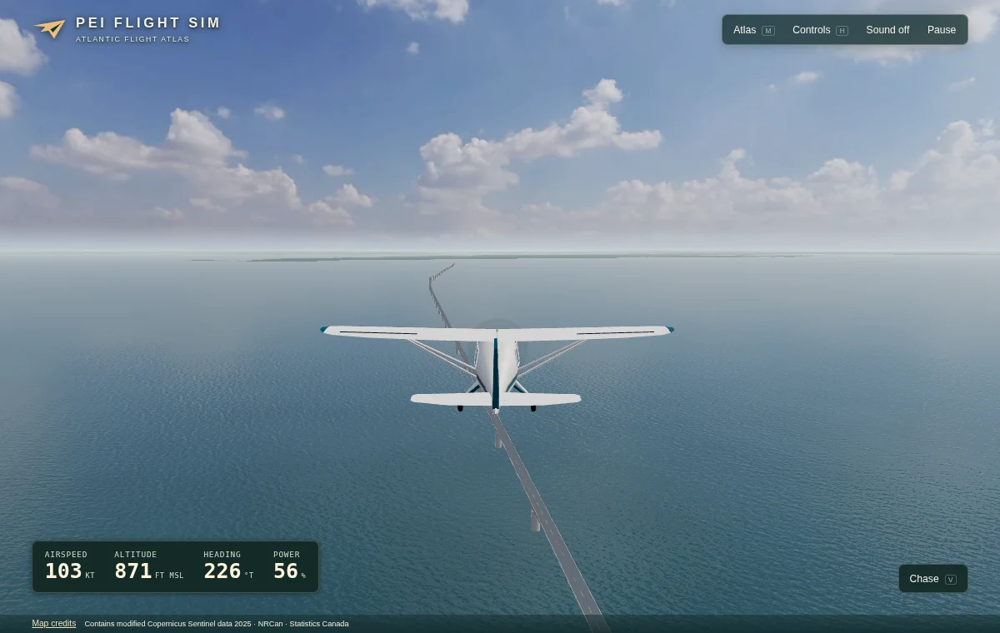
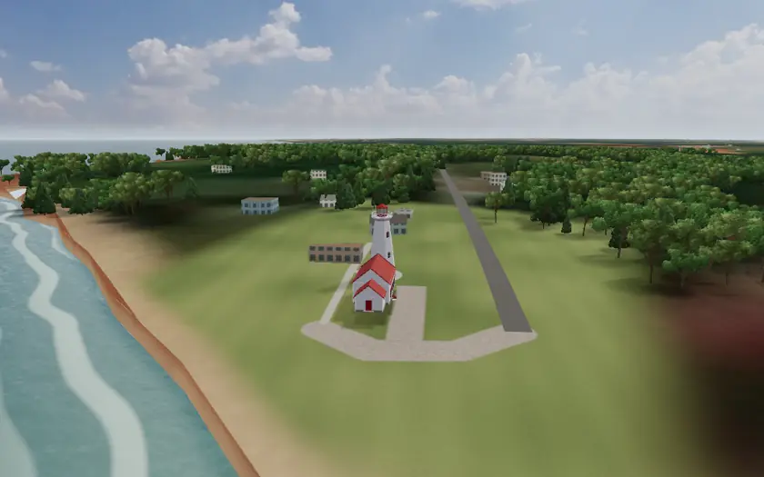

# PEI Flight Sim

**Prince Edward Island, Canada, in a browser flight simulator.**  
A province-wide, metre-scale world built in TypeScript and Three.js.

[](https://github.com/cheshmakzanoon-ops/PEI-Flight-simulation/actions/workflows/verify.yml)

Follow the north shore from Cavendish, fly over Summerside and Charlottetown, or cross Kings County toward East Point. You can start in the air or depart from a runway, switch from chase view to the cockpit, and reposition from the in-flight atlas.

[Download web build](#download-the-web-build) · [Build from source](#run-locally) · [Pilot guide](docs/FLIGHT.md) · [World data](docs/WORLD.md) · [Aircraft](docs/AIRCRAFT.md) · [Production gates](docs/PRODUCTION.md) · [QA record](docs/QA.md)

> **Development build.** The map covers all three counties, not just a showcase area. The current detail level is regional: real geographic inputs and simplified 3D scenery. Accurate shopfronts, most landmarks, close-range materials and training-grade aerodynamics are not part of this build.


*An in-engine low pass over the Cavendish coast.*

## Fly the province

| System | What is in this build |
| --- | --- |
| **World** | LiDAR-derived terrain, a 2025 satellite-colour mosaic, a refined coastline and water, 245 near-detail imagery tiles, 19,465 road segments and 85,866 LiDAR-derived building footprints. Woodland follows land cover with [streamed provincial stand heights](docs/qa/forest-height-stream.md); [roof-centred tree stems are excluded](docs/vegetation-clearance.md). Confederation Bridge, St. Dunstan’s Basilica and both [point light stations](docs/landmarks/lighthouses.md) have custom models. Both lighthouse approaches use [higher-resolution measured coastal relief](docs/coastal-relief.md). [South Lake](docs/qa/south-lake.md) uses sheltered water shading without changing the shoreline. |
| **Aircraft** | An original single-engine high-wing survey plane, with an animated propeller, [moving ailerons and elevators](docs/qa/control-surfaces.md), a modeled cockpit, graduated flight instruments and synthesized engine audio. |
| **Flight** | Fixed-step civilian flight model, density-adjusted airspeed, angle-of-attack stall behavior, ground roll and runway landings. Two runway departure presets and thirteen scenic starts. |
| **Navigation** | Atlas with position and heading, true-heading and airspeed displays, plus chase, cockpit and wide-chase views. |
| **Inputs** | Keyboard, touch controls and browser-standard gamepads. |

**A first route:** Begin at Cavendish, hold a shallow bank to follow the shore, and switch to cockpit view with **V**. Open the atlas with **M** and reposition to East Point for a contrasting coast. For a ground departure, select Charlottetown or Summerside and follow the [pilot guide](docs/FLIGHT.md).

**Waterfront approaches:** Choose **Basin Head · low pass** or **Summerside waterfront · low pass** in the departure menu to start offshore facing the local scenery. [Flight checks](docs/qa/waterfront-departures.md).

**Scenery previews:** Add `?basinChannel` to see the measured [Basin Head inlet, bridge and Cannery](docs/qa/basin-head-cannery.md), or `?montagueFoundationPreview` to see the [Montague River and curved Main Street bridge](docs/montague-bridge-preview.md). Try `?legacyShoreArcs` for the [three-county coastline repair](docs/qa/legacy-shore-arcs.md). Use `?spinnakersPreview` for the surveyed [Spinnakers’ Landing boardwalk and waterfront buildings](docs/qa/spinnakers-landing.md) in Summerside. Use `?shoreFoamDetail` to compare the [shore-breaker treatment](docs/qa/shore-foam-detail.md). Use `?canopyLight` for [directional crown lighting](docs/qa/canopy-light-preview.md). These previews leave the default scenery unchanged.

## Download the web build

[Download the latest successful build ZIP](https://nightly.link/cheshmakzanoon-ops/PEI-Flight-simulation/workflows/verify/main/pei-flight-sim-web.zip)
or use the [GitHub Actions artifacts](https://github.com/cheshmakzanoon-ops/PEI-Flight-simulation/actions/workflows/verify.yml?query=branch%3Amain+is%3Asuccess) while signed in.
The direct link is a public mirror of the successful CI artifact; it is not a hosted game.

Extract the ZIP and run a static server from the extracted directory. For example:

```sh
python3 -m http.server 8080 --bind 127.0.0.1
```

Open `http://127.0.0.1:8080` in a WebGL 2 browser. Do not open `index.html` as a file.

## Run locally

Use **Node.js 22.12 or later** and a WebGL 2 browser with hardware acceleration.

```sh
git clone https://github.com/cheshmakzanoon-ops/PEI-Flight-simulation.git
cd PEI-Flight-simulation
npm ci
npm run dev -- --host 127.0.0.1
```

Open the local address printed by Vite. The simulator loads its geographic assets from the project, without an API key. For a deployable build, run `npm run build` and serve `dist/` over HTTP(S). Opening the HTML file directly from disk is not supported.

### Essential controls

| Action | Keyboard | Gamepad |
| --- | --- | --- |
| Pitch / roll | Arrows or WASD | Left stick |
| Rudder | Q / E | Right stick left/right |
| Throttle | Hold + / − or ] / [ | Right / left trigger |
| Ground brakes | B | South face button |
| View / atlas / pause | V / M / P | Start pauses |

Press a gamepad button while the simulator has focus to activate it in the browser.

## Development

```sh
npm run check                # Flight tests, TypeScript and production build
node tools/verify-world.mjs  # Asset hashes, formats, extents and counts
```

| Directory | Responsibility |
| --- | --- |
| `src/sim/` | Map scale, terrain queries, flight dynamics and runway data |
| `src/render/` | Three.js world, aircraft, roads and streamed building geometry |
| `src/app/` | Flight deck, controls, atlas, telemetry and sound |
| `public/world/` | Runtime scenery packs and source manifests |
| `tools/geodata/` | Reproducible geographic-data processing |
| `test/` | Flight and terrain regressions |

CI verifies the data, flight regressions, production build, and a Chromium smoke route across all three counties. Next targets are finer coastal terrain, remaining close-range vegetation and façade detail, an externally benchmarked airframe, and real-device flight and graphics benchmarks. See [acceptance gates](docs/PRODUCTION.md) for the criteria used to judge those passes.

## Scenery gallery

| Charlottetown Harbour | Confederation Bridge |
| --- | --- |
|  |  |

| East Point Light Station | West Point Light Station |
| --- | --- |
|  |  |

These are in-engine development captures, not reference photographs. The
[landmark notes](docs/landmarks/lighthouses.md) explain what is measured and
what was interpreted. See the [matched before-and-after evidence](docs/qa/LANDMARK-VISUAL-GATE.md).

## Credits and use

Contains modified Copernicus Sentinel data 2025. Contains information licensed under the Open Government Licence – Canada. [Source, processing and attribution details](docs/WORLD.md). No Google Maps or Street View content is included.

Built for exploration and recreation. Not for navigation, flight instruction, or airport operations.
