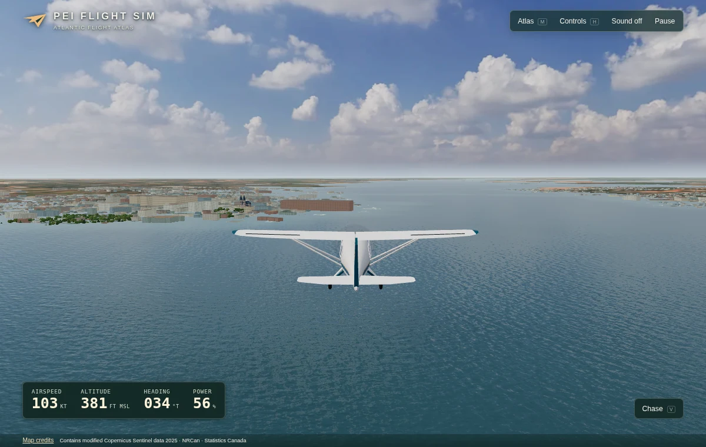
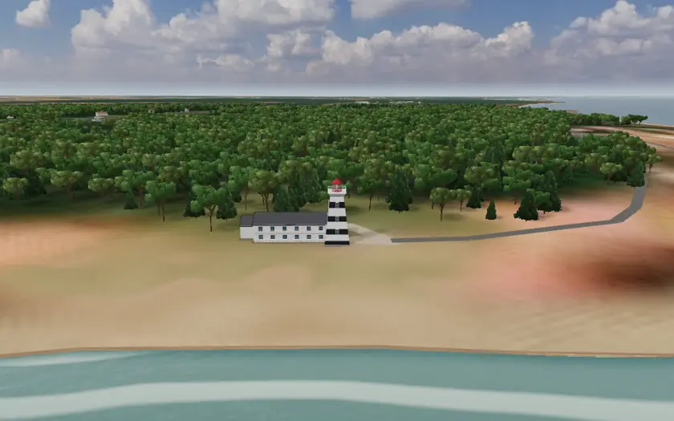

# PEI Flight Sim

**Prince Edward Island, Canada, in a browser flight simulator.**  
A province-wide, metre-scale world built in TypeScript and Three.js.

[](https://github.com/cheshmakzanoon-ops/PEI-Flight-simulation/actions/workflows/verify.yml)

Follow the north shore from Cavendish, fly over Summerside and Charlottetown, or cross Kings County toward East Point. You can start in the air or depart from a runway, switch from chase view to the cockpit, and reposition from the in-flight atlas.

[Download web build](#download-the-web-build) · [Build from source](#run-locally) · [Pilot guide](docs/FLIGHT.md) · [World data](docs/WORLD.md) · [Aircraft](docs/AIRCRAFT.md) · [Production gates](docs/PRODUCTION.md) · [QA record](docs/QA.md)

> **Development build.** The map covers all three counties, not just a showcase area. The current detail level is regional: real geographic inputs and simplified 3D scenery. Accurate shopfronts, most landmarks, close-range materials and training-grade aerodynamics are not part of this build.


*An in-engine low pass over the Cavendish coast.*

## Fly the province

| System | What is in this build |
| --- | --- |
| **World** | LiDAR-derived terrain, a 2025 satellite-colour mosaic, a refined coastline and water, 245 near-detail imagery tiles, 19,465 road segments and 85,866 LiDAR-derived building footprints. Woodland follows land cover with [streamed provincial stand heights](docs/qa/forest-height-stream.md); [roof-centred tree stems are excluded](docs/vegetation-clearance.md). Confederation Bridge, St. Dunstan’s Basilica and both [point light stations](docs/landmarks/lighthouses.md) have custom models. The [Matthew and McLean Heritage Building](docs/qa/souris-mclean.md) in Souris has a measured roof and a reconstructed storefront. The [former railway station in Summerside](docs/qa/summerside-railway-station.md) replaces the old flat massing with a survey-informed exterior. Surveyed roof planes refine 108 existing outlines across [Kings](docs/qa/kings-neutral-roofs.md), [Prince](docs/qa/prince-neutral-roofs.md) and [Queens](docs/qa/queens-neutral-roofs.md) counties, including a [Charlottetown gable checked against raw LiDAR](docs/qa/queens-survey-roof.md). [Fifty-nine large roofs](docs/qa/large-roof-tone.md) use colour from the verified 2025 satellite mosaic. [Hangar 4 at Slemon Park](docs/qa/hangar-4.md) has a measured roof silhouette and lower annexes. Both lighthouse approaches use [higher-resolution measured coastal relief](docs/coastal-relief.md). [South Lake](docs/qa/south-lake.md) uses sheltered water shading without changing the shoreline. |
| **Aircraft** | An original single-engine high-wing survey plane, with an animated propeller, [moving ailerons and elevators](docs/qa/control-surfaces.md), a modeled cockpit, graduated flight instruments and synthesized engine audio. |
| **Flight** | Fixed-step civilian flight model, density-adjusted airspeed, angle-of-attack stall behavior, ground roll and runway landings. Runway departure presets and scenic starts across all three counties. |
| **Navigation** | Atlas with position and heading, true-heading and airspeed displays, plus chase, cockpit and wide-chase views. |
| **Inputs** | Keyboard, touch controls and browser-standard gamepads. |

**A first route:** Begin at Cavendish, hold a shallow bank to follow the shore, and switch to cockpit view with **V**. Open the atlas with **M** and reposition to East Point for a contrasting coast. For a ground departure, select Charlottetown or Summerside and follow the [pilot guide](docs/FLIGHT.md).

**Cavendish scenery in one step:** Select **Cavendish Dunelands · coastal pass**, then **Enable Cavendish detail**. This selects six compatible local studies without changing the other scenery settings. [What the pack enables](docs/qa/cavendish-package.md).

**Waterfront approaches:** Choose **Basin Head · low pass**, **Summerside waterfront · low pass**, or **Georgetown harbour · low pass** in the departure menu to start offshore facing the local scenery. [Basin Head and Summerside flight checks](docs/qa/waterfront-departures.md) · [Georgetown exterior and flight check](docs/qa/st-davids-church-study.md).

The [Panmure Head lighthouse study](docs/qa/panmure-detached-exterior.md) is a standalone artist preview, not a replacement for the current scenery. The live [Panmure coastal pass](docs/qa/panmure-pasture.md) includes a separately source-checked 2020 pasture interior, not the studio tower.

**Dalvay Lake · coastal pass** starts over the Gulf in Queens County. The optional [lake reflection preview](docs/qa/dalvay-lake-optics.md) adds wind ripples and sky reflections without changing flight contact or the shoreline. The separate [manor exterior preview](docs/qa/dalvay-exterior.md) adds its gables, covered veranda and rounded dining room.

**Seacow Head · coastal pass** starts offshore facing the Bedeque Bay lighthouse. Add `?departure=seacow-head-coast&seacowExteriorStudy` to see the [authored white octagonal tower, red gallery and glazed lantern](docs/qa/seacow-exterior.md); the shore and nearby building are unchanged.

The [Cape Egmont lighthouse studio](docs/qa/cape-egmont-detached.md) is a separate Prince County model with unverified placement; it does not alter the live island.

**Tracadie Bay · marsh pass** starts over one of [three mapped coastal marsh patches](docs/qa/coastal-marsh.md). Get close to see wind-laid grasses; the patch layer is also available at Cascumpec and Morell in Standard.

**Cape Tryon · cliff pass** starts offshore in Queens County. It passes the [repaired headland shoreline](docs/qa/cape-tryon-coast.md), while keeping the original tower and flight surfaces.

### Scenery previews

In Dispatch, choose **Use detailed preview** to enable the [curated profile](docs/qa/scenery-profile.md). Use **Use standard** to return without losing your departure. For individual comparisons, these flags also work on their own:

| Area | Preview flag | What to look for |
| --- | --- | --- |
| West Cape, Eastern Kings and Hermanville | `?stockRegionalWind` | In Standard, fly past [74 turbines in three registered arrays](docs/qa/regional-wind.md), with 80, 90 and 116 m rotors. [Moving blade shadows sweep past the stationary tower shadows](docs/qa/regional-wind-rotor-light.md). Use `?stockRegionalWindRotorLight` to keep the turbines and tower shadows but remove the blade shadows. |
| North Cape | `?stockNorthCapeWind` | Standard streams [all 16 commercial turbines](docs/qa/north-cape-turbines.md) near the [wind farm low pass](docs/qa/north-cape-departure.md). The flag hides them; `?northCapeWind` retains the older shadow study. |
| Summerside | `?spinnakersPreview&northBaywalkPreview&baywalkConcrete` | [Historical Spinnakers’ Landing integration](docs/qa/spinnakers-landing.md), the [surveyed court and ramp](docs/qa/baywalk-court.md), and the [mapped concrete approach](docs/qa/baywalk-concrete.md). |
| Inland grassland | `?stockMeadow` | Compare [the close open-ground material](docs/qa/meadow-texture.md) on an **inland meadow pass** in Prince, Queens or Kings. |
| Basin Head beach | `?stockBasinSand` | Compare [Standard’s pale Singing Sands material](docs/qa/basin-head-sand.md) with the original sand on the low pass. |
| Basin Head | `?basinChannel&basinWharf` | The [measured inlet, bridge and Cannery](docs/qa/basin-head-cannery.md) and [outer wharf](docs/qa/basin-head-outer-wharf.md). |
| Great George Street, Charlottetown | `?departure=harbour-low&basilicaExteriorStudy` | See [St. Dunstan’s Great George Street frontage study](docs/qa/basilica-exterior.md): three recessed entrances, twin steeples, original sandstone and roof finishes. Optional frontage only, not a surveyed replica. Add `&basilicaYardSun` for its [shadow across the court, street and sidewalks](docs/qa/basilica-yard-sun.md). |
| Charlottetown | `?beaconsfieldReview` | The [Beaconsfield Historic House exterior](docs/qa/beaconsfield-review.md), an aerial art preview near the waterfront, with [measured ground contact](docs/qa/beaconsfield-contact.md) in low local views. Add `&stockBeaconsfieldGrade` to compare the same house over the original ground. |
| Montague | `?montagueFoundationPreview` | The [river opening and curved Main Street bridge](docs/montague-bridge-preview.md). |
| Dalvay-by-the-Sea | `?departure=dalvay-lake-coastal-pass&dalvayExteriorStudy` | [Documentary manor exterior](docs/qa/dalvay-exterior.md). The historic footprint and existing surroundings stay in place. |
| Dalvay Lake | `?departure=dalvay-lake-coastal-pass&dalvayWaterOptics` | [Wind ripples and sky reflections](docs/qa/dalvay-lake-optics.md) on the verified interior. `&stockDalvayWaterOptics` keeps the original lake appearance. |
| Souris · Knight Point | `?departure=souris-waterfront-pass&sourisKnightExterior` | [Souris East lighthouse](docs/qa/souris-knight-exterior.md), with a tapered white body, red bracketed gallery and domed glazed lantern. The shore and ground are unchanged. |
| Georgetown | `?stDavidsChurchReview&buildingShadows` | [St. David’s United Church](docs/qa/st-davids-church-study.md): survey-fitted gables and tower, original Gothic sash and a matching shadow caster. Use Standard. |
| North Rustico Harbour | `?northRusticoLighthouseStudy` | [Survey-fitted lighthouse, keeper’s dwelling and local grade](docs/landmarks/north-rustico.md). Choose **North Rustico Harbour · coastal pass**. |
| Indian River | `?indianRiverReview` | [St. Mary’s exterior and local grade](docs/landmarks/st-marys-indian-river.md). Choose **Indian River · country pass**. |
| Point Prim | `?stockPointPrim` | Standard shows the [surveyed-era lighthouse and measured dry ground](docs/point-prim-study.md). Choose **Point Prim · lighthouse pass** for a virtual 72 m offshore approach. |
| Hog Island | `?hogIslandPhotoStudy` | [Dated aerial surface detail](docs/qa/hog-island-photo-study.md). Choose a west or east **Hog Island · dune pass**. |
| Green Gables grounds | `?stockGreenGablesBarn` | Compare the original massing with Standard’s [survey-fitted Barn and adjoining wing](docs/art/green-gables-barn-review.md). |
| Cavendish Dunelands | `?cavendishWaterReview` | [Lake of Shining Waters, 2020 freshwater core](docs/qa/cavendish-water.md). Choose **Cavendish Dunelands · coastal pass** for an offshore start. |
| Near Green Gables | `?gablesTrailReview` | [Mapped gravel connection](docs/qa/gables-trail.md), with short-scale grain on the existing terrain. |
| Southwest of Green Gables | `?gablesFairwayReview` | [Source-fenced fairway colour](docs/qa/gables-fairway.md) on the verified open ground, without moving the path or golf boundary. |
| Southwest of Green Gables | `?gablesGradeReview` | [Survey-supported dry rise](docs/qa/gables-southwest-grade.md), a close-range correction to terrain and contact in one small area. |
| Greenwich Dunes | `?bowleySurveyPreview` | [Bowley Pond’s surveyed 2020 open-water core](docs/qa/bowley-water.md). Choose **Greenwich Dunes · coastal pass** for the view from offshore. |
| Prince, Queens and Kings | `?cropRowsReview` | The [field surface preview](docs/qa/crop-preview.md) adds close soil relief at three selected locations. |
| Selected grassland across PEI | `?sourceGrassStudy` | [Source-backed ground vegetation](docs/qa/province-grass.md) in all three counties, with representative **grassland passes**. |
| Selected fields across PEI | `?provinceFieldsReview` | [Expanded farmland](docs/qa/province-fields.md) adds close-range furrow shading within 76.27 km² of source-qualified field interiors. Select it in Standard Dispatch; it is off by default. |
| Gravel roads across PEI | `?stockGravelSurface` | Compare Standard’s [close gravel material](docs/qa/gravel-surface-study.md) on 2,651 verified non-bridge road records. |
| One surveyed roof west of Summerside | `?stockPrinceSurveyRoof` | Compare the original flat building with its [surveyed cross-ridges and stepped roof](docs/qa/prince-survey-roof.md). Use `?stockPrinceRoofContact` to keep that shape while switching off [local roof-contact shading](docs/qa/prince-roof-contact.md). The façade remains unsurveyed. |
| Four mapped gravel-lane sites | `?mappedLaneCanopyStudy` | [Canopy placement study](docs/qa/mapped-lane-canopy.md): hides the exact game-generated trees and shadows in surveyed open lane centres. Standard only. |
| Distant PEI coast | `?stockAerialPerspective` | Compare [Standard daylight haze and sea horizon](docs/qa/aerial-perspective-study.md) with the original fixed mist. |
| Orby Head | `?stockOrbyCoast` | [Shoreline gap repair](docs/qa/orby-shore-closure.md): Standard closes known mask-cell gaps below the cliffs. The flag restores the inherited coastline wall. |
| Close satellite-image boundaries in all three counties | `?stockCountyOrtho` | Standard softens the [Souris, western PEI and Queens County tile joins](docs/qa/county-aerial-joins.md) using only the neighbouring image pixels. This switch restores those three old seams; `?stockTracadieOrtho` independently restores the [Tracadie Bay seam](docs/qa/tracadie-aerial-join.md). |
| Two inland field edges in Prince County | `?stockInlandOrtho` | Compare two [short, source-checked image windows](docs/qa/inland-aerial-joins.md). At low altitude the original field and vegetation colours meet without a straight tile-clamp line. This switch affects only these windows. |
| Kings County coastal ridge | `?kingsDryCrownStudy&departure=kings-coastal-ridge` | [Measured dry ridge](docs/qa/kings-dry-crown.md): 2020 LiDAR terrain with matched contact and a distant fade. Standard only. |
| Ordinary beach and cliff surfaces | `?shoreToneStudy` | [Tint compatibility study](docs/qa/shore-tone.md): smooths visible colour steps only on affected renderers. Standard only. |
| Coastal optics shortcut | `?coastalOptics` | [Coastal optics](docs/qa/coastal-optics-profile.md) in Optional scenery studies applies the separately tested coastal views together. Standard only. |
| Exposed Prince and Kings shores | `?stockOpenCoast` | Compare [local coastline gap repairs](docs/qa/open-coast-closure.md) without disabling the nearshore foam. For Kings County, the [Panmure Head coastal pass](docs/qa/panmure-open-coast.md) also has a repaired headland approach. |
| Exposed Prince and Kings shores | `?stockNearshoreFoam` | Compare [Standard’s small moving breaker groups](docs/qa/nearshore-foam-study.md) on **Prince County · open shore pass** or **Kings County · coastal ridge pass**. The flag retains the previous water look. |
| Four offshore areas | `?stockOpenRipples` | Compare [open-water ripple variation](docs/qa/open-water-ripples.md), independent of the coast mask, wave foam and physical sea surface. |
| Charlottetown, Summerside and Souris | `?townWallStudy` | [Expanded town façades](docs/qa/town-wall-study.md) extends Standard’s existing close-wall treatment to wider areas. |
| Queens and Kings woodlands | `?stockRegionalCanopy` | Compare [measured canopy infill](docs/qa/regional-canopy.md) on the two **woodland passes** in Standard. |
| Miscouche woodlot | `?stockMiscouche` | Compare the [bounded canopy infill](docs/qa/miscouche-canopy.md) on **Miscouche · woodland pass** in Standard. |
| Standard woodland | `?stockCanopyLight` | Compare [directional tree-crown lighting](docs/qa/canopy-light-preview.md) with the original diffuse canopy. |
| Qualified coastal grass | `?stockDuneGrass` | Compare [Standard’s close coastal grass material](docs/qa/coastal-grass-surface.md) with the original diffuse ground. |
| Woodland passes in all three counties | `?woodlandView` | [Woodland scenery view](docs/qa/woodland-scenery-view.md): forest surface, close bark, near conifers and a down-looking camera. Press **V** to cycle to **Scenery**. [How nearby tree draws are reduced without thinning the forest](docs/qa/woodland-volume-cull.md). |
| Across PEI | `?legacyShoreArcs&shoreFoamDetail&canopyLight&forestFloor` | [Coastal seam repair](docs/qa/legacy-shore-arcs.md), [shore break](docs/qa/shore-foam-detail.md), [canopy light](docs/qa/canopy-light-preview.md) and [woodland floor variation](docs/qa/forest-floor-preview.md). Standard uses broken shoreline crests; `?stockShoreFoam` restores the original foam. Compare the [mapped open-ground material](docs/qa/meadow-texture.md) with `?meadowTexture`. |

**Optional scenery studies** in Dispatch offers the Beaconsfield and Green Gables exteriors, the Dunelands freshwater core, North Rustico lighthouse, St. Mary’s exterior, Hog Island aerial detail, Ground vegetation, Close grass detail, and both farmland studies without editing the URL. Enable both Cavendish studies and choose **Cavendish Dunelands · coastal pass** to try them on the same route. Use the Prince, Queens or Kings County **fields low pass** to compare farmland relief. The three county **dry dune passes** show [verified near-ground sand detail](docs/qa/dry-dune-surface-detail.md) in Standard. In Standard, [Ground vegetation and Expanded farmland](docs/qa/province-land-surfaces.md) can be enabled together.

[Standard close-wall detail](docs/qa/town-wall-core.md) now fits window spacing and subtle wall finishes in the cores of three towns, without changing their outlines or roofs. Optional scenery previews are regional.

In Prince County, the **Summerside waterfront · low pass** shows a [measured raised boardwalk and seven roof sections at Spinnakers’ Landing](docs/qa/summerside-standard-wharf.md), alongside the railway station and survey-fitted roofs [along Water Street](docs/qa/summerside-measured-roof.md), [north of downtown](docs/qa/summerside-north-roof.md), and [in western downtown](docs/qa/summerside-west-roofs.md) in Standard. Beside Water Street, [one survey-cleared storefront site](docs/qa/summerside-water-open-ground.md) removes an unsupported tree without changing nearby vegetation.

Try the terminal wall study with `?departure=spinnakers-low&summersideTerminalWallPreview`. It replaces the generic office-window pattern with an original industrial finish, informed by a [2005 harbour aerial](https://publications.gc.ca/collections/collection_2024/mpo-dfo/Fs74-50-2024-2-eng.pdf#page=79). No photo pixels are used. The roof, building outline, terrain, shoreline and flight physics are unchanged. Add `&stockSummersideTerminalWalls` for the stock finish on the same route.

In Queens County, the **North Rustico Harbour · coastal pass** includes a [dated roof-colour correction](docs/qa/rustico-harbour-roof.md) on one harbour building. Its existing gable, neighboring lighthouse and terrain are unchanged.

In western PEI, **O’Leary · railway station pass** is a fictional low sightseeing departure. Add `?departure=oleary-railway-low&olearyExteriorStudy` to see the [original station exterior](docs/qa/oleary-station-exterior.md), with a dated reference ledger and matched close and distant views. The [neighboring industrial building study](docs/qa/oleary-industrial-context.md) separately replaces one oversized stock block with its surveyed shed-and-tower form. A separate [stepped warehouse study](docs/qa/oleary-warehouse.md) restores two low roof bands and a small side mass without replacing either neighboring exterior.

For a low offshore approach in Kings County, choose [Souris · waterfront pass](docs/qa/souris-waterfront-pass.md) in Dispatch. Near Main Street, Standard scenery uses the [survey-backed exterior at 77 Main](docs/qa/souris-east-exterior.md) in place of the old flat block.

## Download the web build

Open the [successful GitHub builds for `main`](https://github.com/cheshmakzanoon-ops/PEI-Flight-simulation/actions/workflows/verify.yml?query=branch%3Amain+is%3Asuccess).
While signed in, select the newest successful run and download **pei-flight-sim-web** from its **Artifacts** section.
For changes newer than that build, [run the current source locally](#run-locally). The ZIP is not a hosted game.

Extract the ZIP and run a static server from the extracted directory. For example:

```sh
python3 -m http.server 8080 --bind 127.0.0.1
```

Open `http://127.0.0.1:8080` in a WebGL 2 browser. Do not open `index.html` as a file.

## Run locally

Use **Node.js 22.12 or later** and a WebGL 2 browser with hardware acceleration.

```sh
git clone https://github.com/cheshmakzanoon-ops/PEI-Flight-simulation.git
cd PEI-Flight-simulation
npm ci
npm run dev -- --host 127.0.0.1
```

Open the local address printed by Vite. The simulator loads its geographic assets from the project, without an API key. For a deployable build, run `npm run build` and serve `dist/` over HTTP(S). Opening the HTML file directly from disk is not supported.

### Essential controls

| Action | Keyboard | Gamepad |
| --- | --- | --- |
| Pitch / roll | Arrows or WASD | Left stick |
| Rudder | Q / E | Right stick left/right |
| Throttle | Hold + / − or ] / [ | Right / left trigger |
| Ground brakes | B | South face button |
| View / atlas / pause | V / M / P | Start pauses |

Press a gamepad button while the simulator has focus to activate it in the browser.

## Development

The [Province House](docs/qa/province-house-study.md), [Summerside City Hall](tools/art/summerside-cityhall-study/README.md), and [Lefurgey Cultural Centre](tools/art/lefurgey-study/README.md) exterior studies include original Three.js art and reproducible checks. They are separate from the playable atlas.

```sh
npm run check                # Flight tests, TypeScript and production build
node tools/verify-world.mjs  # Asset hashes, formats, extents and counts
```

| Directory | Responsibility |
| --- | --- |
| `src/sim/` | Map scale, terrain queries, flight dynamics and runway data |
| `src/render/` | Three.js world, aircraft, roads and streamed building geometry |
| `src/app/` | Flight deck, controls, atlas, telemetry and sound |
| `public/world/` | Runtime scenery packs and source manifests |
| `tools/geodata/` | Reproducible geographic-data processing |
| `test/` | Flight and terrain regressions |

CI verifies the data, flight regressions, production build, and a Chromium smoke route across all three counties. Next targets are finer coastal terrain, remaining close-range vegetation and façade detail, an externally benchmarked airframe, and real-device flight and graphics benchmarks. See [acceptance gates](docs/PRODUCTION.md) for the criteria used to judge those passes.

The narrow [Green Gables gravel fixture](docs/qa/gables-gravel.md) is retained as a material test, not a courtyard reconstruction.

## Scenery gallery

The [Souris Town Hall exterior study](tools/art/souris-town-hall-study/) records the original frontage asset and its open verification issues. It is not enabled in the simulator.

| Charlottetown Harbour | Confederation Bridge |
| --- | --- |
|  |  |

| East Point Light Station | West Point Light Station |
| --- | --- |
|  |  |

These are in-engine development captures, not reference photographs. The
[landmark notes](docs/landmarks/lighthouses.md) explain what is measured and
what was interpreted. See the [matched before-and-after evidence](docs/qa/LANDMARK-VISUAL-GATE.md).

## Credits and use

Contains modified Copernicus Sentinel data 2025. Contains information licensed under the Open Government Licence – Canada. [Source, processing and attribution details](docs/WORLD.md). No Google Maps or Street View content is included.

Built for exploration and recreation. Not for navigation, flight instruction, or airport operations.
