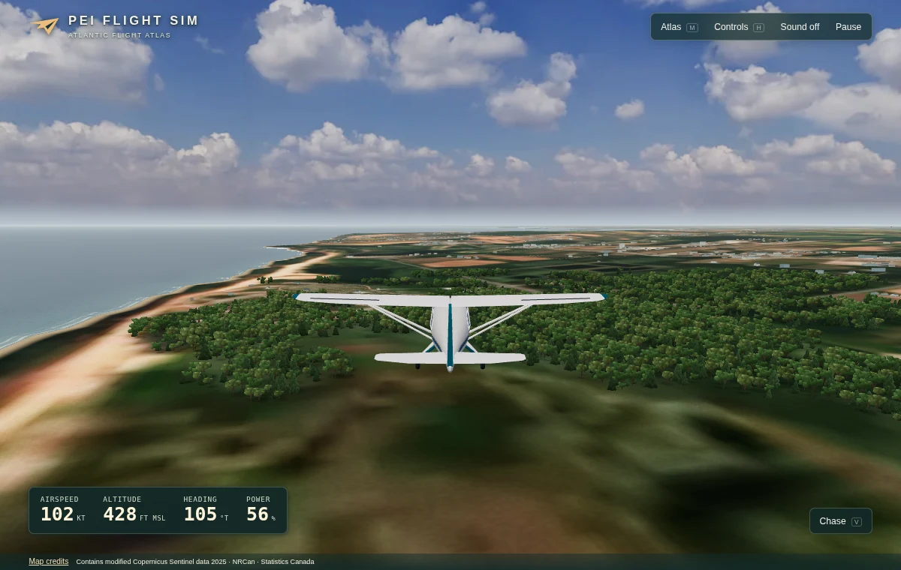

# PEI Flight Sim

**Prince Edward Island, Canada, in a browser flight simulator.**  
A province-wide, metre-scale world built in TypeScript and Three.js.

[](https://github.com/cheshmakzanoon-ops/PEI-Flight-simulation/actions/workflows/verify.yml)

Follow the north shore from Cavendish, fly over Summerside and Charlottetown, or cross Kings County toward East Point. You can start in the air or depart from a runway, switch from chase view to the cockpit, and reposition from the in-flight atlas.

[Download web build](#download-the-web-build) · [Build from source](#run-locally) · [Pilot guide](docs/FLIGHT.md) · [Scenery guide](docs/SCENERY.md) · [World data](docs/WORLD.md) · [Aircraft](docs/AIRCRAFT.md) · [Production gates](docs/PRODUCTION.md) · [QA record](docs/QA.md)

> **In development.** You can fly across all three counties at metre scale. Geography comes from real data, but detail varies: selected sites have surveyed relief and original models; most buildings and close scenery are still approximate. This is not a navigation or training tool.



*An in-engine low pass over the Cavendish coast.*

## Download the web build

Open the [successful GitHub builds for `main`](https://github.com/cheshmakzanoon-ops/PEI-Flight-simulation/actions/workflows/verify.yml?query=branch%3Amain+is%3Asuccess).
While signed in, select the newest successful run and download **pei-flight-sim-web** from its **Artifacts** section.
For changes newer than that build, [run the current source locally](#run-locally). The ZIP is not a hosted game.

Extract the ZIP and run a static server from the extracted directory. For example:

```sh
python3 -m http.server 8080 --bind 127.0.0.1
```

Open `http://127.0.0.1:8080` in a WebGL 2 browser. Do not open `index.html` as a file.

## Run locally

Use **Node.js 22.12 or later** and a WebGL 2 browser with hardware acceleration.

```sh
git clone https://github.com/cheshmakzanoon-ops/PEI-Flight-simulation.git
cd PEI-Flight-simulation
npm ci
npm run dev -- --host 127.0.0.1
```

Open the local address printed by Vite. The simulator loads its geographic assets from the project, without an API key. For a deployable build, run `npm run build` and serve `dist/` over HTTP(S). Opening the HTML file directly from disk is not supported.

## Fly the province

| First flight | What you'll see |
| --- | --- |
| **Cavendish** | Follow PEI’s north shore and switch from Chase to Cockpit with **V**. For the detailed dunes and lake approach, choose **Cavendish Dunelands · coastal pass**. |
| **Charlottetown waterfront · low pass** | Start over the harbour, then use the atlas (**M**) to reposition. For a runway start, use Charlottetown or Summerside and follow the [pilot guide](docs/FLIGHT.md). |
| **Eastern Kings · turbine skyline** | Approach the eastern end of the island from the sea. Standard includes [both generations of the Eastern Kings turbines](docs/qa/east-point-phase-ii.md). |
| **New Glasgow · field-edge pass** | Start 42 metres above the terrain and fly southwest across mapped farm hedges. See the [route guide](docs/qa/new-glasgow-field-edge.md). |
| **Prince County · mapped farmland pass** | Start in the air over an inland field. The [Standard farmland departures](docs/qa/province-fields.md) show close furrows in Prince, Queens and Kings. |
| **Prince or Kings County · inland meadow pass** | Select the route in Standard Dispatch and wait for **Survey-based woodland sizes ready** before beginning. See the matched woodland views in [Prince](docs/qa/prince-dispatch-woodland.md) and [Kings](docs/qa/dispatch-woodland.md). |
| **Queens County · woodland view pass** | Select the low Queens route in Standard Dispatch. The [mapped woodland guide](docs/qa/queens-dispatch-woodland.md) explains how the existing inventory sizes are used when ready. |

Standard combines LiDAR-derived terrain with 245 near-detail imagery
tiles, 19,465 mapped road segments and 85,866 detected building
footprints. Those footprints and heights are not facade surveys.
[Eight inland image windows](docs/qa/expanded-inland-aerial-joins.md)
recover continuous ground sampling using the original imagery.
[Bookmarked departures](docs/qa/forest-departure-preflight.md) warm
available mapped woodland heights before the first flight.

The original high-wing aircraft has a modeled cockpit, animated controls
and propeller, and a fixed-step flight model with stall, ground-roll and
landing behavior. Standard supports keyboard, touch, and browser gamepads.

### Scenery previews

The [scenery guide](docs/SCENERY.md) lists what's already in Standard and
how to enable or compare the individual scenery studies. The opt-in
**Use detailed preview** profile keeps the same province, departures and
flight controls.

### Essential controls

| Action | Keyboard | Gamepad |
| --- | --- | --- |
| Pitch / roll | Arrows or WASD | Left stick |
| Rudder | Q / E | Right stick left/right |
| Throttle | Hold + / − or ] / [ | Right / left trigger |
| Ground brakes | B | South face button |
| View / atlas / pause | V / M / P | Start pauses |

Press a gamepad button while the simulator has focus to activate it in the browser.

## Development

```sh
npm run check                # Flight tests, TypeScript and production build
node tools/verify-world.mjs  # Asset hashes, formats, extents and counts
```

| Directory | Responsibility |
| --- | --- |
| `src/sim/` | Map scale, terrain queries, flight dynamics and runway data |
| `src/render/` | Three.js world, aircraft, roads and streamed building geometry |
| `src/app/` | Flight deck, controls, atlas, telemetry and sound |
| `public/world/` | Runtime scenery packs and source manifests |
| `tools/geodata/` | Reproducible geographic-data processing |
| `test/` | Flight and terrain regressions |

CI verifies the data, flight regressions, production build, and a Chromium smoke route across all three counties. Next targets are finer coastal terrain, remaining close-range vegetation and façade detail, an externally benchmarked airframe, and real-device flight and graphics benchmarks. See [acceptance gates](docs/PRODUCTION.md) for the criteria used to judge those passes.


## Scenery gallery

The [Souris Town Hall exterior study](tools/art/souris-town-hall-study/) records the original frontage asset and its open verification issues. It is not enabled in the simulator. The [Quintin Court Fish House study](tools/art/north-rustico-fish-house-study/) compares two reference periods in original Three.js models; waterfront placement remains unverified.

| Charlottetown Harbour | Confederation Bridge |
| --- | --- |
|  |  |

| East Point Light Station | West Point Light Station |
| --- | --- |
|  |  |

These are in-engine development captures, not reference photographs. The
[landmark notes](docs/landmarks/lighthouses.md) explain what is measured and
what was interpreted. See the [matched before-and-after evidence](docs/qa/LANDMARK-VISUAL-GATE.md).

## Credits and use

Contains modified Copernicus Sentinel data 2025. Contains information licensed under the Open Government Licence – Canada. [Source, processing and attribution details](docs/WORLD.md). No Google Maps or Street View content is included.

Built for exploration and recreation. Not for navigation, flight instruction, or airport operations.
