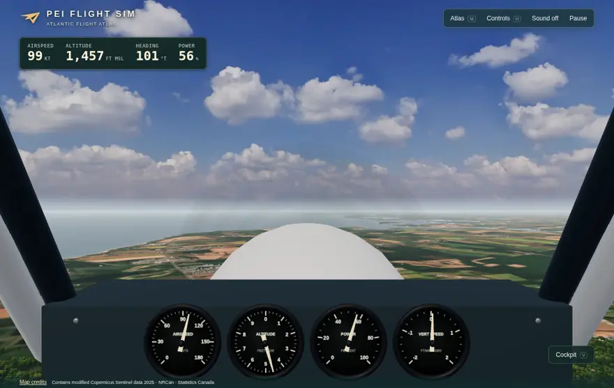

# Aircraft development and validation

The current survey aircraft is fictional. Its panel, exterior and handling are
development assets, not a replica or a training aid. Changes to art and changes
to handling are reviewed independently.

## Reference airframe

Use one documented high-wing single-engine aircraft as a reference, rather than
mixing dimensions and performance numbers from different variants. The
[Textron Cessna Skylane](https://cessna.txtav.com/en/piston/cessna-skylane) is
the candidate performance reference. Select the exact variant and flight-manual
revision before calibration. Do not introduce manufacturer branding or use
unlicensed manuals, artwork, textures, or geometry as shipping content.

| Area | Review evidence required |
| --- | --- |
| Exterior | Front, side, three-quarter and underside comparisons at matching focal length. Measure span, length, incidence, gear clearance and tail geometry against dimensions for the specific variant. |
| Cockpit | Seated eye-point and field of view, readable instrument states, correct needle response and working input. Review daylight and low-light captures. |
| Dynamics | Record mass, configuration, CG, density, wind, control schedule and step size for each scripted case. Target reference stall, climb, cruise, glide, takeoff, touchdown and braking values only under matching conditions. |
| Handling | Validate accelerated stall, recovery, coordinated bank, sideslip and crosswind touchdown as separate cases. Compare entertainment assists on and off when implemented. |

## Current validation

The covered flight regressions are both PEI runway departures, an accelerated
stall and recovery, a continuous 182 km island crossing, and a Charlottetown
flare and stop. Unit tests also check standard-atmosphere density and the
relationship between true and equivalent airspeed. Passing these checks is
not evidence that the model matches the reference aircraft.

Read the [FAA handbook](https://www.faa.gov/regulations_policies/handbooks_manuals/aviation/phak)
for definitions and the difference between flight principles, instrument
indications and published aircraft performance.

## Cockpit at the current milestone



Current in-engine display: equivalent airspeed, hundreds of feet on the cyclic
altimeter needle (full altitude on the HUD), throttle percentage and vertical
speed. The instrument on the right of the altimeter is commanded power, not
measured engine RPM. These are development gauges, not certified avionics.

## Reference evidence to validate before tuning

The Australian Transport Safety Bureau cites the 182T pilot handbook for
54 KCAS with flaps up and 49 KCAS with full flap at idle power.
See the [aircraft information in investigation AO-2025-028](https://www.atsb.gov.au/investigations/ao-2025-028).
The same report differentiates calibrated and indicated airspeed and lists
1,406 kg as the maximum weight used for the handbook's bank-angle stall data.

The present fictional model predicts approximately 59.7 knots equivalent
airspeed at maximum lift in a static level-flight calculation at its default
1,450 kg. At the reference weight of 1,406 kg it predicts about 58.8 knots.
These are analysis values, not measurements of the simulated stall transient.
Flaps are not implemented, so there is no valid flaps-down comparison yet.
Do not tune the stall flag to hit the reference number. Match the effective
wing area, configuration, weight and force balance first; then verify the
result with a repeatable dynamic approach and recovery.

Regenerate this static analysis with:

```sh
node --experimental-strip-types tools/qa/airframe-baseline.mjs
```

For the measured power-off result, see the [dynamic clean-glide sweep](qa/GLIDE-BASELINE.md).
It measures range against height lost instead of inferring glide distance from a polar.

The [dynamic clean-stall trial](qa/STALL-BASELINE.md) measures both the peak lift
coefficient and the later separation flag, then requires a sustained return to glide.
