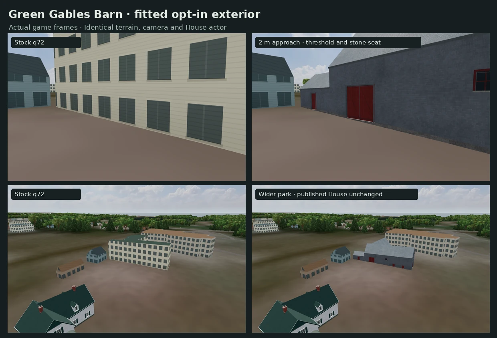

# Green Gables Barn exterior

Choose **Cavendish Dunelands · coastal pass** to see the modeled Barn
in Standard scenery. Use `?departure=cavendish-dunelands-low&stockGreenGablesBarn`
for the original massing. The House remains separate. This one exterior
does not implement new grounds, building access, terrain, or flight collision.

[Standard courtyard and overflight images](../qa/gables-barn-standard.webp) ·
[Exact render scope](../qa/gables-barn-standard-scope.json) ·
[Compiled ordinary flight check](../../tools/qa/green-gables-barn-standard-flight.py).

*These are actual simulator views with the independently selected House kept
on both sides. The surrounding grounds and other buildings remain stock.*

## Source and scope

- One existing PEI flight atlas building only: `q03323`, zero-based row 72, Barn and its physically adjoining lower wing. The atlas manifest, original byte allocation, complete compressed chunk digest, exact ordered footprint and original heights must agree. The strict expected stock span elides 40 triangles when shown. Green Gables House is ordinal 101 of the same tile and is independently verified and drawn.
- The [Parks Canada 2026 site guide](https://pcweb2.azureedge.net/-/media/lhn-nhs/pe/greengables/WET4/visit/guides-and-maps/2026-site-maps-and-brochures/Green-Gables-Parks-DIGITAL-Brochure-ENG-2026.pdf) distinguishes the recreated Barn and adjoining wing from the House, granary and visitor centre. Its photographs provide visual reference only. No photograph, publicity material, guide text/logo, or third-party texture is loaded, copied or supplied. Materials and closed exterior timber doors are original art, not measured casing or access geometry.
- [NRCan CanElevation LiDAR Point Clouds](https://open.canada.ca/data/en/dataset/7069387e-9986-4297-9f55-0288e9676947) and [HRDEM](https://open.canada.ca/data/en/dataset/957782bf-847c-4644-a757-e383c0057995): contains information licensed under the [Open Government Licence – Canada](https://open.canada.ca/en/open-government-licence-canada). The [2020 PEI COPC tile](https://canelevation-lidar-point-clouds.s3.ca-central-1.amazonaws.com/pointclouds_nuagespoints/PEI/Prince_Edward_Island_2020/pei_2020_370000_715000.copc.laz), ETag `"d4073598b4a920bbcdc1dd2e3574ae73-16"`, was scoped to EPSG:2961 E470630–470692/N5148344–5148401. 11,579 Class 6 returns are inside the verified owner, with separate supported gables, lean-to, and low approach. No raw lidar, DSM or DTM is included. [OpenStreetMap way 181530650](https://www.openstreetmap.org/way/181530650), © OpenStreetMap contributors, corroborates identity only; no OSM polygon is reused.
- The roof is the same C3 authored geometry as the detached study. Actual Three.js rays sampled 2,159 retained source cells (same 2020 survey; used for topology choice, not fitting the roof-plane coefficients) without a miss. Relative absolute p90 for the cross roof, main roof, junction, lean-to and low approach is .059, .088, .093, .019 and .255 m respectively. This does not characterize every eave, tiny return, model detail, or real-world building height.

## Visual ground and loading

- The current game uses a fixed 13.66 m display seat for this exterior instead of its 14.19 m source datum. The rendered terrain underneath is unchanged. Only the existing q72 stone break and the display heights of nine closed-door thresholds are fitted to the existing near terrain. Actual near-tier stair-free threshold separation in this visual study was about 4.5–18.6 cm before ground/rigging variations in other tiers (which are not eligible). These are in-plan visual joins, not specifications for real entrances. There is no altered grade or foundation in the terrain, no gameplay collision, and no adjustment to the House or its separate seat.
- Activation requires the pinned decoded terrain and Cover, one regular dry near terrain tile (`N112`) and matching height/land witnesses. At medium or coarse terrain resolution (`N56/N8`), the original Barn is drawn. The adaptive relief, inland relief and building-shadow flags keep their original behavior. This accounts for a nearby inherited coarse facet around 22 m that would otherwise obscure the model. It is not an elevation correction.
- The local art asset is 34,760 bytes gzipped (123,416 decoded) and contains only original fitted art: 11 opaque batches, 1,371 triangles. The full stock tile streams first. A rejected owner, missing, changed, truncated or late response cannot remove the stock building. A verified Barn and House can coexist while sharing the same six stock vertex attributes, without a second building-data fetch.
- To reproduce authored data from this checkout, run `node --experimental-strip-types tools/art/bake-green-gables-barn.mjs`. This asserts that the roof top, soffit and exterior fascia stay byte-equivalent to C3 while baking the skirt/threshold treatment. `npm test` checks source protections, exact owner selection, all four sibling visibility modes, coarse fallback, and bad or late optional data.

## Verification

The [matched camera checks](../qa/gables-barn-review.json) kept all
541,772 protected pixels exact, including the published House. The
Barn scope adds 11 draws and 1,331 net triangles in those comparisons.
The original terrain and flight-contact samples match. Missing,
decoded-but-corrupt, and valid-but-late data preserved the full 504,000
stock pixels in each fault frame. A valid HTTP-decompressed body passed.

The [normal compiled flight replay](../qa/gables-barn-flight.json) checks
the Barn beside the House, Dunelands freshwater, and the dry rise using
the public departure, with no camera or flight override. To repeat it,
run `tools/qa/green-gables-barn-flight.py --help` after building.

Ordinary scenery verifies the land-cover bytes and the existing 32
ground heights before requesting art. Entry is within 2.25 km and below
540 m above local ground. Once visible, the Barn stays active until
2.7 km, 730 m above ground, or earlier if the exact ground lease is lost.
A cold distant flight requests no Barn artwork. The separate
`greenGablesBarnReview` compatibility URL is retained, and
`stockGreenGablesBarn` overrides it. The optional House, freshwater and
dry rise can still be viewed together using the prior comparison route.

The Standard matched court and air frames preserve all 486,304 pixels
outside the projected Barn-plus-stock outline. The Barn adds 11 draws
and 1,331 net triangles while visible. These are render counts, not
device performance estimates.
