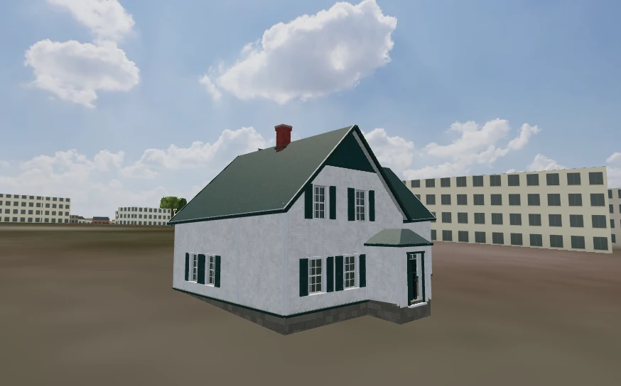

# Green Gables House, Cavendish

A source-bounded exterior review for the simulator. In Dispatch, select
**Green Gables House** under **Optional scenery studies** and apply. Or append `?greenGablesReview` to the game URL (or add `&greenGablesReview` if it already has a query), then fly to the Green Gables House in Cavendish, approximately **46.48779° N, 63.38206° W**. This is one exterior: not an ordinary ground view, restored estate, visitor route, current as-built survey, property plan, replica interior, or official Parks Canada product. Ordinary scenery is unchanged without the flag.

*The garden side in the shipping Three.js scene, not a reference photograph.*

## What is authored and what is measured

- One existing atlas envelope, tile `q03323`, zero-based row 101, at bytes 1,315,922–1,337,301 inclusive. Its original ten ordered vertices, height, floor estimate, and tile range must match. The parent atlas manifest declares the pinned atlas digest, and the exact compressed owner range is itself SHA-256 verified before replacement. The decoded elevation and terrain cover must match their respective pins too.
- The measured silhouettes are the main gable and transverse kitchen roof, with two chimney groups and corroborating return clusters around both dormers. The small east entry canopy is supported by a separate lower cluster of 98 unclassified airborne returns and visible in the 2025 southeast photo; it is not asserted to be a classified roof fit. Scaled woodwork, secondary fascia, siding, window/door details and pale/green trim are original interpretations of the public exterior, not fitted surveyed details.
- This is not a reimport of OpenStreetMap or the province's building boundary. Submitted authored eaves and portico divide about 156.46 m² in the local survey frame versus 129.07 for the old box. Of 2,653 sampled 10 cm cells in the extension, 95% are within 0.690 m of a local qualified building return (or a corroborative entry-band return), with one 1.021 m nearest-return distance. The extents have zero overlap with the tested exterior building, paved-road, sidewalk or parking packs. Source density, eave thickness, minor architectural details and changes since 2020 are not characterized to that precision.
- On the actual submitted Three.js roof, 192 retained main-body and 68 retained kitchen Class 6 observations had 90th-percentile absolute relative height errors of 0.163 m and 0.229 m, respectively, with no missing top ray. The numeric witness cells were held out of the underlying coefficients, but also reviewed while choosing the model topology. They come from the **same 2020 survey**, not a blind or modern source. Compare geometry in the common model datum, not absolute in-game flight height.
- The entire asset uses a fixed scene seat of 12.285 m rather than its local source reference of 13.929 m CGVD2013. The resulting −1.644 m translation puts the form on the inherited game terrain while keeping the roof proportions. A coarse stock terrain facet near 22.5 m can hide this location and does not match the native survey. The scene reverts to the stock building outside the prequalified local visual grade band; no terrain, water, navigation, flight model, road, collider or scenery layer is edited. Dark foundation adjustment is visible from low angles; no exterior steps, landscape additions or purported visitor access were invented. The review is disabled when the adaptive relief or building-shadow review is active.
- The 136,002-byte `.bin.gz` contains only original authored render vertices for 10,131 triangles, in 14 opaque material batches. It is lazy and same-origin, 714,380 bytes decoded. There are no external photo textures. Closed, painted soffits add real underside surfaces below the existing surveyed top planes; the eave silhouette is unchanged. The original tile is shown first, and one verified contiguous span of just 28 stock triangles is omitted on success. HTTP failure, unexpected lengths, truncated/corrupt or late bodies, or a non-matching parent leave the old owner fully submitted. An inactive art preview is not a terrain fix.

## Sources and attribution

- [Parks Canada: Green Gables House](https://parks.canada.ca/lhn-nhs/pe/greengables/activ/maison-house), [Federal heritage designation](https://www.pc.gc.ca/apps/dfhd/page_fhbro_eng.aspx?id=2491), [Canadian Register of Historic Places #11370](https://www.historicplaces.ca/en/rep-reg/place-lieu.aspx?id=11370): location, architectural character and publicly visible features. No agency text, logo or imagery is included in the scene.
- [Natural Resources Canada: CanElevation LiDAR Point Clouds](https://open.canada.ca/data/en/dataset/7069387e-9986-4297-9f55-0288e9676947) and [high-resolution elevation](https://open.canada.ca/data/en/dataset/957782bf-847c-4644-a757-e383c0057995), [Open Government Licence – Canada](https://open.canada.ca/en/open-government-licence-canada). The relevant [PEI 2020 COPC tile](https://canelevation-lidar-point-clouds.s3.ca-central-1.amazonaws.com/pointclouds_nuagespoints/PEI/Prince_Edward_Island_2020/pei_2020_370000_715000.copc.laz) has object ETag `"d4073598b4a920bbcdc1dd2e3574ae73-16"`; analysis clipped EPSG:2961 bounds E 470645–470705, N 5148284–5148346 m. The reference 1 m DSM/DTM crop was 73×73 cells at EPSG:3979 upper-left (2353278, 316536) m, CGVD2013. The test witness has only derived model-frame roof coordinates/observations. No raw elevation tiles or point archive are included in this patch.
- [Hayden Soloviev, southeast exterior, 2025](https://commons.wikimedia.org/wiki/File:Green_Gables_Heritage_Place.jpg), and Markus Gregory's dated [front](https://commons.wikimedia.org/wiki/File:Green_Gables_House_front_view.jpg) and [back](https://commons.wikimedia.org/wiki/File:Green_Gables_House_backyard.jpg) views were viewed for architectural form, not loaded, projected or copied into any asset. No Google data or donor pixels are used.

## Run the geometry regression

`node --experimental-strip-types tools/art/bake-green-gables.mjs` reproduces the authored pack and non-runtime semantic triangle-range fixture. `npm test` exercises the bounded loader, real Three.js intersections of decoded roof geometry, coarse visibility handoff and ordinary fallbacks. The artwork uses ordinary opaque Three.js materials plus original weathered cedar, roof, masonry and glazing shaders; the terrain and light rigs are the stock game.

The [recorded locked-camera checks](../qa/green-gables-review.json) found
106,955 pixels changed by more than two code values inside the projected
garden-view envelope, with zero change to all 273,540 outside it. An
independent first-hit replay caught a see-through gable opening in the
unpublished model. The final painted soffits close all 211 enclosed misses
without moving the measured upper planes. The stock view is pixel-identical
when the optional fetch fails, returns corrupt bytes, or misses its deadline.

The [ordinary production flight replay](../qa/green-gables-flight.json)
uses **Cavendish shore · low pass** with no camera or physics override and checks
that the house and expanded farmland can be enabled together. It can be
repeated from the compiled build with
`tools/qa/green-gables-flight.py --dist dist --chromium <browser> --out <directory>`.
