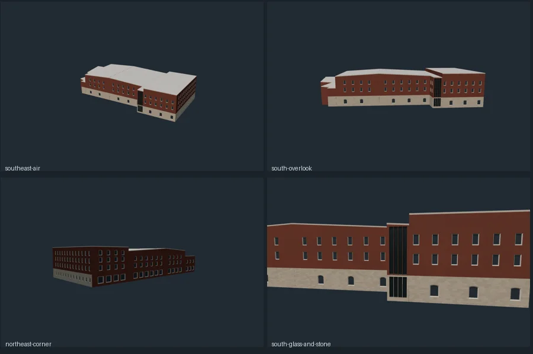

# Holman Centre exterior asset

This workbench contains an original full exterior for the former Holman
Department Store at 250 Water Street, Summerside. It is **not installed in
the playable map**. Stock buildings, shoreline, roads, aircraft contact, and
the earlier railway station and wharf replacements are unchanged.



## What informed the model

- The [Holman Centre operator](https://holmancentre.com/), [PEI building
  record](https://www.princeedwardisland.ca/en/building/holman-centre) and
  [Canadian Register entry](https://www.historicplaces.ca/en/rep-reg/place-lieu.aspx?id=10088)
  identify the site and distinguish the historic department store from the
  later redevelopment.
- The signed [NRCan building outline](https://open.canada.ca/data/en/dataset/7a5cda52-c7df-427f-9ced-26f19a8a64d6)
  `q032001/132` has 98.3% of its area inside the provincial historic
  roofprint FID 56032. GeoLinc and [OpenStreetMap contributors](https://www.openstreetmap.org/copyright)
  corroborated the plan; no coordinate paths from those services ship here. A [July 2025 aerial](https://commons.wikimedia.org/wiki/File:Summerside,_Prince_Edward_Island,_Canada.jpg)
  and a [separately dated October 2025 aerial](https://commons.wikimedia.org/wiki/File:Summerside,_Prince_Edward_Island.jpg)
  by Quintin Soloviev corroborate the red upper
  masonry, pale lower frontage, and inserted dark glazing. They are
  references only: no photographed pixels, scanned drawings, or exact
  window-spacing claims are included.
- Natural Resources Canada [High Resolution Digital Elevation Model](https://open.canada.ca/data/en/dataset/957782bf-847c-4644-a757-e383c0057995)
  (2020 PEI, 1 m, [Open Government Licence – Canada](https://open.canada.ca/en/open-government-licence-canada)) informed relative
  height families. An independent check reserved 359 actual elevation
  samples that were not used to fit the geometry. The main roof's
  90th-percentile absolute error was **0.34 m**; the east flat control was
  **0.27 m**. Those checks are historical and regional. They do not certify
  every eave, the west wing, the newer roof details, or the current grade.

The four joined sections have 5,054 triangles in seven material batches and
7,581 consistently paired Float32 edges. The meshes use authored brick,
stone and glazing materials. In four fixed WebGL2 views the detail modes
changed only their visible target materials, with exact image restoration.
The [render receipt](../../tools/art/holman-centre-exterior/proof/native-studio-receipt.json)
records the tested renderer and source versions rather than a performance
claim.

## Remaining integration work

The current simulator ground is dry around the site, but its south side
sits about 0.51 m above the 2020 bare-earth check in the median. The west
ground also fails the original tolerance. The app does not shift or flatten
the terrain to fit this exterior. The west roof is provisional, exact modern
window bays remain approximate, and the flight map keeps the original stock
draw while the site is being qualified.

## Open the workbench

After `npm ci`, from the repository root:

```sh
npm exec vite -- tools/art/holman-centre-exterior
node --experimental-strip-types --test tools/art/holman-centre-exterior/holman-detached-portable.test.mjs
```

Choose one of the four viewpoints and switch between plain materials,
the authored finish, and the detailed masonry and glass. This workbench
does not appear in the game's dispatch menu.
