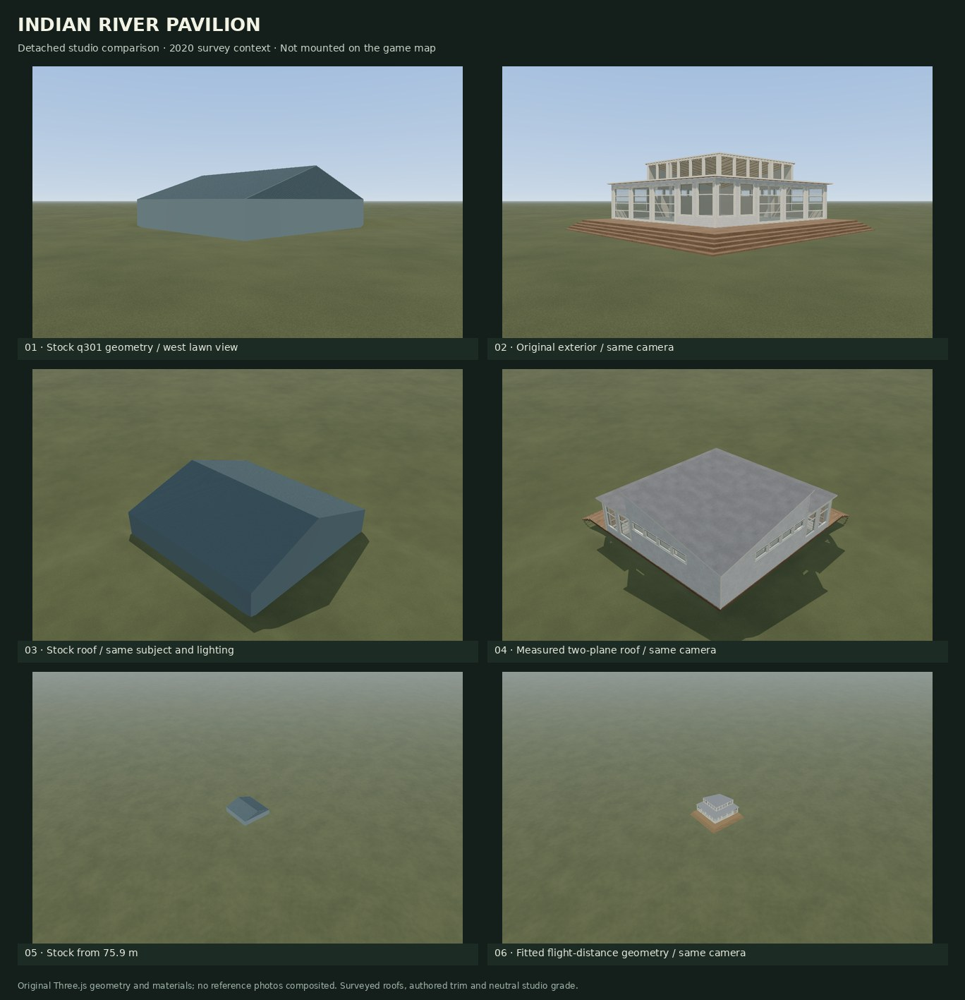

# Indian River Festival Pavilion: production art study

The 2015 timber pavilion on the west side of St. Mary’s is a separate
building. This original TypeScript/Three.js asset is kept in the art
tooling for later placement. **It is not enabled in the simulator.**
The current live landmark ground, nearby trees, flight contact and stock
pavilion are unchanged.



The model uses a measured low roof and two raised butterfly faces; the
clerestory, cedar, decking, glazing, and visible frame are authored
representations. [Data and material provenance](../../tools/art/indian-river-pavilion/SOURCES.md)
distinguishes the 2020 LiDAR from the architect's documentation.
The image above shows a detached studio floor, not geographic game imagery.

## Source fit

A matched test at 234 spatially withheld roof returns reduced p90
vertical disagreement from **2.233 m** on the stock mesh to **0.041 m**
on the new mesh. At 170 supported interior locations the new p90
is 0.0235 m. All returns are from the same flight line; the worst
1.858 m discrepancy is near an edge or seam, so the model does
not claim survey accuracy at every joint or present-day condition.

The close and flight tiers have 4,568 and 3,272 triangles respectively.
No photograph or source drawing was embedded in the geometry, materials
or screenshots. The data provenance page includes original sources.
The alternate tiers have identical fitted roof geometry.

## Placement gate

The timber deck can sit above actual lawn, but the actual south and west
step approaches do not meet the current simulator's terrain. Those are
distinct from the raised deck underside. Some necessary contact points
fall directly on terrain already used and protected by the adjacent
St. Mary's release. Competing tree shadow receivers also need their own
proof. Until a measured approach and its protections can coexist, the
stock atlas remains unchanged; the art is useful as an offline asset,
not as an optional live building.

Run the scoped tests from the repository root after `npm ci`:

```sh
node --test tools/art/indian-river-pavilion/qa/roof.test.ts
```
