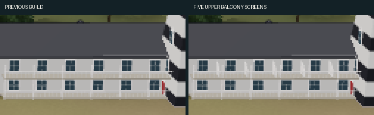

# East Point and West Point light stations

Two custom, ground-anchored exteriors replace three generic building extrusions. They are construction references for a flight game, not navigational aids or a survey of every doorway.

| Station | Position and measured scale | What distinguishes the model |
| --- | --- | --- |
| East Point, Kings County | 46°27′09.1″N, 61°58′18.6″W; 19.5 m structure | An eight-sided white shingle tower with a projecting gallery, cross-braced rail, red lantern and gabled casements. The adjacent fog-alarm house has stepped gable volumes and a red roof; small modeled paired horns refer to the museum display. |
| West Point, Prince County | 46°37′13.1″N, 64°23′12.3″W; 67′8″ (20.62 m) | A square taper with four black horizontal daymarks, a white square gallery, red lantern and attached two-storey inn with long seaward balconies and five upper privacy screens. |

**Fly the two passes:** choose *East Point · lighthouse pass* or *West Point · lighthouse pass*. Each starts 58 m above the starting surface, roughly 350 m offshore, with the tower to the right of the aircraft’s nose. Exact woodwork, some window positions, inn and museum details, and present-day ground treatment are interpretations. No imagery was used as geometry or texture.

**Placement and fallback.** The positions come from the [PEI Lighthouse Society: East Point](https://peilighthousesociety.ca/index.php/lighthouses/open-lighthouses/46-east-point-lighthouse) and [West Point](https://peilighthousesociety.ca/index.php/lighthouses/open-lighthouses/89-west-point-lighthouse). See also the [Canadian Coast Guard light list](https://notmar.gc.ca/publications/list-lights/atl/atl942-en). The shipped [NRCan building atlas](../WORLD.md) corroborates highest returns of 19.48 m for the East tower and 20.73 m for the combined West tower and inn. The East fog-alarm building is a separate 9.21 m roof record. We match the three full outline fingerprints at the released source precision rather than clearing other buildings nearby. Forest stems affected by these outlines or tower foundations are filtered using their crown radii. Base elevations and surrounding shoreline retain the resolution of the province atlas; fine beach and cliff geometry has not been surveyed by this pass.

**Architectural reference.** The Canadian Register documents the [East octagonal station](https://www.historicplaces.ca/en/rep-reg/place-lieu.aspx?id=11479), [East fog-alarm building](https://www.historicplaces.ca/en/rep-reg/place-lieu.aspx?id=19205), and [West square station](https://www.historicplaces.ca/en/rep-reg/place-lieu.aspx?id=18794). The [West Point Lighthouse Inn and Museum](https://www.westpointlighthouse.ca/) also documents the lodging wing.

Visual comparisons, not distributed assets:
- Bob Linsdell, [East Point foghorns](https://commons.wikimedia.org/wiki/File:East_Point_Lighthouse,_Prince_Edward_Island_(471426)_(9450826868).jpg) and [East tower and fog house](https://commons.wikimedia.org/wiki/File:East_Point_Lighthouse,_Prince_Edward_Island_(471430)_(9450830054).jpg), [CC BY 2.0](https://creativecommons.org/licenses/by/2.0/).
- Quintin Soloviev, [East Point aerial, August 2023](https://commons.wikimedia.org/wiki/File:East_Point_Lighthouse_from_above_-_Prince_Edward_Island_-_PEI_(Quintin_Soloviev).png), [CC BY-SA 4.0](https://creativecommons.org/licenses/by-sa/4.0/).
- Tangerinehistry, [West Point Lighthouse](https://commons.wikimedia.org/wiki/File:West_Point_Lighthouse.jpg), [CC BY-SA 3.0](https://creativecommons.org/licenses/by-sa/3.0/).

**West Point’s upper balcony.** Five original rounded and stepped screens separate
the six visible bays on the seaward run, following [the July 2025 visitor
photographs](https://www.culturedindividual.com/2025/08/i-climbed-up-peis-tallest-lighthouse.html)
and [the inn’s exterior photos](https://www.westpointlighthouse.ca/). Their
positions and sizes follow the simulator’s existing deck and windows; they
are not surveyed room locations. The screens sit on the existing upper
deck without changing the rail. They fade out before the original switch
to the simplified distance model.

The comparison is enlarged 3× from the same position four seconds into
the ordinary West Point chase-camera departure. The left frame uses the
previous balcony, and the right includes the screens. No reference
photograph or extra camera was used in this comparison.

**Render budget.** Each station has two near draws (opaque painted exterior and lantern glazing), one simplified draw beyond 750 m, and an empty LOD at 8.5 km, with hysteresis. The stations share paint and glazing finishes; West Point’s close opaque batch uses a separate program to fade the screens. Original shingle courses fade below pixel resolution. A bounded ground material reconstructs the mown lawn, gravel forecourt and walks on the eastern point and dune-grass/sand transition at the western site. Their fine layout and materials are interpretations, not survey data. Soft station contact and fixed daylight shadows are calculated on the already-masked ground, adding no draws or over-water shadow. The station tests verify exact mesh height at both visible LODs, draw limits, the position and heading of both departures, and exactly three replaced footprints among the shipped building inventory.

## Detached artwork: Wood Islands

The [Wood Islands Lighthouse studio](../../tools/art/wood-islands-exterior/) contains an original Three.js model of the relocated keeper’s light, with native-size views from two sides. It is not an in-game replacement. The available building outline does not fit the unscaled art, and matching the elevation and boundary of the actual site remains unresolved.
