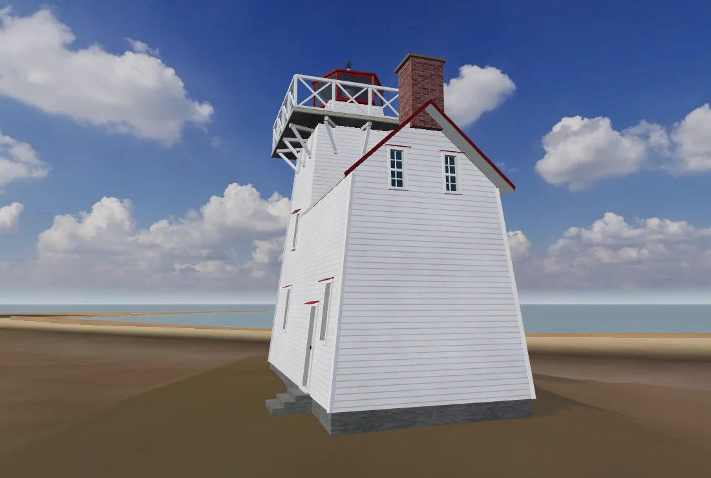
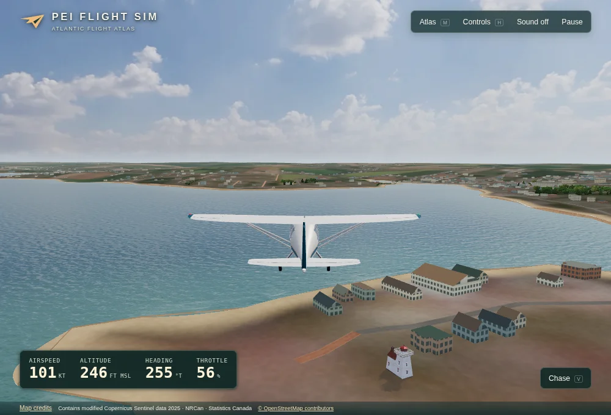

# North Rustico Harbour lighthouse

In Dispatch, select **North Rustico Harbour · coastal pass** and enable **North Rustico lighthouse** under **Optional scenery studies**. The equivalent URL flags are `?departure=north-rustico-harbour-low&northRusticoLighthouseStudy`. The lighthouse and attached former keeper's dwelling are a single authored exterior. North Rustico Harbour's 2020 surface survey is the modelling epoch. This study does not reconstruct later harbour work, shoreline erosion, adjoining buildings, or the interior.

## Where the model belongs

- The [Canadian Register of Historic Places](https://www.historicplaces.ca/en/rep-reg/place-lieu.aspx?id=19724) identifies the tapered tower, gabled residence, brick chimney, red lantern, gallery, and four-over-four windows. Its exterior photographs were reference only.
- The [Canadian Coast Guard List of Lights](https://notmar.gc.ca/publications/list-lights/atl/atl942-en) identifies station **1056 / H1141**. Its 10.4 m structure height is not the 12.4 m focal height above the chart’s Higher High Water Large Tides datum. The model does not emit or simulate an operational light signal. The chart coordinate identifies the navigation light; it is about 13 m west of the coherent measured tower mass and is not used to place the model.
- Natural Resources Canada's [2020 PEI LiDAR object](https://canelevation-lidar-point-clouds.s3.ca-central-1.amazonaws.com/pointclouds_nuagespoints/PEI/Prince_Edward_Island_2020/pei_2020_377000_711000.copc.laz) was read via seven verified ranges in a 68 × 68 m query, not downloaded or embedded as a game asset. It contains two contributing survey flight lines. All returns from the actual lighthouse in this query are unclassified (class 1); the separate class-6 building mass to the west remains in the simulation. Ground controls use class 2 and the official 1 m bare-earth grid. The model's roof and gallery dimensions are metric and are not inferred from the chart focal height. Heights below are in CGVD2013 before the simulator's shared +0.12 m presentation offset.

| Survey feature | Evidence |
|---|---|
| Local modelling control | 477578.490 m E, 5144677.260 m N, EPSG:2961; model ridge axis approximately 42.45° counter-clockwise from grid east |
| Cottage ridge | Approximately 9.74 m; holds across both recovered roof slopes |
| Cottage roof-plane repeatability | Independently holding out each flight line: 90th-percentile absolute residual 0.065–0.129 m |
| White X-railed gallery | Median deck surface 11.084 m; nominal top near 12.159 m based on the gallery’s visible proportions and an upper return band. The individual rail line and height are not a LiDAR survey |
| Upper returns | Dense measured returns around 13.23–13.50 m, with a fitted hexagonal red cap from both flight lines. The small wind ornament is inferred from photos, not surveyed |
| Open ground around the tower | Within 3 m, 40 class-2 returns with median 2.754 m; the surface beneath the roof itself is interpolated using independent ground points |

## Why surrounding scenery is left alone

The 2020 source surface is nearly two metres higher at the tower than the unrefined simulator mesh. Lowering the entire real structure or placing it on a fictional raised foundation would get the silhouette, entrance, or ground connection wrong. The scenery therefore needs a jointly verified local land correction and exterior. The separate house in the building atlas, existing roadway, water mask, and mapped coastline are read-only controls. The [provincial post-Fiona field report](https://www.princeedwardisland.ca/sites/default/files/publications/post_tropical_storm_fiona_highwater_mark_and_shoreline_erosion.pdf), fig. 11, records erosion near the light in 2022; it is not combined with 2020 LiDAR to redraw a later wharf or coastline.

Reference photographs by [Dan Bhentschel](https://commons.wikimedia.org/wiki/File:PEI_North_Rustico_Harbor_Lighthouse.jpg) and [Koobs](https://commons.wikimedia.org/wiki/File:North_Rustico_Lighthouse,_North_Rustico,_PEI.jpg) corroborated visible gallery, window and dwelling profiles. Neither image is included in the game or texture files.

The visible three-step entry follows the form in the dated exterior photograph. Its dimensions and grounding are authored to meet the measured 2020 terrain, not supplied as as-built or accessibility information. Painted lap courses, roof shingles and brick use original materials. The local shadow is calculated from the authored solid geometry and the game's static sun, not taken from imagery. To reproduce the original mask, run `node tools/qa/bake-rustico-shade.mjs /tmp/rustico-mask.json` on the same terrain and source revision; its decoded hash is pinned beside the generated mask.

## In-game scope

The optional study requires the authenticated 3,201-byte grade pack and its exact terrain and cover versions. On compatible close-range terrain, the same inserted faces support both display and aircraft ground contact. A missing or invalid pack, or an incompatible terrain or building-shadow mode, leaves the original ground and no detached lighthouse. The original lighthouse-free higher terrain levels remain unchanged; the exterior is a close-range study.

The playable approach starts offshore at 72 metres above the game's starting surface. The selected view also includes [one measured nearby roof](../qa/rustico-neighbour.md) and an [authored dry-ground treatment](../qa/rustico-dry-ground.md) around the lighthouse. The rest of the harbour and the later breakwater are **not** rebuilt by this change. See the [terrain, model and flight checks](../qa/rustico-site.json).

Contains information licensed under the [Open Government Licence – Canada](https://open.canada.ca/en/open-government-licence-canada). This scenery is for simulation only, not navigation or flight training.
