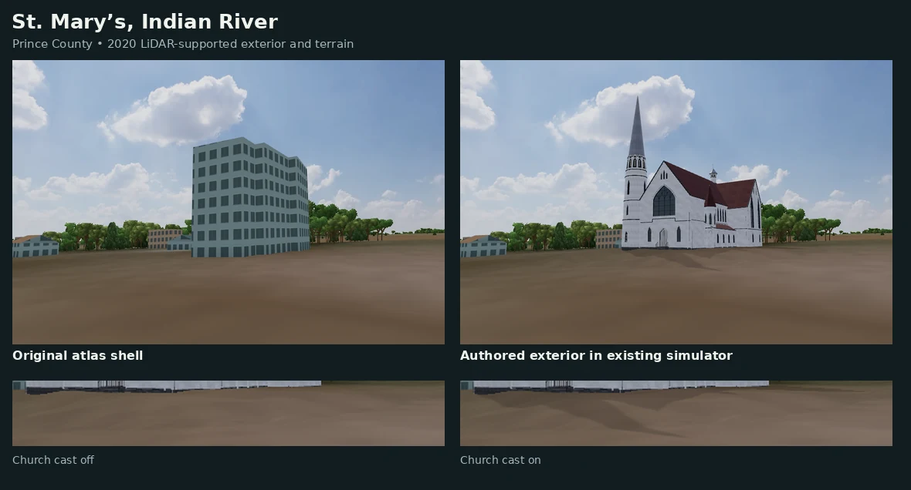

# St. Mary’s, Indian River

This exterior study replaces the old flat shell for one historic landmark in
Prince County. The full island atlas is otherwise unchanged by the asset.
In **Standard** scenery, enable **St. Mary’s exterior** under **Optional
scenery studies**, then choose **Indian River · country pass**. The departure
starts in farm country west of the church, 80 m above the starting surface.
Bookmark: `?indianRiverReview&departure=indian-river-country-pass`.

The model depicts the exterior, not the interior or present-day condition.
The [Canadian Register](https://www.historicplaces.ca/en/rep-reg/place-lieu.aspx?id=18823)
describes William Critchlow Harris’s French Gothic church and its distinctive
tower. The [venue’s building history](https://underthespire.ca/about-the-festival/about-st-marys/)
records details of the church as a performance space. We referenced dated
photography for observable proportions, circulation and finish, including
[Larry from Charlottetown’s CC BY 2.0 view](https://commons.wikimedia.org/wiki/File:St._Mary%27s_Church,_Indian_River,_PEI_(41541509404).jpg).
No photo pixels are in the model or textures.

## What is measured

The 2020 LiDAR supports the steep nave and transept slopes, lower roofs and
spire taper. The spire is independent from the simpler stock footprint,
which omits it. The surveyed central roof surfaces were checked by tracing
the actual authored mesh against 580 sampled returns, rather than just
comparing control meshes. The two main slopes have about 9 cm p90 vertical
residual in those regions. Cross-gable witnesses are about 6–14 cm p90.
The spire’s supported radial fit has 57 additional checks. The lantern
shoulder, hip geometry with fewer returns, narrow finial, tracery and
individual material marks are interpretations and are not survey claims.

Textures, shingles, railings, threshold, recessed Gothic openings and
scalloped details are original Three.js art. A stable local survey
projection converts the world position without duplicating the terrain
renderer’s vertical offset. No raw point cloud, reference imagery, modern
business or occupancy data is distributed.

## Terrain and fallback

A small, optional measured grade brings the old bare-earth mesh into line
with the local dry ground plan at approach distance. Nearby unrelated
buildings, roads and mapped tree trunks are preserved. The shadow adjustment
keeps the original four foliage footprint positions and materials, and
changes their receivers to match the submitted ground triangles.
Farther terrain levels retain the original mesh.

The alternate model hides only the exact authenticated stock record. A
missing or altered source, incorrect grade, failed receiver fit or missing
owner falls back without removing another building. This does not adjust
civilian flight dynamics or add structure collision.

## Sunlight and the visible test

The directional cast traces the same opaque, original roof, wall and spire
triangles against the submitted terrain. Its 241 × 261 coverage mask is
roughly 1.7 kB compressed, contains no photograph, and is sampled by the
existing ground shader on that tile. It requires no extra terrain draw.
Every nonzero bilinear sample is more than 22 m from the mapped road
ribbon and more than 5 m from unrelated building outlines. It is separate
from the four re-seated foliage shadows and does not darken building
facades, canopy geometry, or the underlying imagery.

The placement is a near-range study: it uses source-matched grade and tree
coverage and falls back to the stock shell if those details are not ready.
It is not present in unselected Standard mode or in competing terrain or
woodland preview modes. No changes to aircraft contact or dynamics are made
outside the measured local patch.

The packaged normal departure completed a 715 m flight with model, grade
and both shadow systems present. Independent malformed grade and cast
responses stayed fully in Standard geometry during ordinary flight.
The matched close views changed no pixels outside the ground-shadow
receiver when toggling the church cast alone.

See [the measured and rendered checks](st-marys-indian-river-check.json)
and [the repeatable packaged flight test](../../tools/qa/st-marys-player.py).

## Distant drawing tier

The distant model preserves the measured outer roof and spire silhouette
with a single vertex-coloured mesh. It drops fine trim and materials only
when the projected vertical span is small. It is eligible at 430 m or more
and no more than 86 drawing-buffer pixels high. Once active, it remains
eligible down to 395 m or up to 100 pixels. The separate enter and exit
thresholds prevent a rapid toggle around one distance or screen size.

The full external scene, exact grade, foliage receivers and directional
cast still have to pass their existing admission checks. The distant
mesh is not a way to show an unsupported or floating building when those
checks fail. The detached art was compared farther away than the live
scene's admitted range.

In two matched in-simulator views, this one change saved **12 draws
and 19,201 triangles**. No pixels outside the building's projected bounds
changed. The packaged 716 m ordinary approach changed from distant to
flight to close detail while the grade and all shadows stayed active.
The farther model does not reduce the allocation of the existing close
textures or establish an end-user FPS gain.

[Far-tier checks](st-marys-indian-river-far-check.json). Rebuild and
recheck the ground cast if the source opaque silhouette, site transform,
terrain registration or sun direction changes; the distant drawing tier
does not edit that measured cast.
