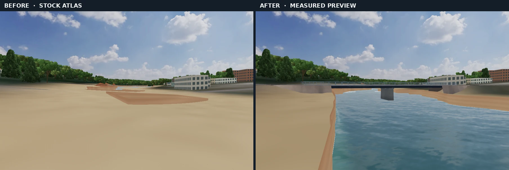
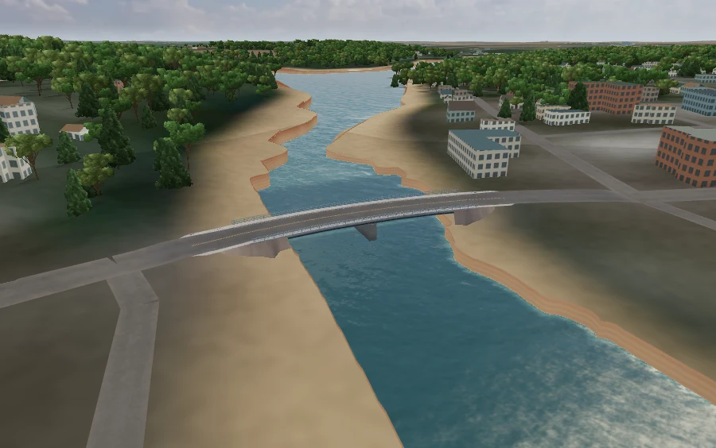

# Montague Bridge and river opening: feasibility preview

**Status: opt-in and not a release acceptance.** This is a measured reconstruction
of one structure and a bounded river correction, not an as-built bridge or marine
chart. On this checkout open the normal app with `?montagueFoundationPreview`.
To preselect the lower approach, use `?montagueFoundationPreview&departure=montague-bridge-low`.
The stock app does not load or install the local pack without the flag. Once
the verified preview loads, choose **Montague · river bridge pass** in Dispatch
or the map. This starts 620 m northeast of the Main Street span at 64 m above
the starting surface. In Chase, the slightly offset heading keeps the bridge
to the left of the aircraft rather than directly behind its fuselage. The older **Montague River** departure remains the
higher estuary flight. The low pass is not offered when the preview pack or
its required source files do not authenticate; a saved low-pass link then
selects the original Montague River departure. Add
`&montagueReachOptics` for a separate visual-only test of quieter river water.
No photograph is distributed or sampled as texture.


[Capture positions and render counts](../data/montague-bridge/matched-near-render.json).
The after frame uses the optional water optics along with the measured preview.
The nearby buildings, banks and vegetation still use the existing atlas art.

## What is measured

- Statistics Canada's old cartographic land mask fills portions of the real
  Montague River. The pinned [November 1, 2026 OSM extract](https://download.geofabrik.de/north-america/canada/prince-edward-island-261101.osm.pbf),
  relations [17973539](https://www.openstreetmap.org/relation/17973539) and
  [13481135](https://www.openstreetmap.org/relation/13481135), supplies a water
  envelope. © [OpenStreetMap contributors](https://www.openstreetmap.org/copyright),
  ODbL. The [separate bounded ODbL extraction](../data/montague-bridge/local-osm-water-odbl.json)
  retains both source shapes, CRS and the source PBF fingerprint. The mask additionally requires direct 2020 classified water returns, or
  two-sided returns across the area occluded by the bridge; it protects known
  dry returns and does not create any land. Existing water remains water.
  This is not a surveyed bank line, modern tide model, or calculation of depth.
- Canada’s [National Road Network](https://open.canada.ca/data/en/dataset/3d282116-e556-400c-9306-ca1a3cada77f),
  PEI edition 22.1, OGL Canada: road segment FID 15172, NID
  `d312f24857e44d61a3f4891496b4dd95` and exact adjacent FIDs 15317 and 15264.
  All eight original points of the bridge curve span 60.657 metres in EPSG:3979;
  the game's older packed row retained three. Exact packed SHA-256, row,
  vertex count, coordinates and flags are checked before replacing the
  generic bridge and its two inboard approaches. The unchanged packed
  neighboring roads meet the same original cross-sections.
- Natural Resources Canada's CanElevation [2020 classified point cloud](https://canelevation-lidar-point-clouds.s3.ca-central-1.amazonaws.com/pointclouds_nuagespoints/PEI/Prince_Edward_Island_2020/pei_2020_427000_679000.copc.laz)
  and corresponding [1 m HRDEM mosaic](https://datacube.services.geo.ca/pgstac/api/collections/hrdem-mosaic-1m/items/10_3-mosaic-1m),
  OGL Canada. Pinned COPC ETag `"f81e73668d3b7c1c1b283803715a9ece-7"`.
  Class 17 and class 2 resolve the deck crossfall, two raised walks and their
  curbs, and the elevated curved roadway around both bridgeheads.
  Optical deck tops add 0.132 m in the scene (the atlas's 0.12 m optical
  ground offset plus 0.012 m). Under-deck observations do not resolve precise
  foundations. Class 9 heights reflect a dated sweep, not the scene sea plane.
- The official [PEI bridge inventory](https://services9.arcgis.com/zow9Ot3ujGSyJI3C/ArcGIS/rest/services/Bridge_Structure_Features_view/FeatureServer/0)
  identifies 2007 continuous-steel structure K3-037 on Main Street across the
  Montague River. The [owner engineering presentation](https://fdotwww.blob.core.windows.net/sitefinity/docs/default-source/structures/innovation/frp/iwfrpcs4-1a_owners-canadian.pdf),
  PEI section slide 13, reports curved steel plate girders and two spans, total
  60 m. The [2007 opening announcement](https://archivenews.princeedwardisland.ca/completion-new-49-million-montague-bridge)
  confirms two pedestrian walkways; the [Canada Gazette](https://gazette.gc.ca/rp-pr/p1/2007/2007-03-10/pdf/g1-14110.pdf),
  page 534, identifies plan deposit 32385. There is no public as-built drawing in
  this preview.
- The Canadian Hydrographic Service [ATL 108](https://waves-vagues.dfo-mpo.gc.ca/library-bibliotheque/chs-shc-ATL108-eng-202504-41282735.pdf),
  p. 1-24, `MONTAGUE (2013)`, visually distinguishes a single in-water support
  between the spans. Its deck-relative position is approximate, 27–32 m from
  the NW registration end; the prototype uses approximately 29.2 m. The
  bridge inventory point is **not** a pier position. The 2019 [deck photo](https://commons.wikimedia.org/wiki/File:Montague_Bridge_(48589164267).jpg)
  and [river photo](https://commons.wikimedia.org/wiki/File:Montague_River_(48589165532).jpg)
  (WabbitWanderer, CC BY-SA 2.0) are visual evidence only. Original art models
  only the two visible outer fascia/girder profiles and the exposed support
  above the modeled water, not hidden members, materials, dimensions, or
  underwater structure. Sloped approach skirts are conditional on verified
  existing dry land. No road, bridge or maritime collider is added, and neither
  water plane nor beyond-scope terrain is intentionally changed by the model.

## Gates and remaining limits

The packed 30,508-byte foundation contains an opt-in 177 × 221 signed water
mask and a 129 × 129 dry-height patch. Missing and corrupt archives retain the
old atlas. In the initial complete-mask replay, 857 direct source water
observations were newly wet, with no audited dry land flooded; the 738 actual
dry mesh probes reduced p90 absolute error from 2.970 m to 0.0266 m and shared
the contact height within 0.011 mm. [Foundation witness](../data/montague-bridge/foundation-contact-gate.json),
[whole-tent water bounds](../data/montague-bridge/whole-tent-water-proof.json).
The [actual deck Three ray witness](../data/montague-bridge/deck-mesh-gate.json)
found zero missing or duplicate heights over 789 spatially held-back class-17
native deck returns, including the walks. The 549 samples covered by *both* the
old and new road mesh reduce p90 absolute source error from 0.893 m to 0.150 m
(0.0255 m with the explicit 0.132 m render offset subtracted).
Four original cross-line junction vertices agree within 0.0021 mm in the
actual Three world transform. The short reconstructed dry approach walks
and skirts have zero sampled overlap with the modeled water. These are local
results, not province-wide claims.

Footage must not be used as an as-built or navigation reference. The original
broad ortho, nearby generic blocks, dry bank colour and structures may still
differ materially from the site. The exposed pier shaft, rail proportions,
marking placement, skirt art and other hardware below the observed scale
remain illustrative. The optical layer does not imply bathymetry or hydrodynamics.
The [intermediate LOD witness](../data/montague-bridge/distance-lod-gate.json)
checks 66,049 half-grid points and actual native triangle intersections with
no gaps or inverted triangles, and <0.5 px worst projected height change at
1080p/53° for the middle LOD. The local middle-distance mesh uses 3,502 interior
triangles instead of the near mesh's 32,768. The most distant 8×8 atlas tile
intentionally keeps its original terrain geometry and regular lighting:
its kilometre-scale parent faces cannot safely receive a local measured zipper.
This means unrefined dry elevation at that distance. The independently scoped
water mask and stock-owner-matched road persist. No near terrain or physical
contact change is implied by the distant renderer's fallback. This is not a
device frame-time result.

### Replaying the local witnesses

After `npm ci`, run the following commands from the checkout. Only the two
small scoped CanElevation witnesses are needed; both are derived from the same
pinned Canadian source under the Open Government Licence – Canada. These
replay the saved evidence, not an independently sourced resurvey.

```sh
node tools/qa/montague-foundation-preview.mjs
node tools/qa/montague-deck-preview.mjs
node tools/qa/montague-lod-gate.mjs
```

### Current integration controls

Montague remains independent of the existing Basin Head and Quartermaster insets.
Unset flags have no extra requests. The combined optional classification witness
preserves all still-dry material/planting distance values and all sampled exterior
ground contacts and shoreline segments. The 738 dry ground ray probes are a
qualified cohort, not all class-2 returns: the independent wider audit found
1,642 newly wet class-2 ground returns in the interval −0.927 to −0.631 m, all at
least 0.576 m below the fixed −0.055 m scene sea plane and corroborated by dated
class-9 water nearby. This neither measures draft nor predicts a tide.

The road now remains in exactly the owning stock tile's visibility window;
replacing three source rows cannot open a hole at arbitrary distance. The
existing 420 m owner-position reuse is preserved. The actual
[road ownership/seat witness](../data/montague-bridge/road-stream-gate.json)
tests 25 owner-edge and retained positions and zero optional seating weight across
all 242 samples spanning both unmodified road joints. Local visual receivers
read the actual current LOD triangles and its sewn apron; outside those
triangles the old regular facet remains exact. The
[real Three buffer witness](../data/montague-bridge/visual-attachment-gate.json)
tests 687 real patch/apron rays and 193,886 unchanged regular points across the
near and intermediate LODs; it additionally compares all stock far vertex/index
buffers and 899 actual far rays exactly. The
[mixed neighbour seam witness](../data/montague-bridge/mixed-seams-gate.json)
checks all four sides at 56↔8, 112↔56 and 112↔8, preserving the full sewn
edge topology (maximum sampled Float32 elevation difference 0.00491 mm).

With experimental forest floor and seated-road flags active, their guard is
limited to the fixed Montague grid or its adjacent interpolation margin, not
the entire terrain tile; ordinary hedgerows outside the site remain eligible.
Montague's known fixed foundation takes priority over *additional* experimental
adaptive survey relief in its single owner terrain tile 22–17; that adaptive
candidate is not combined with a second independent mesh there.

The [compiled eight-case route witness](../data/montague-bridge/compiled-integration-route-gate.json)
uses the ordinary Montague River menu departure and pilot controls. Default,
both previews, absent/corrupt Montague, valid changed road pack, changed decoded
Cover, consistently changed terrain manifest+pack, and absent Basin Head each
retained the expected coherent layers and normal flight. The
[actual route approach](../data/montague-bridge/actual-route-approach.json) used
normal rudder input (no position, heading or clock override) from 2.62 km to
0.526 km from the mapped span. The [default view comparison](../data/montague-bridge/default-render-gate.json)
held the camera and all 18 loaded imagery tile IDs fixed: 507,600 pixels, draw
calls and submitted triangles matched exactly.

Additional replay:
```sh
node tools/qa/montague-coexistence-gate.mjs
node tools/qa/montague-visual-attachment.mjs
node tools/qa/montague-road-stream-gate.mjs
node tools/qa/montague-mixed-seam-gate.mjs
```

### Closing five witnessed shoreline gaps

Several pale inland-water polygons in the 44.5 m inspection were actual
background holes, inherited from old straight curtain chords across
curved bilinear contours. Not a tide, foam, or a new erosion defect.
The five individually listed 47.6 × 47.4 m legacy cells now trace the
existing signed zero at roughly 1.08 m intervals and seat the vertical
curtain to the actual submitted land and the same fixed sea plane.
The footage scope is independent of the water-evidence footprint.
No land or water sign, physical height, or other shoreline segment changes.

- [Exact contour/scope replay](../data/montague-bridge/reviewed-contour-gate.json):
  51,161 exterior contours exact, 103,828 wet/dry sample scalars exact,
  and all 10 adjacent coarse joins intact.
- [Actual three-LOD envelope](../data/montague-bridge/reviewed-curtain-envelope.json):
  9,958 probes per LOD, no uncovered heights, at least 0.090 m overlap with
  the two actual submitted depth sources. Nothing extends the wet classifier.
- [Locked sky diagnostic](../data/montague-bridge/reviewed-curtain-render.json):
  743 pure-background aperture pixels below y101 dropped to zero; all
  718 independently ray-confirmed former holes now have opaque coverage.
  Changes affect 1,984 pixels in the measured bank window; 505,616 in the
  same frame are unchanged.



Replay the analytic scope with
`node tools/qa/montague-review-contour-gate.mjs`.
