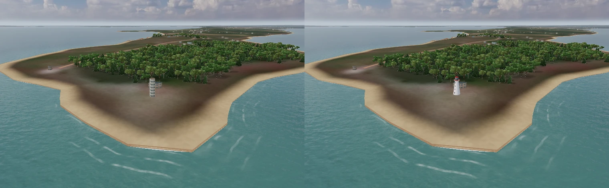

# Point Prim exterior preview

This optional Standard study shows the surveyed-era Point Prim Lighthouse exterior and the small measured dry seat it needs. It does not depict the 2026 repairs, reconstruct a keeper’s cottage or trails, operate a navigation light, or change the shoreline. The existing atlas stores the lighthouse as one tall flat column (q100/266). The authored outline restores the tapered shaft, bracketed gallery, twelve-sided red lantern and red door and four western windows. It uses original opaque Three.js surfaces with painted colors and never allocates the optional cedar texture during flight.

Try an ordinary virtual offshore start at 72 m with:

- Candidate: /?pointPrimStudy&departure=point-prim-offshore&diagnostics
- Stock: /?pointPrimStudy&stockPointPrim&departure=point-prim-offshore&diagnostics

Press **Begin flight**. Just visiting Dispatch, flying near a different cape, or flying this view from too high up cannot load the optional asset. The virtual departure is only visible on an explicit Point Prim study URL, including its stock control. It is not a real-world flight route. The existing departure array, optics, standard flag defaults and incompatibility flags are not modified. Detail and explicit alternate terrain, lighting, shadow, road-seating or near-foliage modes retain their ordinary behavior, but do not activate this preview.

The comparison uses the real game renderer, the same locked camera and
the same settled scenery on both sides. It shows the flight-detail model
used by this study, with the measured seat. The neighboring buildings,
vegetation and shoreline still use their preceding artwork. The study
adds a locally measured slope, not a reconstruction of the whole headland.

The [detached close art view](qa/point-prim-studio-detail.webp) shows the
door, bracketed gallery and lantern detail separately. It is not a
screenshot of the live flight preset.

## One owner, one dry ground transaction

- Owner: q100 ordinal 266. The ordinary q100 gzip range (bytes 1370208–1392868) is reused with no optional duplicate request. Atlas identity, projected tile bounds, all 22,661 wire bytes, exact decoded row and all six existing attribute arrays are each checked before the optional code or grade is requested. The same submitted buffers retain original vertices [0,17820) and [17877,29745). Only the 57 lighthouse vertices are indexed out, and the original full geometry object is kept. Invalid optional proof never withholds the standard owner. The two exact UV buffers observed in Node and compiled Chromium both qualify; all other attributes use the same single checksum. The 59 different UV entries are outside the replaced row and differ by at most 6.04 × 10⁻¹² in the stored values. No loose tolerance or alternative wire or row is accepted.
- Ground: the exact 1,465-byte Point Prim signed pack, SHA-256 b6732d103d610289a4765365e3a2b5f8ce42b85b2d657267fee9f60580a69f21. It decodes to 28,227 exact bytes; bare decoded content cannot substitute for the signed wire file (transparent HTTP gzip is checked as its exact decoded representation). Terrain dimensions/bounds, actual decoded Cover, roads, sidewalks, parking and the building owner must match the protected release data. The installed refinement belongs to one current regular 112-grid tile, 18-19. It does not enter the permanent local-grade list, modify another grade or take St. Mary’s lease. The near stock grid and all inherited seams remain available for exact restore.
- Asynchronous handlers can only deliver signed data and an invisible plain mesh. First commit occurs on the same synchronous callback **before** the simulation’s fixed-step contact call. It is deferred below an absolute 14.845 m when the aircraft is within the actual changed-face bounds plus a 12 m horizontal safety allowance; a late package cannot raise dry land under low gear. Once the correct view is admitted, a normal descent keeps the common collider and mesh. An eye/range change or evicted owner clears both before paint. Valid re-entry reuses prepared data; corrupted, missing, or tardy data does not retry in the background. The near flight qualification is site-relative, not an absolute height restriction or navigation feature.

## Data and preview scope

Ground is based on the [Natural Resources Canada High Resolution Digital Elevation Model](https://open.canada.ca/data/en/dataset/957782bf-847c-4644-a757-e383c0057995), supplemented by the tightly bounded [CanElevation LiDAR point cloud](https://open.canada.ca/data/en/dataset/7069387e-9986-4297-9f55-0288e9676947) for the PEI 2020 project, [Open Government Licence – Canada](https://open.canada.ca/en/open-government-licence-canada). Datum is CGVD2013. The small rendered dry seat adds the atlas’s fixed 12 cm vertical convention. A separate before/after source receipt demonstrates dry distance and leaves roads, mapped footways and parking, and the neighboring q100/222 footprint outside moved faces. Supply/authentication failures do not disable those layers.

Architectural form, white shaft, red lantern, windows and approximate cardinal roles are based on [Parks Canada’s designation](https://www.pc.gc.ca/apps/dfhd/page_hl_eng.aspx?id=14835) and the [PEI Lighthouse Society’s exterior description](https://peilighthousesociety.ca/index.php/lighthouses/open-lighthouses/64-point-prim-lighthouse). Dated public photographs guided original geometry only; no donor pixels, scans or map imagery are packed. The [lighthouse operator’s 2026 restoration](https://pointprimlighthouse.com/ppl-2026-restoration/) is not surveyed here. Finish, trim widths, fine lantern orientation and exact doorway bearing are nominal interpretations, not contractual dimensions or access guidance. Surface checks use the model’s 2020 training observations. The independent reserved returns are not a released validation claim.

## Reproduce

Use Node 22.12 or later. Normal type-check and app build use the project scripts. For the exact real World / Buildings / Three geometry transaction without a browser:

    node_modules/.bin/esbuild tools/qa/point-prim-runtime.mjs --bundle --platform=node --format=esm \
      --external:three '--external:three/*' '--define:import.meta.env.BASE_URL="/"' \
      --outfile=tools/qa/.point-prim-runtime.run.mjs
    HEAD="$(git rev-parse HEAD)" node tools/qa/.point-prim-runtime.run.mjs

Expected: the altered ground area admits only the exact signed pack; 3,130 protected height samples stay unchanged, 340 actual moved-face rays match submitted heights within 43 µm, and all 29,688 non-lighthouse owner vertices are unchanged. Cold/far, low-gear first contact, warm re-entry, moved-terrain LOD and wrong q100 gzip / missing / same-length corrupt / late grade are included. Separate unit tests verify decoded vs packed caps, normal draw ranges, immutable layout, opacity and absence of paint. The browser diagnostics report pointPrim.layers, owner, data, requests, active, grade, draw and temporary deferredClearance.

The bundled Dispatch regression is `tools/qa/point-prim-dispatch.mjs`.
For the built app run `tools/qa/point-prim-flight.py --dist dist --out OUTPUT
--chromium /path/to/chromium` with Python Playwright. The
[verification receipt](qa/point-prim-gate.json) holds the compiled runs,
protected-mesh checks and failure controls.

All six compiled Chromium cases flew and paused normally. The enabled run
covered 110.935 m with one grade request and both halves active. Stock,
wrong-cover and distant flights made no grade request. Corrupt and withheld
grade each made one request and retained the original draw and contact.
All 375 Node tests, the production build and the world checks passed.
