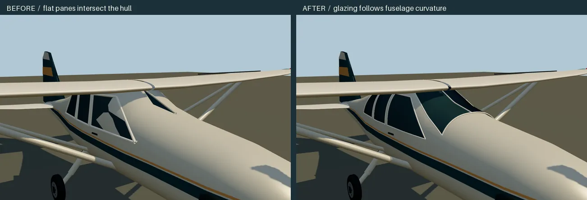

# Survey aircraft exterior gate

The previous flat glazing intersected the hull, leaving large light patches in
the windows. The revised pane follows the fuselage cross sections and has a
single center mullion. The same aircraft asset includes modeled tires, hubs,
brake lines, a nose fork, and position-light lenses. Wheels are static for this
milestone; the lenses are colored details, not aviation light-system simulations.
The tinted exterior panes are not a transparent view into the cockpit.

## Reproduction

1. Run the development server: `npm run dev`.
2. Open `/tools/qa/aircraft-preview.html?pose=windshield` on the dev server.
   Capture the 1,160 × 740 canvas. Use `?pose=gear` for a close-up including the
   contact plane or omit the query for a full-airframe view.
3. Compare to commit `e44a0c4` with the **same fixture** copied into
   `tools/qa/` there. The photographed asset is the same Three.js module as the
   game; the fixture isolates it on a flat plane under fixed light. It is not
   a gameplay screenshot or a change to production lighting.

| Fixed camera | Draw calls before → after | Triangles before → after |
| --- | --- | --- |
| Full airframe | 294 → 238 | 26,030 → 33,694 |
| Windshield | 277 → 221 | 22,870 → 30,534 |

The counts include the fixture shadow pass, so they are not a player hardware
benchmark. The declared wheel contact plane remained at 1.40 m below the aircraft
origin in both matched captures.
