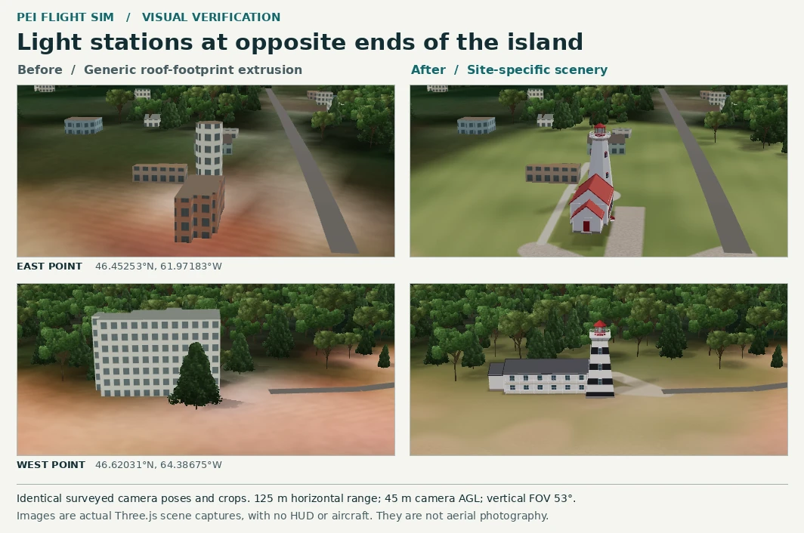

# Landmark visual verification



These are captures of the running Three.js scene, not illustrations, reference photography or a `photorealism` score. Both sides use the same camera, field of view, lighting, viewport, crop and terrain data. The fixed inspection camera hides the aircraft and UI to expose the landmarks. A second test flies both routes in the **unmodified production player**.

## What changed in the reviewed build

| Site | Before | After | Cost of landmark geometry alone |
| --- | --- | --- | --- |
| East Point | Repeated, parallel-sided building with office windows, and a generic block for the fog building. A sky slit ran below the bluff. | White tapered octagonal shaft, gallery, red lantern, gabled fog building, connecting path, road forecourt and directional ground shade. The near bluff is solid at the sentinel view. | +2 calls, +2,872 visible triangles |
| West Point | A generic slab represented the tower and inn. Four generated stems were centred inside the measured footprint. | Striped tapered square tower, separate gallery and lantern, and attached inn. Four intrusive stems are gone; 24 of the original 33 generated trees within 60 m remain. | +2 calls, +5,261 visible triangles |

The separate coastal face also costs geometry. In the *combined* build the East close view changed from 256 draws / 231,837 triangles to 262 / 238,385. West changed from 111 / 269,786 to 118 / 278,921. Do not infer a frame rate from these counts or from the software renderer.

| Regression | Control | Accepted capture |
| --- | ---: | ---: |
| East seaward close view: sky visible through terrain, in a fixed 108,000-pixel ROI | 4,976 (4.607%) | **0** (gate <0.1%) |
| Cavendish woodland in ordinary chase after teleport via Bridge and Charlottetown: water-coloured pixels in a different, 30,800-pixel ROI | See historical coast regression | **0** (gate <25%) |
| Actual landmark routes, 1200×760 chase camera | No dedicated route | Both selected via the real map UI; 104.05 m East and 116.92 m West travelled; no WebGL, JavaScript, layer or missing-near-detail errors |

The East camera revealed a **real hole**, not stylized white foam: only the sky material was changed to magenta in the diagnostic. A 0 count means no such pixels in that **one** measured region at that pose, not that all province coastlines have been inspected. The player snapshots and diagnostic were rendered separately. One pre-release change also passed TypeScript but failed the live GPU shader compiler; a clean build alone does not satisfy this gate.

## Reproduce

Use a complete checkout with its world packs, Node per `package.json`, Python 3.10+ with [`playwright`](https://playwright.dev/python/), Pillow and NumPy, and an installed Chromium executable. Install project dependencies with `npm ci`. The control uses the pre-landmark renderer published in `41f06cc`; label both your control and candidate revisions when publishing comparisons. Use an output directory **outside** the checkout.

```sh
# PROJECT is a full candidate checkout; CONTROL is the pre-change checkout.
# CHROMIUM points to a known Chromium executable on the test computer.
python tools/qa/fixed-scenery.py --checkout "$CONTROL" --out /tmp/pei-before --chromium "$CHROMIUM"
python tools/qa/fixed-scenery.py --checkout "$PROJECT" --out /tmp/pei-after --chromium "$CHROMIUM"
python tools/qa/fixed-scenery.py --checkout "$PROJECT" --out /tmp/pei-void --chromium "$CHROMIUM" --views east-close --void-probe
python tools/qa/coast-void-gate.py /tmp/pei-void/east-close.png
npm run check
python tools/qa/player-routes.py --dist "$PROJECT/dist" --out /tmp/pei-flight-routes --chromium "$CHROMIUM"
```

The fixed camera tool copies source to a temporary tree, mounts the checkout's own assets and dependencies, holds the water phase, and waits for stable calls and triangles, settled detail requests, no missing near imagery, and all real layers. Assets, shaders, toggles and scene geometry are otherwise unchanged. It fails if its source anchor changes: inspect rather than loosening the capture. `player-routes.py` applies no hooks; the PNGs come from the shipped JS/CSS. The browser starts a loopback HTTP service; it does not publish anything. `--suite coast` and `--suite stations` select subsets.

| Pose | Station target (WGS84 lon, lat) | Direction from station | Close / approach |
| --- | --- | --- | --- |
| `east-*` | −61.9718333333, 46.452527778 | Seaward northeast: 0.91 east, 0.415 north | 125 / 650 m horizontal; camera 45 / 120 m AGL |
| `west-*` | −64.38675, 46.620305556 | Seaward southwest: 0.88 west, 0.475 south | Same |

The optical target is halfway up the documented tower. At 53° vertical FOV, 1024×640 and DPR 1, the reference height projects to ~96–99 px near and ~19–20 px on approach. That projection is **not** a measured mesh height. The reproducible comparator uses only screenshot counts where the camera and expected surfaces are defined; an arbitrary “scene complexity” or image-difference threshold does not measure fidelity.

## Standard for the next pass

- **Correct place and identity:** coordinate within 5 m and tower height within 5% of the cited structure height. Check East’s taper, gallery/lantern and adjoining fog building; West’s square taper, four black daymark bands, gallery and connected inn. Compare against appropriately licensed/publicly viewable references; do not copy proprietary Google/Street View pixels or derive geometry from those assets.
- **Correct fit:** no duplicate generic extrusions, floating base, intrusive generated tree stem or material disappearing over water. Review the near and approach poses plus at least one in-player route. The chase wing can partially obscure the East lantern at an individual frame, so do not silently substitute a prettier inspection frame for a flight screenshot.
- **Operational budget:** the station-specific target is at most +2 opaque draws and <6,000 additional triangles per visible site. Report whole-scene costs too. No GLSL, HTTP, layer or route errors. For frame-rate claims collect p50/p95/p99, stalls, DPR and cache status on a named physical GPU; SwiftShader is for reproducibility, not that performance claim.
- **What these results do not establish:** surrounding roofs and facades still repeat; soil, vegetation transitions, lane surfaces and storefronts do not carry street-scale fidelity. The control assigns 46,075 of 85,866 roofs (53.7%) a flat fallback. This is a classification of *renderer behavior*, not a claim that the source roofs are wrong. Expand authenticated landmark/facade/material references and capture urban, rural, airport and coastal routes across all three counties before making broader claims.

Structure references: [East Point Lighthouse, PEI Lighthouse Society](https://peilighthousesociety.ca/index.php/lighthouses/open-lighthouses/46-east-point-lighthouse); [East tower](https://www.historicplaces.ca/en/rep-reg/place-lieu.aspx?id=11479), [East Fog Alarm Building](https://www.historicplaces.ca/en/rep-reg/place-lieu.aspx?id=19205), [West tower](https://www.historicplaces.ca/en/rep-reg/place-lieu.aspx?id=18794), Canadian Register of Historic Places; [Canadian Coast Guard List of Lights](https://notmar.gc.ca/publications/list-lights/atl/atl942-en). This entertainment scene is not navigational data.
