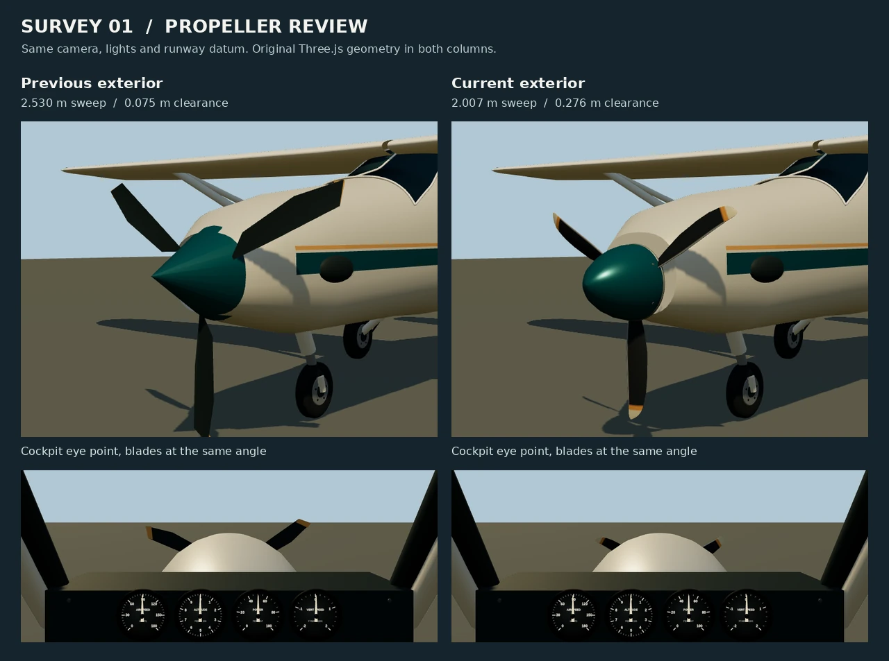

# Propeller geometry and ground clearance



Both columns use the simulator’s actual Three.js aircraft under identical
fixture lighting. The right column uses three swept, twisted, closed blade
meshes in **one batched draw**, a rounded spinner with a bolted metal
backplate, and an explicitly closed cowling face. In motion, the rigid
blades fade into a translucent shutter sweep bounded by the same disk.

| Measured in the installed aircraft fixture | Previous | Current |
| --- | ---: | ---: |
| Swept diameter across all blade vertices | 2.5305 m | 2.0066 m |
| Lowest possible sweep above the level gear datum | 0.0748 m | 0.2762 m |
| Solid blade geometry (triangles) | 18 | 1,668 |
| Chase fixture, solid blades: draws / rendered triangles | 238 / 33,694 | 230 / 39,010 |
| Chase fixture, full blur: draws / rendered triangles | 229 / 33,664 | 230 / 35,866 |

The last two rows include the shadow pass. They are not player hardware or
frame-rate benchmarks. In the cockpit the near hub is obscured by the nose;
the shortened tips and the smaller blur disk occupy less of the windscreen.

**Reference dimensions.** Cessna 182T NAV III, handbook 182TPHBUS-03 revision
3, [section 1, propeller dimensions](https://bankstownflying.com.au/wp-content/uploads/2022/08/MJB-C182_G1000-POH.pdf#page=22)
and [Figure 1-1, normal ground attitude](https://bankstownflying.com.au/wp-content/uploads/2022/08/MJB-C182_G1000-POH.pdf#page=21):
three blades, 79-inch diameter and 10.875-inch clearance. The game's gear
datum is 1.40 m below the aircraft origin. The same diameter now feeds its
[windmilling estimate](ENGINE-OUT.md). Blade sections, paint, pitch
distribution and spinner geometry are original art. This is not a
reverse-engineered McCauley propeller or a dimensional claim about the rest
of the aircraft.

**Reproduce.** Run `npm run dev`; open
`/tools/qa/aircraft-preview.html?pose=prop-side&prop=0`. Other poses are
`prop`, `cockpit` and `chase`; set `prop=0.8` for full blur or `prop=0.16`
for the transition. The same 1,160 × 740 fixture reports its measured
swept diameter, clearance, camera visibility and draw stats in
`window.aircraftPreview`. For the previous mesh, use the same fixture
against the prior aircraft revision. Unit tests check the blade vertices’
120° symmetry, closed faces, opposing face-edge order, finite normals and
swept diameter. No source photo, handbook page or off-the-shelf mesh is
shipped.

Automated installed-geometry and camera check (with the development server
running and Python Playwright available):

```sh
python tools/qa/propeller-views.py --base-url http://localhost:5173 \
  --chromium /path/to/chromium --out /tmp/pei-prop-check
```
