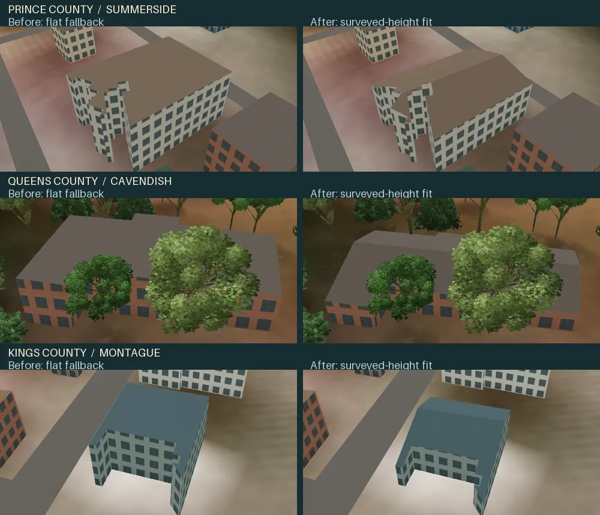

# Survey-supported roof geometry



The same Three.js building renderer is used for all three PEI counties.
Three previously flat roofs now use ridge geometry supported by 1 m Natural
Resources Canada LiDAR, with one fitted outline in each county. The other
85,863 outlines keep the prior geometry. These three deliberately chosen
validation cases are **not** independent proof that the entire province has
true-to-life roof shapes, facade materials, street signs or imagery.

| County / area | Source window inside the rim | Held-out median error, flat → ridge |
| --- | ---: | ---: |
| Prince / Summerside | 349 cells | 0.57 → 0.14 m |
| Queens / Cavendish | 395 cells | 0.51 → 0.10 m |
| Kings / Montague | 174 cells | 0.54 → 0.08 m |

See the [screening pilot](ROOF-FIT-PILOT.md) for rejected cases and the single-plane
comparison. A held-out result from the same elevation product does not prove a
roof type. The ridge is a simple two-plane approximation. Parts outside the
trimmed measurement rim are extrapolated within the exact source footprint.

## Why the roof follows the walls

The fit is in metres. We transform its normal into the simulator's east/south
frame, and align measured **height above** local survey ground to the building's
existing ground anchor. This avoids combining absolute elevations from two
different ground models. The original projected footprint triangulation
is split at the ridge; boundary segments are split at the same intersections
and use those roof heights for the wall tops. The shape does not extend outside
the original outline. Unlisted buildings or a different atlas version fall
back to the previous geometry.

## Rebuild the three coefficients

Requires the same optional Python prerequisites as the
[screening pilot](ROOF-FIT-PILOT.md). Output has the source window fingerprints,
quantized footprint identity, sample count, local-frame model and transform-and-height
height error checks. The command reads only the screened public raster windows:

```sh
OPENBLAS_NUM_THREADS=1 python3 tools/geodata/bake-survey-roofs.py > /tmp/fitted-roofs.json
diff -u src/sim/fitted-roofs.json /tmp/fitted-roofs.json
npm test
```

The browser does not fetch the elevation rasters or separately fetch the fits.
Tests bind the coefficients to the versioned atlas and scan every outline to
check that only the three intended matches activate. Geometry tests check
winding, area, shared roof/wall intersections and unfilled courtyards.

## Visual check

Matched 1,024 × 640 Chromium/SwiftShader shots used the actual terrain and
building shaders. Three separate views kept the same camera, lighting, scene
time and loaded world layers, with only the reference geometric surface change
between baseline and candidate. The sheet crops both halves of each pair
identically. Roof data changes do not add a draw call in any of these views.

| Location | Scene calls before → after | Extra triangles |
| --- | --- | ---: |
| Summerside | 47 → 47 | 30 |
| Cavendish | 31 → 31 | 14 |
| Montague | 33 → 33 | 16 |

Run the same camera poses against this checkout and parent `a30eecd`, using the
same copy of the camera fixture and preinstalled rendering dependencies:

```sh
python tools/qa/fixed-scenery.py --checkout . --out /tmp/roof-review \
  --chromium /path/to/chromium --views summerside-close,cavendish-close,montague-close
```

The roof and height data contain information licensed under the
[Open Government Licence – Canada](https://open.canada.ca/en/open-government-licence-canada);
source versions and attribution are in the [pilot](ROOF-FIT-PILOT.md).
