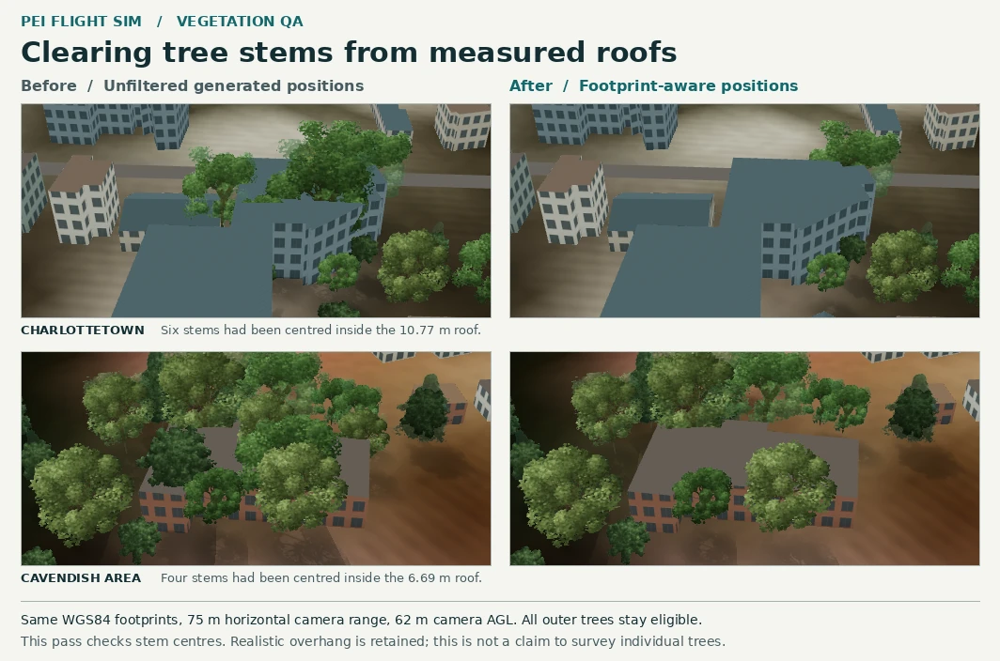

# Verify vegetation against building footprints



PEI’s generated tree layout uses a deterministic candidate in each eligible 12 m grid cell. A coarse forest classification can include small neighboring buildings. The sparse exclusion mask is meant to remove **only stems rooted inside measured building footprints**, not the entire green space around them. It is not a survey of individual trees. The separate two-lighthouse crown-clearance rule is narrower in geographic extent but also checks for canopy contact.

## Full-atlas test

`tools/qa/roof-clearance.mjs` reads the shipped terrain, land-cover and packed NRCan building rings, including hole handling. Starting from the original deterministic tree distribution, it independently computes candidate positions and tests each stem against the source polygon. It does **not** read the mask generator, baked key array, shared key packing or shared pseudorandom-number implementation. It compares the resulting cell set to every tile exposed by the actual `fillRoofTile` API, not just a sample near the two photographed roofs.

```sh
node --experimental-strip-types tools/qa/roof-clearance.mjs .
python tools/qa/fixed-scenery.py --checkout "$BEFORE" --out /tmp/pei-tree-before --views town-close,rural-close --chromium "$CHROMIUM"
python tools/qa/fixed-scenery.py --checkout "$AFTER"  --out /tmp/pei-tree-after  --views town-close,rural-close --chromium "$CHROMIUM"
```

| Full dataset/result | Count |
| --- | ---: |
| Source building footprints checked | 85,866 |
| Footprints with at least one candidate stem inside | 12,557 |
| Expected unique stem-centre exclusions | 18,038 |
| Signed 16×16-cell render tiles checked | 4,194,304 |
| Tiles containing exclusions | 6,620 |
| Unique cell bits actually emitted by runtime | 18,038 |
| Expected cells missing or unexpected cells marked | **0 / 0** |

The exact sorted reference coordinate-set SHA-256 was `1be00d16f59c297d1e0f8156791e133cfc7d59299df61736ee04cc864151405f`. This cut of the source has no interior rings; a synthetic courtyard test exercises the independent predicate, but no courtyard-preservation total is claimed. These are *potential* near-field trees as each area is visited, not 18,038 instances loaded all at once. When terrain extent, footprint pack, pitch, seeded jitter or cover eligibility changes, rerun the bake and this independent check.

## Actual scene checks

Both normal engine renders use the same primary assets, camera settings, time, crop, geometry streaming and replacement logic; the sole relevant difference at these sites is the mask. Both were captured at 1× DPR, 1024×640, an oblique 75 m horizontal range and 62 m AGL; no console/HTTP/layer errors or missing near-detail tiles were observed. No business or use has been inferred from these footprints.

| Roof target (lon, lat) | Height / old stems | Cost before → after |
| --- | --- | --- |
| Charlottetown, −63.124747, 46.239085 | 10.77 m / 6 | 56 → 56 draws; 411,011 → 407,275 triangles |
| Cavendish area, −63.4085265, 46.4838615 | 6.69 m / 4 | 24 → 24 draws; 269,767 → 269,639 triangles |

In the city capture the broad roof opens up without clearing the neighbors’ trees. The rural capture explicitly preserves leaves overhanging the roof from outside. Draw/triangle totals cover the **whole** visible view, not just the marked building, and are not FPS. Future planted/manifest trees and surveyed forest stands need their own positions and provenance.
