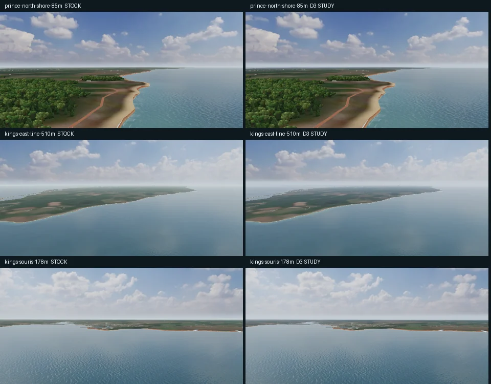

# Daylight haze and the sea horizon

**Standard flight:** choose East Point for a clear far-horizon comparison, or add `?departure=eastpoint&stockAerialPerspective` to see the original mist. Close scenery, terrain and flight controls stay the same. This is not real weather or a model of current visibility.

## What changes

The stock shaders approach a fixed mist colour, even where the sky and the ocean meet a different colour in the same direction. The study integrates molecular and aerosol density along each distant sightline, from camera height to surface height. It shares an approximation of the existing panorama’s horizon colours across the participating surface and sky shaders. For far, nearly horizontal ocean sightlines it gently biases reflections toward the same horizon colour. It leaves nearby waves intact and does not add textures, meshes or draw passes.

The surface blend starts at 2.2 km and reaches full strength at 7.2 km. The sky change is limited to roughly 1.4° from the horizon. Buildings, roads, trees and aircraft keep their existing shaders. This is a flat-world clear-day approximation; it does not model geographic weather, spherical-air paths, or multiple scattering.

The [Hillaire atmosphere paper](https://sebh.github.io/publications/egsr2020.pdf) informs the separation of transmittance and in-scattering. The unchanged [CC0 Poly Haven sky](https://polyhaven.com/a/kloofendal_48d_partly_cloudy_puresky) is the only visual reference for this calibration.

## Render checks

Matched full-game WebGL captures held camera, light, scenery tiles and geometry fixed. Channels below are 8-bit output values. We measured pure sky and pure open water separately from land and mixed pixels.

| View | Stock median / p90 | Study median / p90 |
| --- | ---: | ---: |
| Prince North Shore, 85 m above sea level, 113 columns | 3 / 3 | 0 / 3 |
| East Point, 510 m above sea level, 76 columns | 5 / 6 | 0 / 1 |

In the North Shore check the largest median step anywhere in the eight-row horizon band fell from 15 to 12 codes; the study did not simply remove the gradient below the horizon or flatten the reflections. A reciprocal-heading test at 470 m also reduced the horizon step in both directions. All 210,100 close, downward-looking Breadalbane pixels and 29,233 qualified near-water pixels were exact matches. The four matched full-game captures had the same draw and triangle counts with and without the study. These counts are not a frame-rate benchmark.

## Activation and fallback

In Standard, the existing sky file is fetched once, hash-checked and decoded from those same bytes. The study waits for both the main and distant horizon shaders. New terrain tiles inherit the same gain; they do not fade into a different atmosphere. If the optional check fails, the viewer tries the original sky loader and leaves the effect off. Detail and the explicit stock comparison do not load the optics module. The separate building-shadow and imagery-seam reviews keep their previous baselines unless `aerialPerspectiveStudy` is explicitly selected. Use `&diagnostics` and inspect `window.islandAirDiagnostics.aerialPerspective` to check whether it armed.

In the original compiled study, East Point flights with optics off and on each travelled over 500 m, switched to Cockpit and paused without layer warnings. Each fetched the original sky once. The Detail control loaded no study module. Returning a same-length file with the wrong hash on the first request triggered the stock loader and left the study disarmed. The 311-test suite, TypeScript and Vite build, and world provenance check all passed.

## Standard flight acceptance

In compiled East Point flights, Standard, explicit stock, and Detail each
fetched the bundled sky once. Only Standard loaded the separately compiled
optics module. Corrupt sky bytes and an intentionally stalled optics module
leave the optics off without stopping ordinary flight. All five configurations
moved more than 100 m, entered Cockpit, and paused without layer warnings.

New locked 600 × 395 captures reduced the largest median adjacent-row
RGB step near the open-water horizon from 21 to 17 codes on the Prince
north shore and from 13 to 8 at East Point. The close Queens view's
237,000 pixels were identical. Each pair had exactly the same draw and
triangle counts and restored the active frame byte-for-byte.
[Scope receipt](aerial-standard-scope.json) ·
[Visual replay](../../tools/qa/aerial-standard-frames.py) ·
[Flight and fallback check](../../tools/qa/aerial-standard-flight.py).
