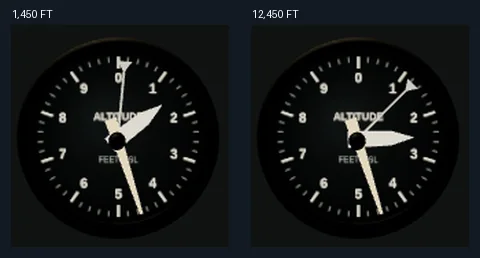

# Three-hand cockpit altitude display

The old single needle repeated every thousand feet. The altimeter now has
separate original hands for hundreds, thousands and tens of thousands.
The long hand sweeps once each 1,000 ft, the wider short hand once each
10,000 ft, and the thin tip with a triangle once each 100,000 ft. The
layout follows the general three-pointer arrangement documented in the
[FAA Pilot’s Handbook, chapter 8](https://www.faa.gov/sites/faa.gov/files/regulations_policies/handbooks_manuals/aviation/phak/10_phak_ch8.pdf);
no manufacturer panel artwork was used.

The dial reads the simulator's geometric altitude above mean sea level;
it does not implement pressure settings, pitot-static errors, or training
instrumentation. The panel and seated camera, airspeed, throttle and
vertical-speed gauges are otherwise unchanged.

`npm run check` covers negative elevation and threshold crossings.
Use `tools/qa/altimeter-views.py` on the dev server to reproduce pointer
angles and real Three.js captures at 0, 999, 1,000, 1,450 and 12,450 ft.
These are fixed fixture inputs, not claims about the aircraft's ceiling.
