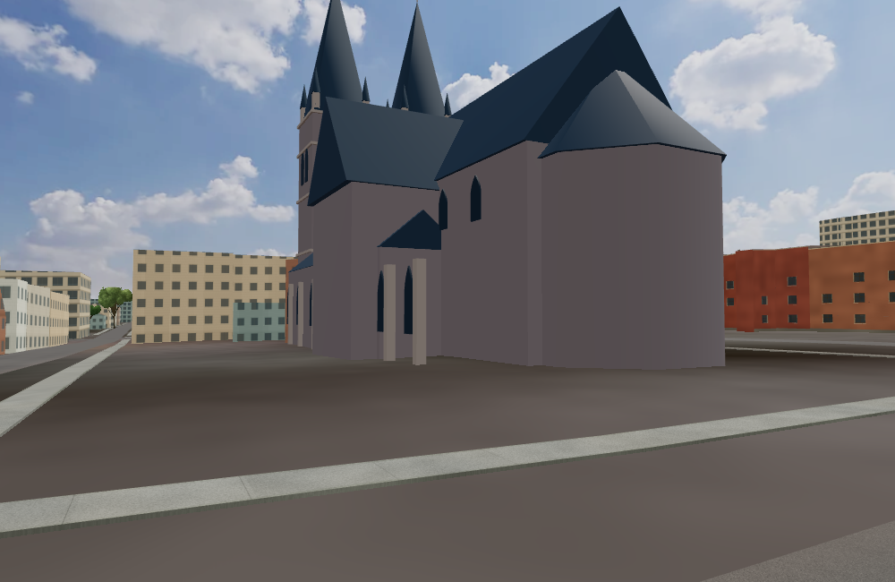
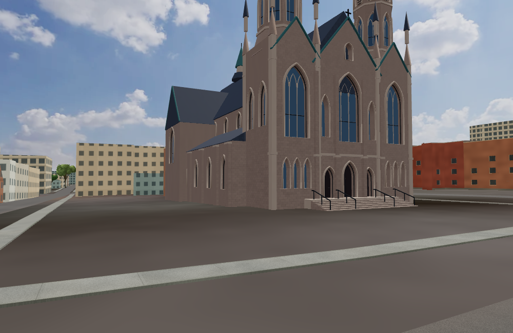

# St. Dunstan’s Basilica: Great George Street frontage study

The previous game model presented its rounded sanctuary end to Great George Street. The actual church presents its three main entrances and twin towers to the street. This optional Three.js frontage study corrects that distinction without rotating the entire old model into a neighbouring building. The ordinary game keeps its original Basilica.

**Try it:** open the running game with `?departure=harbour-low&basilicaExteriorStudy`. Begin the **Charlottetown waterfront · low pass** and look toward the twin steeples downtown. The existing **Charlottetown Harbour** departure also works (`?departure=charlottetown&basilicaExteriorStudy`). These are flight starts, not the fixed street camera below. For the original model at the same location, append `&stockBasilicaExterior`, or remove the study flag. There is no new departure or checkbox.

**Original, looking from Great George Street:**



**Frontage study, same camera and light:**



## What changed

The entry has three separate oak-coloured doors behind pointed arches, six stair treads with rails, a large pointed central window and paired tower bays. The game retains distinct nave, side arms and rear volumes; these are not a verified reconstruction of the apse. The original shaders distinguish rough sandstone from smoother dressed trim, slates from sheet-covered spires, and localized patina from the rest of the roof. They do not sample photographs.

The new group has **30,931 triangles in nine material batches**; the old has **6,500 in five**. Both maintain the same game anchor and both old summit heights (50.05 m above that anchor). The stairs meet the existing rendered terrain; no ground, collision, roadway or neighbouring building was changed. The comparison is about the rendering, not device frame rate or real-world height.

To see the paired towers cast a shadow across the court and onto the pavement, add `&basilicaYardSun`. This [separate ground-lighting study](basilica-yard-sun.md) keeps the architecture unchanged.

## What the evidence supports

- Separate rays through the actual opaque meshes resolve **three street-facing doors** and none on the rear, compared with zero on the old street face. The outer stair edge is 6.0–8.6 cm above the existing game ground along its width. The new footprint clears all 48 surrounding original building records and the mapped roads, walks and parking. [Geometry and contact checks](basilica-exterior/independent-geometry.json).
- Dated photographs checked separately after the artwork was frozen support the grouping of the street windows, entrances and paired skyline. They also show **figurative stone carvings around the doors that this model does not reproduce**. The waterfront view also shows a taller, more prominent secondary crossing steeple with an open-looking drum: **the small crossing cap in the study understates it**. The rear, sacristy dimensions, precise tower profiles, ornamental details and exact historic finishes are not established by these comparisons. [Independent appearance review](basilica-exterior/independent-appearance.json) · [Design references and limits](basilica-exterior/sources.md).
- A separate attempt to validate dimensions from federal 2020 LiDAR did **not** qualify: only one acquisition line covered the registered areas, and the opposite tower lacked independent held-out samples. No surveyed church elevation was read or used for this model. This is an authored architectural study, not a measured reconstruction.

## Running the checks

The study only admits a compatible Standard scene, the original terrain and cover, and the known dry regular ground receiver. A missing study module, altered receiver, incompatible relief profile or explicit stock override leaves the old model visible. With `&diagnostics`, `window.islandAirDiagnostics.basilicaExterior` reports `authored` or `stock`. [Fixed renderer comparisons](basilica-exterior/locked-frames.json) · [Compiled player and fallback cases](basilica-exterior/player.json).

From a checkout with `npm ci`, `npm run check` runs the suite. The [compiled browser replay](../../tools/qa/basilica-exterior/player.py) takes a production `dist` directory, a Chromium executable and an output directory; it needs Python Playwright. To export the actual old and new drawn triangle positions in game coordinates:

```sh
node --experimental-strip-types tools/qa/basilica-exterior/emit-appearance-envelope.mjs . /tmp/pei-basilica-stock current-game-ground stock
node --experimental-strip-types tools/qa/basilica-exterior/emit-appearance-envelope.mjs . /tmp/pei-basilica-study current-game-ground candidate
```

Each directory contains per-batch roles and hashes in `geometry.json` and Float64 world-space triangles in `world-triangles.f64le`. This is a geometry extractor, not a material or photograph comparison.
