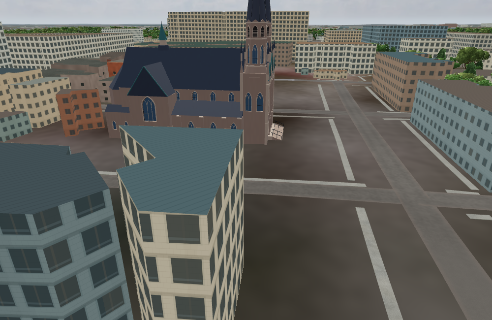
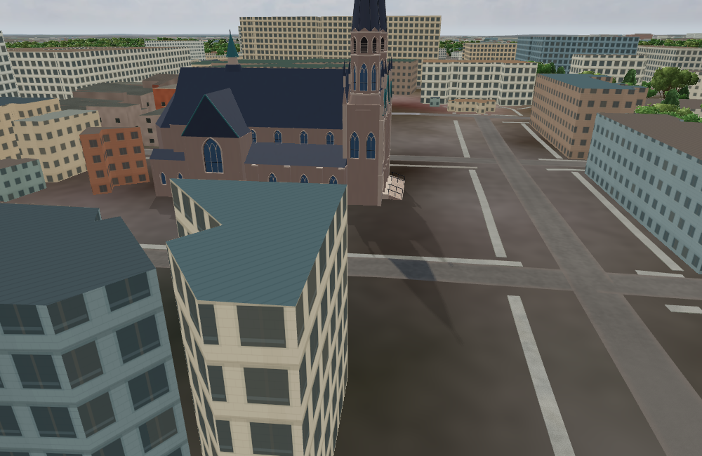

# St. Dunstan’s: daylight across the court and street

Fly near the [Great George Street frontage](basilica-exterior.md) in Charlottetown with `?departure=harbour-low&basilicaExteriorStudy&basilicaYardSun`. Look for the paired spires’ shadows continuing from the court across the sidewalk and street. The departure is an approach to the city, not the fixed camera used below. Add `&stockBasilicaSun` to compare the same building **without** its yard shadow. Neither the ordinary flight nor the frontage option alone enables this study.

**Yard shadow off.** Original frontage and ordinary scene lighting:



**Yard shadow on.** Same camera and building, with the shadow following each ground surface:



## What casts and what receives

The source is the game’s existing 30,931-triangle church, including its opaque window inserts. The fixed game sun illuminates it from the same direction used by the street. A local depth map records where the church blocks that light. The receiver uses its own final 3D position: the street here rises about 0.81 m above the terrain, and the sidewalk top is about 8 cm above it. Using terrain height for all three would put the shadow on the wrong side of some edges.

Only the **direct** light on the local terrain, street ribbon and sidewalk is reduced. The church itself, neighboring buildings, ambient and sky light, fog, vegetation, water and flight collision stay as before. This does not simulate colored light through glazing, a date-specific real shadow or a surveyed church. The [frontage study’s architectural limitations](basilica-exterior.md#what-the-evidence-supports) still apply.

## Checks and rendering cost

- Source verification rebuilds all nine original mesh batches and the light projection from the gameplay code. On 47,662 eligible open-ground points, a hard center-ray check found 2,790 true hits, six extra hits and six misses. The edge softening is an approximation, not exact sunlight transport. [Rebuilt source contract](basilica-yard-sun/source-contract.json) · [Independent geometric and mounted-depth tests](basilica-yard-sun/independent-ground.json).
- A fully streamed 1,000 × 650 comparison, holding the scene still, found **12,918** pixels more than two RGB levels darker, none brighter. Each surface also showed its own signal when switched alone: 11,002 pixels on terrain, 1,557 on roadway and 485 on sidewalk. (These counts should not be added across anti-aliased boundaries.) The final yard-only build matched all seven independently captured source-check images and the raw depth buffer byte for byte. The ordinary rendered scene stayed at **198 draws and 591,020 triangles** in both states. The local program added one fragment texture sampler per receiver (terrain 5→6, road 5→6, sidewalk 0→1). [Independent receiver checks](basilica-yard-sun/independent-views.json) · [Final matched frames](basilica-yard-sun/locked-frames.json).
- The extra work is not free: creating the local depth map draws the nine original batches once per allocation. Its 1,024 × 1,024 16-bit depth and 8-bit color attachments total **3 MiB** before driver overhead. There is no downloaded shadow image. These are workload measurements, not a frame-rate result.
- Only a compatible nearby Standard scene with all three original receivers gets the effect. Missing or changed inputs, an incompatible active direct light or an insufficient device leave the old lighting. The effect fades with distance and height. With `&diagnostics`, `window.islandAirDiagnostics.basilicaSun?.yard` indicates whether the three receivers are active. [Compiled player and fallback cases](basilica-yard-sun/player.json).

The [native WebGL replay](../../tools/qa/basilica-yard-sun/independent/native.py) captures the original per-receiver draws, and the [compiled player replay](../../tools/qa/basilica-yard-sun/player.py) exercises the off and missing-module paths. Both need a Chromium executable and Python Playwright; the native replay also uses NumPy and Pillow. The [low-angle finite-sun witness](basilica-yard-sun/low-finite-sun-witness.json) records the independently verified shadow edge.

Run the [source verifier](../../tools/qa/basilica-yard-sun/verify-source.mjs) after `npm ci`:

```sh
node --experimental-strip-types tools/qa/basilica-yard-sun/verify-source.mjs . /tmp/basilica-yard-source.json
cmp /tmp/basilica-yard-source.json docs/qa/basilica-yard-sun/source-contract.json
```
