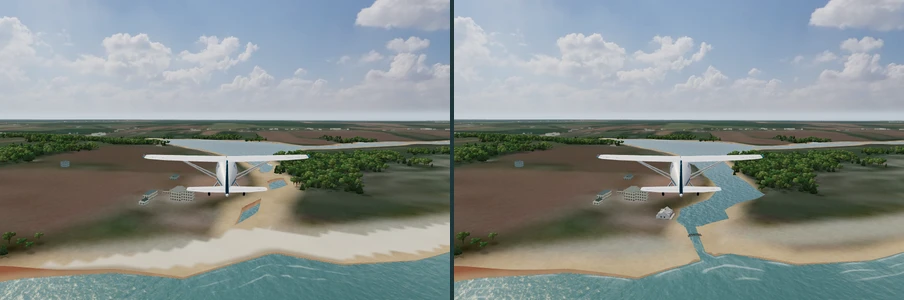
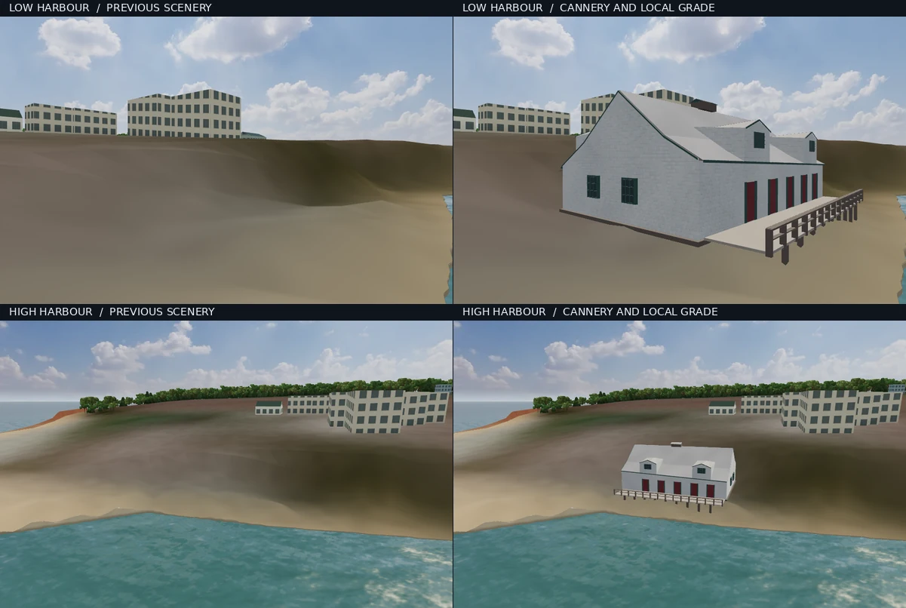

# Basin Head Cannery: measured exterior

Choose **Basin Head · low pass** in Dispatch and select **Open inlet preview**
to load the surveyed banks, historic Cannery and footbridge. The equivalent
URL uses `?departure=basin-head-low&basinChannel`. Select **Close inlet preview**
in Dispatch to return to the ordinary atlas while keeping the departure.
This is a separate coupled water-and-ground view, not a cosmetic switch
during flight. The preview uses the older inlet scenery profile; close
it before comparing other Standard routes. It does not add the separate outer wharf or reconstruct the
whole campus. In the normal atlas the inlet preview stays off.
The camera remains a flight-simulator view; there are no usable
interiors, walking routes, water-level changes or building collisions.

Two main gable planes and two lower eave flares use a [pinned PEI 2020
LiDAR crop](../../data/basin-cannery). The harbour-side roof kick, a
distinctive feature of the original, is drawn as real geometry. On 301
held-out source returns from clean east roof bands, a straight
single-plane interpretation gave **0.685 m** p90 absolute error,
versus **0.079 m** after fitting the kick. This compares surfaces
within the same survey. The frame envelope is from OpenStreetMap,
not an authoritative floor-area figure. Dormer window geometry and
trim are authored; their extent is informed by raised native returns.
The National Trust and Canadian Register source notes explain the
pale roof, dark green trim, five red waterside doors, and pile-built
character without claiming the current condition.

The previous simulated land surface buried the lower western wall.
A small v2 bank extension takes only the local measured native dry
grade with an inherited transition. At the worst checked location
the old game surface was 5.73 m, the native 1 m source was 0.198 m
and the corrected close surface was 0.313 m, including the game's
standard ground offset. All tested land/water classifications and
wet contact heights were identical, and the existing footbridge's
checked geometry and contact supports remained unchanged. The apron
is a documented interior portion of the longer mapped wharf, not its
true retaining edge. Its displayed level sits above the measured
surface by the existing renderer lift plus a narrow seating clearance.



The [ordinary flight replay](basin-inlet-current-flight.json) matched
position, altitude and heading at three points in the same departure.
It checks both inlet structures and leaves the outer wharf absent; it
does not assert matching terrain contact or optics between the views.


The [actual scene gate](basin-head-cannery-render-gate.json) records both
harbour angles and an unchanged 585,600-pixel East Point control. The
[local grade checks](basin-head-cannery-grade-gate.json) separately
cover native support, unchanged water, and the nearby bridge.

The original v1 native pack is retained for already-cached player code.
The updated optional preview authenticates a versioned v2 pack. A
missing or failed v2 package retains the earlier base terrain rather
than rendering newly carved water with wrong banks.
`?basinChannel&noBasinCannery` can hide the model in the updated game;
it retains the corrected grade, so it is a model-only comparison.

The [separate outer wharf preview](basin-head-outer-wharf.md) uses its
own surveyed crop and flag. It does not change the Cannery comparison.

## Replay

```sh
python tools/geodata/bake-basin-cannery.py --out /tmp/basin-cannery.generated.ts
/usr/bin/python3 tools/terrain/bake-basin-bank-terrain.py --world public/world \
  --channel-bake /tmp/pei-basin --out /tmp/pei-basin
npm run check
python tools/qa/basin-cannery-frames.py --checkout . --chromium /path/to/chromium \
  --out /tmp/pei-cannery --size 960x610
```
