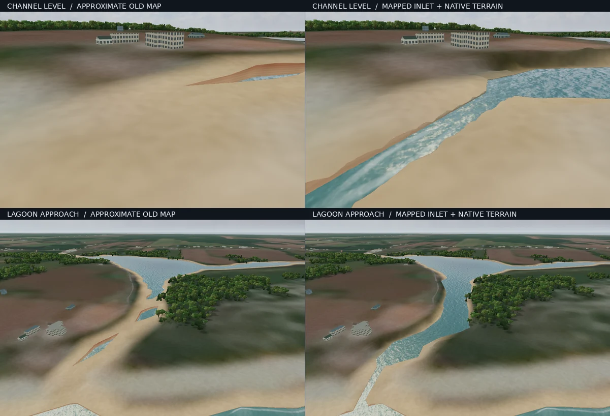

# Basin Head: the Run, measured preview

Append `?basinChannel` to the simulator address to see the narrow tidal
entrance connecting Basin Head's lagoon to the sea. The default map is
unchanged. This is scenery, not a navigation or bathymetry product.
The footbridge is not part of this pass.

[Tourism PEI](https://www.tourismpei.com/what-to-do/beaches-parks/basin-head-provincial-park)
and the [federal management plan](https://www.dfo-mpo.gc.ca/oceans/publications/basinhead-management-gestion-2021-2026/index-eng.html)
document the entrance. The old 47 m raster incorrectly showed the
whole mapped footbridge line as dry land. The new version uses a pinned,
[attributed and reproducible derivative of OpenStreetMap's bank lines](../../data/odbl/basin-head-channel)
and changes only covered water classification inside this analysis.
The inset adds a connected wet area at the inlet. It does not bring any
prior wet sample onto land; it keeps the original dry-side scalar used
by grass, forest and cliff materials. No tide or current is simulated.

A second package reshapes only the small native bank envelope against
the [NRCan 1 m terrain mosaic](https://open.canada.ca/data/en/dataset/0fe65119-e96e-4a57-8bfe-9d9245fba06b).
The visible close grid is approximately 4 m, not the original 1 m.
Heights are centimetre deltas from the exact previous visible surface.
The new channel stays on the simulator's old sea plane. At close range,
dry contact matches the visible surface in the fully surveyed core;
the collar smoothly returns to the old gameplay grade and can still
retain some older visual/contact differences. The original medium and
far terrain surfaces are kept. Near this particular terrain tile the
inlet preview takes priority over the experimental province-wide relief.
Both inlet packages must pass verification against the exact base inputs,
or the earlier scene is kept. The regular sand material is independent.

## Checked evidence

On 6,643 dry native 1 m positions not used in the fitting kernel in the
high-authority core, the p90 absolute height error fell from 5.136 m
to 0.587 m. Both are from the same survey, not an independent resurvey.
The worst previous wall in the checked area went from 7.662 m to
0.173 m in the actual mesh at identical plan coordinates; a real higher
headland still exists elsewhere. In source-aligned tests all 27,001 road
cross-section and all 14,254 nearby footprint contact probes agreed
with the prior version. The land and sea use the same continuous
field and the scoped optics retain some outer swell. They are not a
claim about the exact current tide or condition of the wharf.
The [matched scene gate](basin-head-channel-render-gate.json) includes
actual close and aerial views, plus a long view from East Point. There,
453,585 pixels were identical, with 15 changes on the distant Basin Head
shore. The close frame adds 58,754 submitted triangles without adding
a draw; this is not a frame-rate guarantee.



## Rebuild and render

```sh
/usr/bin/python3 tools/geodata/bake-basin-head-channel.py --world public/world \
  --osm-pbf /path/to/prince-edward-island-261101.osm.pbf --out /tmp/pei-basin
/usr/bin/python3 tools/terrain/bake-basin-bank-terrain.py --world public/world \
  --channel-bake /tmp/pei-basin --out /tmp/pei-basin
npm run check
python tools/qa/basin-channel-frames.py --checkout . --chromium /path/to/chromium \
  --out /tmp/pei-basin-frames --size 840x540
```
