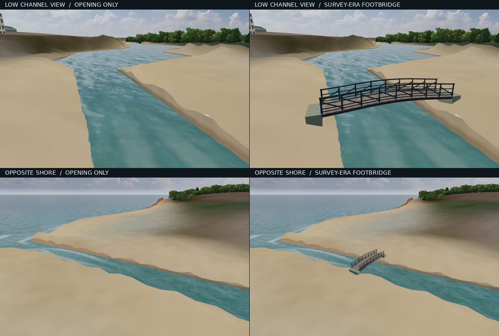

# Basin Head park footbridge

The optional `?basinChannel` scene now includes the small arched crossing
over the Run. The visible deck is approximately 10.35 m in the source
reference system. The longer 21.25 m OpenStreetMap way includes approach
sections and is **not** a bridge-length measurement.

The arched profile and offset frame use the [PEI 2020
CanElevation LiDAR window](../../data/basin-footbridge). The dark open
bracing and seated approach caps are original work informed by a dated
[2012 site photograph by Stefan Krasowski](https://commons.wikimedia.org/wiki/File:Prince_Edward_Island_012_(7893580732).jpg).
Railing and deck-board dimensions are authored. This is a survey-era
exterior, not an as-built or current condition claim. It does not
add a walking route, aircraft collision surface, tide or navigation
feature. The original terrain and both water appearance and flight
contact are unchanged by the model.



## Checked geometry

- 174 native deck-class returns were found; 172 were inside the fit
  selection. In the actual mesh the 34 held-out points that hit exposed
  boards gave 0.031 m p90 and 0.045 m maximum absolute height error.
  Two of the 36 held-outs were outside the authored width. Of the full
  172, five hit realistic board gaps and eight fell outside the width;
  they are not counted as measured exposed-top hits.
- All 4,446 tested cap contacts stayed dry and met the visible bank
  without a float gap. If either cap cannot be placed within the validated
  dry surface, the optional model stays absent.
- Four local draws and 4,968 submitted triangles are added. No near
  model is submitted outside its 3 km display range.
- `?basinChannel&noBasinFootbridge` provides the original inlet view.
  The same genuinely installed inlet is used in the before/after shots.
The [matched-browser gate](basin-head-footbridge-render-gate.json) shows
no pixel changes beyond the model and its two-pixel raster allowance in
either direction. At East Point all 492,800 pixels, draws and triangle
counts matched exactly.

Reproduce the native fit from the pinned range window (Python with
NumPy, laspy/lazrs, and GDAL CLI) and run the actual rendered comparison:

```sh
python tools/geodata/bake-basin-footbridge.py --generated /tmp/basin-footbridge.generated.ts
npm run check
python tools/qa/basin-crossing-frames.py --checkout . --chromium /path/to/chromium \
  --out /tmp/pei-basin-footbridge --size 880x560
```
