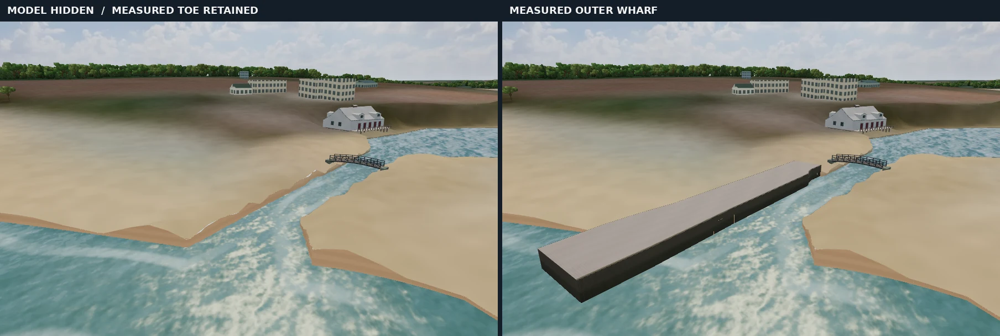

# Basin Head: measured outer wharf

Use `?basinChannel&basinWharf` to see a **47.1 m** surveyed section of the
older outer wharf. This is not the entire waterfront or a reconstruction of
the present-day works. Neither the default atlas nor earlier Basin preview
changes unless the new option is present and the pinned inlet and bank load.
The wharf has no walking route, collider or tide simulation.

Thirteen cross-sections follow the 2020 native returns. The top uses timber
seams, joints and fine grain, and the east wall is a separate enclosed timber
face. It has a small coping allowance to fit the modeled shoreline. The
frontage ends just below the existing scene sea level for coverage; no
foundation depth is inferred. No claims are made about closed versus public
access. [Source notes and pins](../../data/basin-wharf).

The narrow water-side toe distinguishes the shelf from the lower observed
surface. None of the 171 observed points in the new toe were above the scene
sea level. An independent replay checked all 51,645 crop returns. The 12 points whose classification changes are class 2
returns from −0.667 to −0.562 m; no tested dry point above the scene sea plane
became water and no old water became land. No terrain elevation is changed.
A redundant sand-colored renderer curtain is skipped only where the view
actually intersects the fitted wharf face, and is kept at the cropped ends.
The underlying curtain remains at far range. The optional
`&noBasinWharf` switch retains the toe, not the timber model.

Across 383 spatially withheld deck returns the actual Three.js rays had
**0.033 m p90** height error after subtracting the renderer's 0.157 m seating
offset. Same-survey holdout measures the selected shelf, not a resurvey.
The regular plane, nearby footbridge, and Cannery are not altered.

The [scope measurements](basin-head-wharf-toe-gate.json) also keep 50,454
original exterior contour segments and 19,380 sampled inner bank contacts
unchanged. The [Three geometry gate](basin-head-wharf-geometry-gate.json)
records the 383 holdouts and zero occluding ground samples inside the
probed deck. In two local views, the [render gate](basin-head-wharf-render-gate.json)
found no new exposed background; it records remaining old pixels as well.


Both comparison panels retain the measured toe and use the same camera. The
[compiled startup and fallback gate](basin-head-wharf-fallback-gate.json)
also checks the default, both preview families together, the model-hidden
comparison, and a missing Basin bank package.

## Replay

```sh
python tools/geodata/bake-basin-wharf.py --out /tmp/pei-wharf
cmp /tmp/pei-wharf/basin-wharf.generated.ts src/render/basin-wharf.generated.ts
cmp /tmp/pei-wharf/basin-wharf-toe.generated.ts src/sim/basin-wharf-toe.generated.ts
npm run check
python tools/qa/basin-wharf-fallback.py --dist dist --chromium /path/to/chromium \
  --out /tmp/pei-wharf-fallback.json
python tools/qa/basin-wharf-frames.py --checkout . --chromium /path/to/chromium \
  --out /tmp/pei-wharf-frames --size 900x570
```

The source fit needs NumPy, laspy with lazrs, GDAL's `gdaltransform`, and
HTTPS byte ranges if not using a cached exact `--source-npz` crop.
