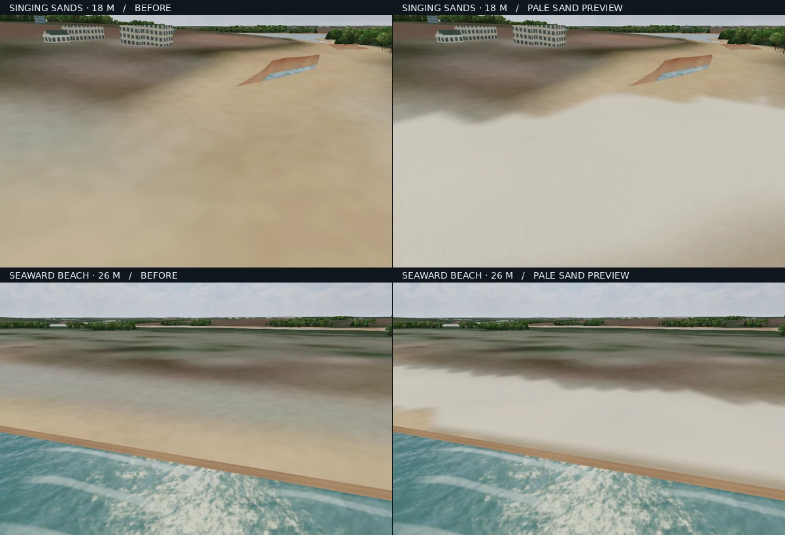

# Basin Head: a pale sand material preview

Add `?basinSand` to the simulator address (or `&basinSand` when a query
already exists). This changes the appearance of the documented
ocean-facing Singing Sands beach, not the lagoon, coastline, bay depth,
terrain geometry, or aircraft contact.

[Tourism PEI](https://www.tourismpei.com/what-to-do/beaches-parks/basin-head-provincial-park)
documents the area's pale silica sand, and [Fisheries and Oceans Canada's
management plan](https://www.dfo-mpo.gc.ca/oceans/publications/basinhead-management-gestion-2021-2026/index-eng.html)
distinguishes the ocean-side beach from its protected dunes and lagoon.
The limited application mask uses the [ESA WorldCover 2021 v200
bare/sparse class](https://doi.org/10.5281/zenodo.7254221), an approximate
10 m land-cover observation, not the current surveyed edge of the beach.
The asset derives from the pinned N45W063 product already credited for
province ground-cover inputs (© ESA WorldCover project 2021, modified
Copernicus Sentinel data 2021; [CC BY 4.0](https://creativecommons.org/licenses/by/4.0/)).
The original field that determines dry land remains authoritative.

The pale/damp values are original art, not a sampled reflectance
measurement. Microtexture is relative luminance, normal relief and AO
derived from [Aerial Beach 01 by Rob Tuytel](https://polyhaven.com/a/aerial_beach_01),
[CC0](https://creativecommons.org/publicdomain/zero/1.0/). Its source RGB
hue is not transferred. It is a generic physical sand scan, not a PEI
site photograph. The sand still follows the pre-existing terrain.

## Scope and checks

The material requires both checksum-verified assets (a 2 KiB mask and
approximately 411 KiB scan), and is not fetched without the preview
flag. An absent or corrupt operand leaves the entire original material in
place. The preview uses the existing ground draws; it adds no geometry.
The near shader feathers inside the 2,379 admitted source cells and
forces exactly zero at their continuous exterior. It does not color
nearby grass or water just because a texture filter spans them.
Distant colour fades to the base.
The [matched game gate](basin-head-sand-render-gate.json) measured
294,275 and 131,522 pixels changing by more than two RGB levels in
the two close views, no difference in the upper 150 rows, and all
453,600 pixels exact in each distant and East Point control. Draw,
triangle and loaded imagery counts were identical across each pair.



Run the matched application shots with a Chromium install plus Python
Playwright, Pillow and NumPy:

```sh
python tools/qa/basin-sand-frames.py --checkout . --chromium /path/to/chromium \
  --out /tmp/pei-basin-sand --size 840x540
npm run check
```
