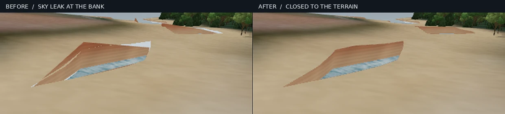

# Basin Head: close-range shore closure

At the simulator's existing Basin Head channel, the near camera could see
sky through breaks between the land, water and vertical bank. Part of the
old bank also rose above the actual rendered land. This is a renderer repair
at one site, not a resurvey of the inlet or a change to tide, elevations,
terrain, the land/water field, or flight contact. The underlying shoreline
can still look angular because the base shoreline source is comparatively
coarse.

The repair replaces 34 existing shore arcs only when the local tile is using
the 112-interval terrain. It follows the zero contour of the **same**
bilinearly sampled signed coast texture, then seats the bank against the
actual terrain triangles. The four connections to the untouched shore use
the original endpoint heights. Medium and far views restore the original
mesh batches, unchanged. The bank is enabled normally; `?noBasinBank`
is the original-bank comparison control.

## Verification

The [independent geometry gate](basin-head-shore-geometry-gate.json)
tests the actual Three.js meshes and a fixed camera at Basin Head:

| Check | Original | Seated near bank |
| --- | ---: | ---: |
| Sight rays with no local surface, out of 912 | 43 | 0 |
| Largest visible bank overhang above nearby terrain | 2.127 m | 0.032 m |
| Local ground/water contacts in the same game scene | baseline | all 272 identical |

The fitted bank stayed at least 2.9 mm above the rendered terrain in
5,058 checks at actual mesh edges, original-grid diagonals, and segment
endpoints. All four old handoffs matched within Float32 precision
(0.00027 mm). This is numerical agreement with the game, not survey
accuracy. Two terrain-batch owners are reused when switching near to
medium and back. The near repair replaces 68 faces with 5,010 and adds one
draw in the close camera; far mode restores the original batches.
The [matched rendered proof](basin-head-shore-render-gate.json) changed
4,698 of 459,000 pixels at Basin Head; the other 454,302 remained exact.
All 459,000 RGB pixels, draw counts and triangle counts matched at the
East Point control.



```sh
npm run check
python tools/qa/basin-bank-frames.py --checkout . --chromium /path/to/chromium \
  --out /tmp/pei-basin-head --size 850x540
```
