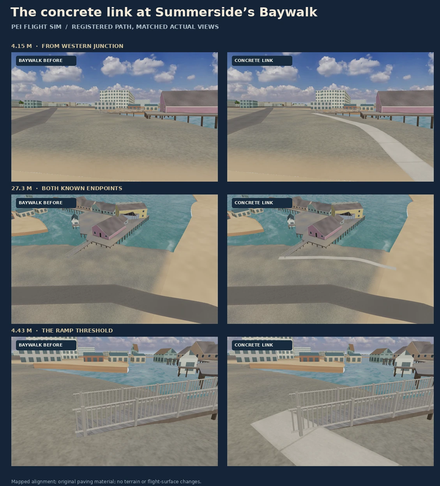

# Summerside’s short concrete Baywalk approach

With `?spinnakersPreview&northBaywalkPreview&baywalkConcrete`, the ramp meets an actual mapped concrete sidewalk. The **36.73 m** westbound segment ends at its real junction with a second footway, with **1.58 m** of the existing eastward branch included only at the ramp throat. It does not depict the sidewalk past either endpoint.

The selected [OSM way 1461955022](../../data/odbl/spinnakers/north-concrete.json) is explicitly tagged as a concrete sidewalk. The scene uses its original mapped alignment. Width, paving joints and appearance are authored choices, not real engineering measurements. There is no kerb reconstruction, navigation guarantee or accessible-grade claim.

The path seats on the local surveyed court and then the exact submitted province facets toward the west. Its terminal position is on land already in the base atlas. In all three terrain tiers, the actual mesh has no wet hits or intersection with mapped parking, other stocked sidewalks, building envelopes or conservative road footprints in the audited window. Neither the existing ramp nor any terrain, water or flight-contact height changes. The [geometry check](baywalk-concrete-geometry.json) covers **4,232** real Three.js rays, all eight ramp-foot transverse points, and the retained stock-land tie-in. Run `node tools/qa/baywalk-concrete-feasibility.mjs` from the repository root to reproduce the seat test.

For a matched WebGL comparison, run `tools/qa/baywalk-court-frames.py` with `--mode court --views concrete-approach-close,concrete-court-close,concrete-threshold-close` and separate output folders, adding `--with-concrete` only to the candidate run.
