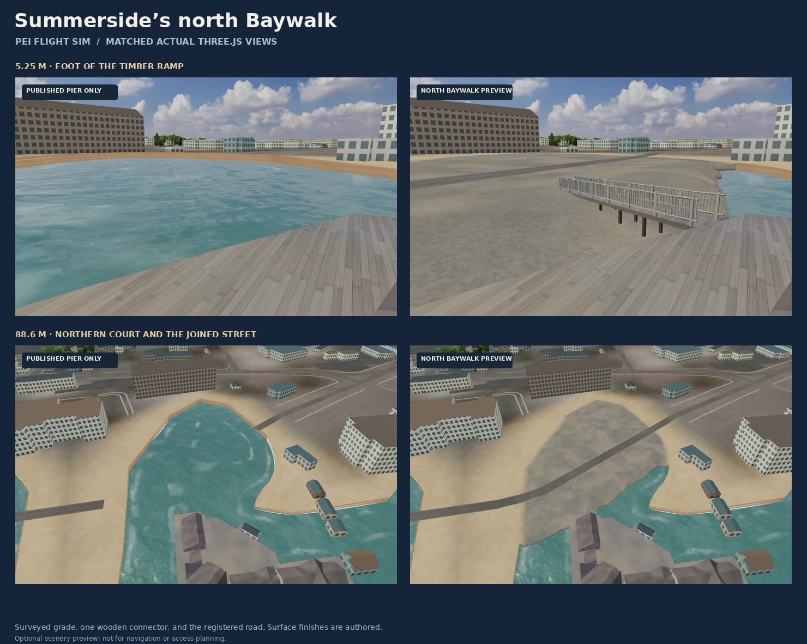

# Summerside’s north Baywalk

Enable the optional preview with `?spinnakersPreview&northBaywalkPreview`, then choose **Summerside waterfront · low pass**. Add `&shoreFoamDetail` to match the water optics in the comparison. The published Spinnakers’ Landing model still works independently. These flags do not change the default scene.



The stock mask put water where a real waterfront court and its street are located. This pass restores approximately **6,690 m²** in one connected source-supported pocket with a small retained wet margin. It joins the existing platform to a **roughly 12.6 m** timber approach and rejoins two segments of the registered paved NRN row at their existing widths. Low survey returns and source water remain wet. Surrounding buildings, unregistered paths and the rest of Summerside retain the previous scenery.

The 2020 NRCan point cloud, independent modern OpenStreetMap coast/linework, and the official trail's gross registration serve different purposes. See the [input receipt and licensing](../../data/baywalk) and [separate ODbL geometry](../../data/odbl/spinnakers/north-baywalk.json). The satellite tile shows water-coloured pixels in the restored parcel; the dry surface is an original neutral material, not a reconstruction of the present-day paving or lawn. Timber rails, beams and material are interpretations; ramp height and street alignment have direct survey support. The ordinary sea plane and other flight surfaces are unchanged. Not for navigation, access or construction.

## Check it locally

```sh
npm run check
node tools/qa/baywalk-early-feasibility.mjs
python tools/qa/baywalk-court-frames.py --out /tmp/baywalk-before --mode pier --with-foam
python tools/qa/baywalk-court-frames.py --out /tmp/baywalk-court --mode court --with-foam --pose-baseline /tmp/baywalk-before/results.json
python tools/qa/baywalk-court-frames.py --out /tmp/baywalk-fallback --mode corrupt --with-foam --pose-baseline /tmp/baywalk-before/results.json
```

The capture script uses Playwright and a local Chromium executable. Drivers can substitute a path with `--chromium`. It runs the real scene and samples the rendered WebGL canvas; only the camera and water time are held fixed for comparison. The [machine receipts](baywalk-court-gates.json) report actual Three.js geometry, ground contact, supported/unsupported field cases, corrupted local transfer, and matched captures. The plus- or minus-millimetre join checks describe the simulation, not engineering tolerances on the real site. Cloud compositor counts are not hardware FPS results.
