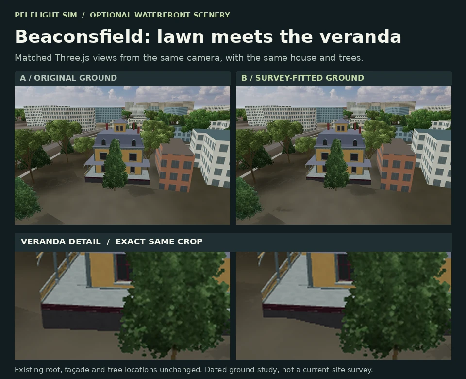

# Beaconsfield: ground contact at the veranda

Select **Beaconsfield exterior** in Optional scenery studies, or use `?beaconsfieldReview`. On a low approach to Charlottetown’s waterfront, the small rise where the lawn meets the house reduces the exposed plinth. To see the difference without swapping the building, add `&stockBeaconsfieldGrade`. The normal provincial map and the [original exterior model](beaconsfield-review.md) are unchanged. The west closure, exact landscaping, access routes and present-day trees are not recreated here.

**Where it passed:** eligible ground 5–11 m outside the footprint, and a smaller preselected, obstacle-clear north/west core immediately next to it. **Where it did not:** the whole immediate 0.75–5 m band failed its historical-height acceptance threshold. There is no qualifying east/south evidence for that immediate core, and no claim that the whole yard is now accurate.

| Original 2020 held survey shots / distinct 2.5 m cells | Median absolute error: original → revised | 90th percentile: original → revised | Result |
| --- | ---: | ---: | --- |
| Entire unblocked 0.75–5 m band: 329 / 71 | 0.540 → 0.364 m | 0.714 → 0.615 m | **Fail** |
| Preregistered obstacle-clear core within 0.75–5 m: 32 / 11 (15 north; 17 west) | 0.695 → 0.024 m | 0.775 → 0.033 m | Pass, limited to these north/west sites |
| Entire unblocked 5–11 m shoulder: 627 / 116 | 0.417 → 0.187 m | 0.590 → 0.422 m | Pass |

The statistics give each occupied 2.5 m cell equal weight. The independently held spatial blocks corroborate the accepted regions; the original and revised surfaces were identical at all 760 exterior observations over 145 cells (18–26 m). No bias was fitted from withheld heights. Separately, 4.165 continuous metres of the existing southwest veranda fascia meet the revised ground more closely without any red fascia clipping in the tests. That is a physical/visual contact check, **not** evidence of survey accuracy across the site. [Full independent ground results](beaconsfield-contact/independent-native.json) · [Actual mounted terrain/collision checks](beaconsfield-contact/mounted-numerical-scope.json).

### What was measured

The producer reads one **136 × 137** native-cell window from Natural Resources Canada’s [CanElevation 1 m bare-earth mosaic](https://datacube.services.geo.ca/pgstac/api/collections/hrdem-mosaic-1m/items/10_3-mosaic-1m). It compares those elevations with the actual, triangulated simulation ground at the existing q12000110/120 museum footprint. It does not move the building, replace its materials or translate a survey up to meet the art. Some present-day conditions may differ from the survey. The mosaic is not a floor, curb-height or basement survey.

The signed revision raises **1,445 ground vertices** by up to **0.87 m**. Near each real road, registered sidewalk, parking surface, neighboring building or existing tree root, both the height and its transition are constrained. Inside the building’s footprint, values complete the closed mesh; they are not measured indoor ground. The separately held original laser returns are not model inputs; the 1 m mosaic may nonetheless incorporate the same underlying survey. [Numeric source and clearance limits](beaconsfield-contact/source-design.json) · [rebuild the stamp](../../tools/geodata/beaconsfield-grade/README.md).

### What it changes in the renderer

The existing foliage, roots, silhouette and canopy texture stay in place. On the affected lawn, the relevant pieces of their original projected shade follow the actual raised ground. The other trees and the remainder of these same shade cards retain the original draw. The old above-ground/canopy assets are still the source of those trees; nothing here identifies specific living specimens.

Only the exact authenticated museum, current local terrain and matching vegetation roster qualify. The 2,408-byte grade stamp is fetched when the existing opt-in art is resident and close. Missing or incompatible data leave the original opt-in house and its old ground together. There is one extra local transparent draw; 3,243 positive ground triangles share the existing terrain draw. The old source faces remain in CPU geometry. In rendering, only the corrected surface is exposed in the interior; near subpixel edges the underlying old opaque depth prevents holes. No capture is a frame-rate claim for end-user graphics hardware. [Actual submitted geometry](beaconsfield-contact/submitted-geometry.json).

The collider follows the corrected visible surface wherever a triangle rises. A narrow continuous collar reconciles it with the simulation's original contact sampler. Not every physically adjusted point is visibly raised: the additional contact weights decay to zero by 2.00 m from a positive vertex at stored grid samples (conservative continuous bound 3.18 m including interpolation). Outside that collar the original dynamics remain in force.

### See the change in the game

A fixed veranda, west and harbour approach kept **17,828 / 1,426 / 1,044** pixel changes above 2/255. In all three cases the rest of the frame outside the projected affected surfaces and two-pixel anti-aliasing margin was byte-identical, including the old distant grass-shadow intersections. The temporary shadow toggle also checks that no light dotted seam or abrupt replica of a buried tree shadow remains. [Matched real renderer checks](beaconsfield-contact/independent-frames.json) · [Fringe and depth diagnostics](beaconsfield-contact/raster-fringe.json) · [Compiled flight and fallback checks](beaconsfield-contact/player.json) · [Run the independent checks](../../tools/qa/beaconsfield-contact/README.md).

The additional close terrain, stock-tree shade and local shade programs linked with six, two and one fragment texture units respectively in the reference WebGL2 run. The feature keeps the prior house/ground if its conservative sampler admission fails; synthetic low-cap tests are not a device benchmark. The earlier [exterior study](beaconsfield-review.md) still documents why the west façade is simplified.
