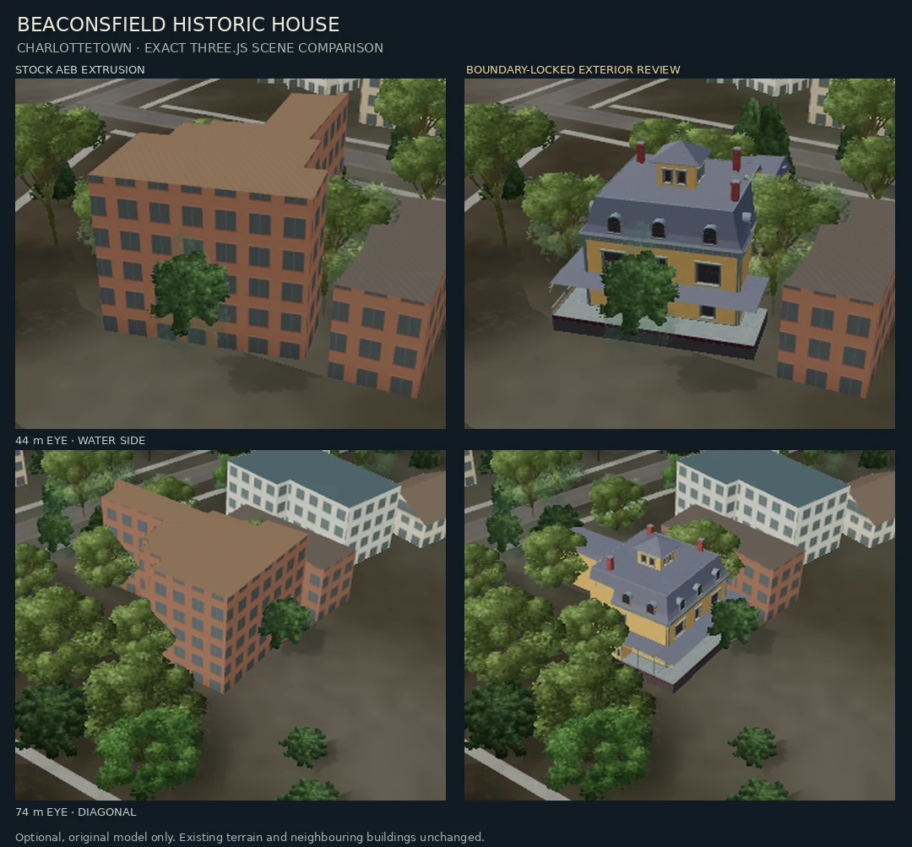

# Beaconsfield Historic House exterior study

This is an optional, one-building review at 2 Kent Street in Charlottetown.
Append `?beaconsfieldReview` to the flight simulator URL (or
`&beaconsfieldReview` if other options are set). The ordinary atlas remains
unchanged otherwise. The preview is also off when `buildingShadows` is
explicitly enabled. These original materials and the grouped exterior model
are a dated visual interpretation, not a conservation survey or an as-built
record of the house today.

## What is constrained

- The model replaces only feature 120 of the shipped AEB-derived building tile
  `q12000110`; the application checks both the atlas and exact compressed
  chunk digests, then the exact ordered 16-step footprint plus heights of
  that row. The ordinary tile mounts immediately; an exact shared-buffer index
  elides only that record when verified exterior
  geometry is ready. No photo or native point-cloud data ships in the pack.
- The [Canadian Register listing, 5116](https://www.historicplaces.ca/en/rep-reg/place-lieu.aspx?id=5116)
  describes the 1877 Second Empire exterior, mansard and verandah. The
  [Museum’s 2008 landscape study](https://www.peimuseum.ca/sites/www.peimuseum.ca/files/cca_bea_res_08.pdf)
  and dated independent exterior photographs ([Charles Hoffman, 2009](https://commons.wikimedia.org/wiki/File:Beaconsfield_House.jpg),
  [Joanne, 2026](https://www.joanne16.com/2026_07_11_archive.html))
  are visual/factual references. No photograph is used as a texture, mask or
  geometry donor. Differences across dates are not represented as verified
  present-day finishes.
- Registered local axes were cross-checked against the existing AEB,
  [OpenStreetMap contributors](https://www.openstreetmap.org/copyright),
  and [PEI independent footprint layer](https://gis.princeedwardisland.ca/server/rest/services/GeoLincData/Building_Footprints_2026/MapServer/0)
  record 139889. The local primary-axis bearing uses the corroborating OSM
  way [255413795](https://www.openstreetmap.org/way/255413795) (ODbL); no
  OSM footprint or side extension is substituted for the AEB outline. The
  provincial comparison overlaps 299.30 of the AEB's 305.21 m²; its metadata
  did not establish a survey date. The public civic point is not used as the
  geometry anchor.
- In the [NRCan 2020 classified LiDAR](https://canelevation-lidar-point-clouds.s3.ca-central-1.amazonaws.com/pointclouds_nuagespoints/PEI/Prince_Edward_Island_2020/pei_2020_389000_686000.copc.laz),
  selected class 6 returns give the relative crown, service and veranda
  planes in metres, then registered to CGVD2013. Leave 1 m spatial cells out
  of the fits, test actual indexed Three.js down rays, and keep deliberately
  scoped panel results distinct from an entire roof or ground accuracy claim.
  The lantern's four slopes and crown were retained; its original physical
  eave boundary is continued to the coherent low edge of the observed cap.
  An isolated high set west of the cap is not used to add roof volume.
- Lap siding, slate, physical dormer returns, glazing, veranda spindles and
  fretwork are original geometry/procedural materials. Outdoor stairs, grade,
  tree locations, shoreline, pavement, yards, interior and unverified exterior
  furnishings are not part of this model. Some unsupported roof edges are
  deliberately not extended beyond the owner plan.

## Actual geometry and limitations

All submitted triangles are losslessly baked from the original fitted/authored
model, clipped inward against the exact source plan. The image-date-supported
oxidized red skirt is limited to the veranda fascia. The neutral underside
below it is an **authored contact plinth**, not an assertion about the real
historic foundations. Existing near mesh ground at this site was about
0.73 m lower (median of the local comparison) than the dated 1 m DTM. The
below-ground model toe is supported, but the existing lawn/plaza height
difference remains visible. This is why the study is opt-in, and why no
grade, roads, navigation or flight settings change.

Selected actual roof-ray p90: main upper plane 0.078 m, service wing 0.055 m,
south veranda 0.051 m on 69 intersections (6 of 75 edge probes are omitted
because covered geometry is not rendered there), west veranda 0.035 m,
lantern crown 0.117 m across all 39 selected retained observations. Distinct
off-cap west cluster retained as three errors over 0.5 m. Panel selection is
not a claim at each building edge, chimney, window, dormer, or position
outside the accepted model. These 2020 labels can also include overlap,
eave edges and trees; they do not independently establish present conditions.

Packing is reproducible with
`node --experimental-strip-types tools/art/bake-beaconsfield.mjs --verify` on the
pinned repo Three.js version. Static art payload: 247,211 bytes gzip;
1,023,568 bytes decoded, 28,778 exact deduplicated model vertices and
17,076 submitted triangles in 15 batches. Bounded stream, SHA checks,
abort/fallback and typed buffer views replace any on-approach modeling or
clipping. Runtime uses no additional textures or aerial downloads.

## Integration checks

Two matched flight poses around 44 m and 74 m above ground were rendered
with the same terrain, streamed rows and camera. The independent geometry
envelope test found **1,119,919** unchanged surrounding RGB pixels. Stock
loads no optional art. Under the project subpath, a valid pinned response
adds the preview, and missing, corrupt or late responses retain the complete
stock tile. See the [compiled project-path receipt](beaconsfield-project-path.json).
Reproduce the project-relative smoke cases with
[`tools/qa/beaconsfield-project-path.py`](../../tools/qa/beaconsfield-project-path.py)
against a production build.
The preview preserves the neighboring row indices and their
attributes while removing the one original shell only after validation.

The west view from Kent Street exposes a simplified clipped closure.
Close façade replication, access and a general reconstruction of the grounds remain out of
scope. The optional [ground-contact revision](beaconsfield-contact.md) is much narrower: it adjusts only source-supported lawn beneath and immediately beside the existing model without moving the house. This is the reason for an explicit review switch, not a standard
map replacement.
