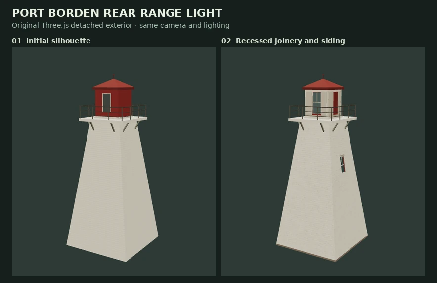

# Port Borden rear range light: detached exterior

The first original Three.js asset for the relocated 1917 tower uses a
tapered white timber shaft, a short braced gallery and a compact red-capped
lantern. The second pass adds a physical recess for the upper sash, a
small shed brow, framed lantern glazing and shutter, and softer variation
in the shingle finish. Both models use an illustrative **12.8 m overall**
height. The individual dimensions, colours and local face orientation
are artistic readings, not surveyed measurements.

The [standalone authoring workbench](../../tools/art/borden-rear-range-study/)
is for asset review, not part of the default world or flight download.
Close and reduced geometry use one opaque draw each: 740 and 500 triangles.
The added marks did not allocate a texture beyond the renderer's existing
material lookup. Three fixed Chromium software-rendered comparisons
change only the marked original art roles, retain exact raw alpha and
restore the earlier view; no FPS or live flight claim follows. See the
[native workbench receipt](borden-rear-range/native-workbench.json).

**Live map unchanged.** The current packaged extrusion blends the real tower
with lower structures on both sides of the park. The separate
[source and placement record](borden-rear-range/source-and-placement.md)
explains why none of that stock geometry was removed, and where dated
park photographs and the bounded original 2020 survey agree or disagree.
No photo files, raw point cloud, navigation light, lettering, ramp, park
furniture, or neighbouring building ships with this asset.
