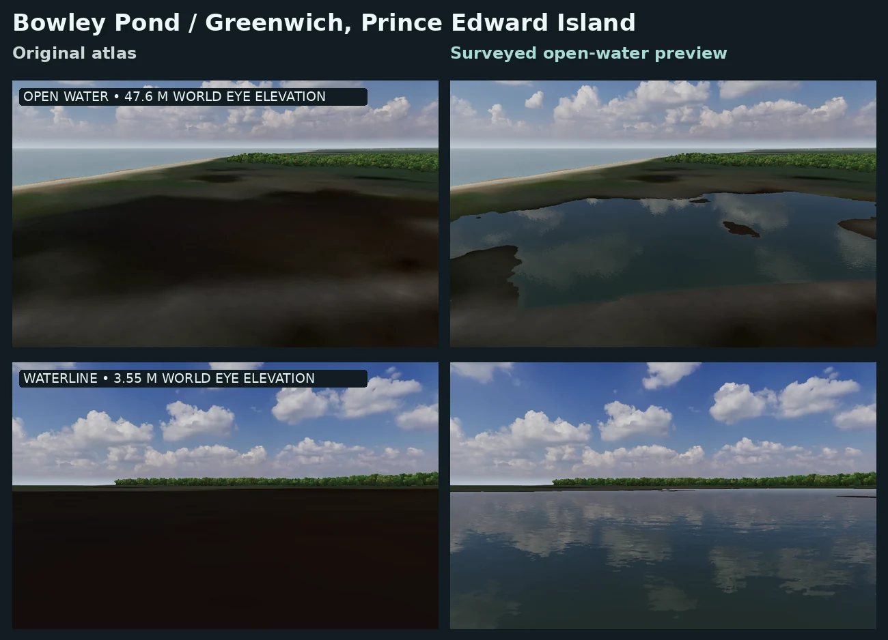
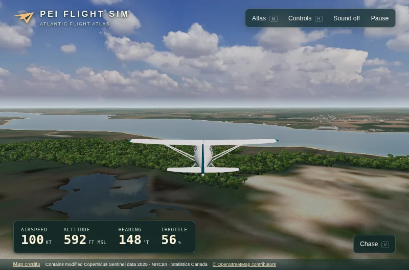
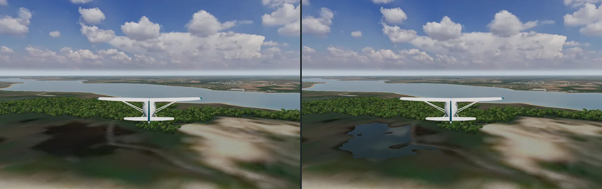

# Bowley Pond: surveyed open-water core

Standard now shows the strongest-supported open-water core near
`46.4484, −62.7083` in Greenwich, Kings County. It is ordinary local
geography, not a feature attached to one departure. Add `?stockBowleyPond`
(or `&stockBowleyPond` if you already have options) to compare the
original dry rendering. **Detailed Preview** and the historical explicit
`?bowleySurveyPreview` link still work. Standard leaves explicitly enabled
legacy terrain and building-shadow studies as they were.

The lake uses an independent **1.132 m CGVD2013** surface, not the ocean plane.
The packed signed field drives flight contact and which tree roots are omitted.
At the display edge, the land and water shaders test one pixel-centred ray at
that same level. The land only drops a fragment when the water pass will keep
its replacement, avoiding small clear-sky leaks between independently antialiased
edges. This changes neither flight contact nor the water-data footprint. A 3D
bank curtain follows the field and seats against the visible terrain at each
detail tier. The quiet ripples and reflections are authored scenery, not
measured wind or depth. The existing water pack is 49.5 kB; absent, corrupt, late,
or atlas-mismatched data keeps the original world.

## What the survey supports

The [source receipt](../../data/greenwich/bowley-water-source.json) pins four
[NRCan CanElevation LiDAR tiles](https://open.canada.ca/data/en/dataset/7069387e-9986-4297-9f55-0288e9676947)
from the **2020** airborne survey. A 51,017.5 m² native core met the return density
and dry-ground exclusions. The registered game mask covers about **4.9 hectares**
after inward safety reserves and exact texture-support checks. The primary class-9
water returns over the admitted patch had a 1.132 m median and 1.118–1.147 m
10th-to-90th percentile. Independent
[2023 ECCC Landsat water classification](https://open.canada.ca/data/en/dataset/62de5952-a5eb-4859-b086-22a8ba8024b8)
corroborates more than 99.9% of the original native core. Six Sentinel-2 scene
classification windows from 2023–2025 further corroborate water in the core.
Coarser classification never draws the fine contour. Contains information
licensed under the [Open Government Licence – Canada](https://open.canada.ca/en/open-government-licence-canada).
No third-party photographs, satellite band images, or OSM trail geometry are
included in this new asset.

Parks Canada [documents a floating boardwalk](https://parks.canada.ca/pn-np/pe/pei-ipe/activ/sentiers-trails/greenwich-dune);
[a field study records Hurricane Fiona damage in 2022](https://doi.org/10.1007/s11852-024-01050-5).
This update does **not** model the boardwalk, adjoining corridors, entire wetland,
seasonal water variation, post-storm anchor positions, or present-day shorelines.
Unqualified shallow/reed margins and separate wet pockets remain unchanged
rather than being filled from the broader wetland polygon. Do not use scenery
for navigation, trail access, or engineering.

## Reproduction

- [Source and portable extraction](../../tools/geodata/bake-bowley-survey.py):
  retrieve the four exact public COPCs from the receipt, preserving their official
  filenames. Put extracted observations outside the checkout. Run
  `bake-bowley-survey.py extract <copc-directory> <observations.npz>`, then
  `bake-bowley-survey.py bake <observations.npz> --verify`.
- [Fixed camera replay](../../tools/qa/bowley-frames.py): pass `--chromium` and
  `--out`. Run `--lock-stream` without the flag for a baseline, then repeat with
  `--lock <baseline/results.json> --extra bowleySurveyPreview --lock-stream`.
  The replay requires the same 12 fully streamed imagery tiles, fixed camera,
  and actual Three.js rendering. Add `--aperture-motion` to both runs and
  feed their output directories to [the aperture checker](../../tools/qa/bowley-aperture-check.py).
  It uses the real sky only as a temporary diagnostic and catches both fully
  exposed and partially resolved samples at each of five matched camera offsets.
  `--device-scale` and `--size` allow repeating the test at other raster sizes;
  match the viewport and scale across the pair.
- [Compiled flight replay](../../tools/qa/bowley-flight.py) covers normal
  departures, cockpit switch, pause, and a CRC fault with existing previews
  active. [Review measurements](bowley-review.json) distinguish visible scope,
  actual game contact, sample support and local triangle counts from hardware FPS.

## Fly to the pond

Choose **Greenwich Dunes · coastal pass** in Dispatch. This 177 m offshore
start crosses the dunes toward Bowley Pond. No preview toggle is needed. The dated core is not the entire pond or a
model of the boardwalk, wet margins, navigation conditions or present-day stage.

The [original flight check](bowley-coastal-pass-gate.json) flew about 600 m
under **Detailed Preview**. The image above is a normal in-flight capture.
The compiled [Standard replay](../../tools/bowley-standard-smoke.mjs) also
selects Greenwich from ordinary Dispatch, flies past the open-water core, and checks
that both explicit opt-out and corrupt data keep the original surface.
The existing 49.5 kB pack is requested once before world creation; a failed
or late request is not installed mid-flight.

At the same point about 615 m into the unchanged flight, the lower-left pond is
visible without enabling a preview. The [runtime receipt](bowley-standard/runtime-receipt.json)
records the original-view and corrupt-file controls. A separate close
dry-ground check confirmed the lake and the existing meadow material can
share their terrain tile. The legacy explicit preview keeps its original
whole-tile material guard.

Three 4× multisampled frames separately marked the visible old ground and
the new water and bank. All changed pixels were inside those measured
regions, alpha stayed unchanged, and restoring the water reproduced the
whole frame. The two near frames add two draws and 29,694 triangles.
The late off-screen camera changed no pixels. These are renderer counts,
not a hardware frame-rate estimate.
