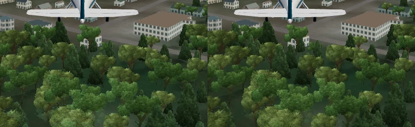

# Woodland edge compositing

Stock tree cards use alpha to choose which multisample pixels a branch or
leaf covers. That coverage was also written into the canvas alpha channel.
At some leaf and branch edges, the page background could then show
through instead of the opaque scenery behind the trees.

On the normal multisampled renderer, stock billboard crowns now replace
RGB only in their covered samples while keeping the destination alpha.
Their fragment coverage, per-sample depth, geometry, atlas, draw order and
ground shadows are unchanged. This is not a change to tree positions or a
new canopy model. It does not force the whole canvas opaque or change the
road, parking or path materials. The no-MSAA fallback, explicit branched
woodland and regional supplemental tree layers retain their prior blend
behavior.

## Verification

The [native frame receipt](canopy-coverage-alpha-gate.json) records eleven
matched Chase frames over O’Leary, Georgetown and Cavendish, at 1120 × 700
with 4× software multisampling. The comparison changed 2,797–48,161
alpha samples per resolved frame, with zero change to raw framebuffer RGB,
draw or triangle counts. Every frame restored the original measurements.
The browser’s final displayed image is intentionally different: in one
O’Leary view, 37,060 screenshot pixels changed, all within the affected
canvas-alpha footprint, and the entire restored screenshot was
byte-identical. Those checks are not hardware frame-rate estimates.

A separate native two-layer and depth probe ran 20 coverage and overlap
cases with zero and four samples. It confirmed the exact RGB replacement
and unchanged depth occlusion. The production renderer only uses the new
blend on an actual multisampled alpha framebuffer. Other legacy
materials may still write sub-opaque destination alpha, which this
change does not overwrite.
