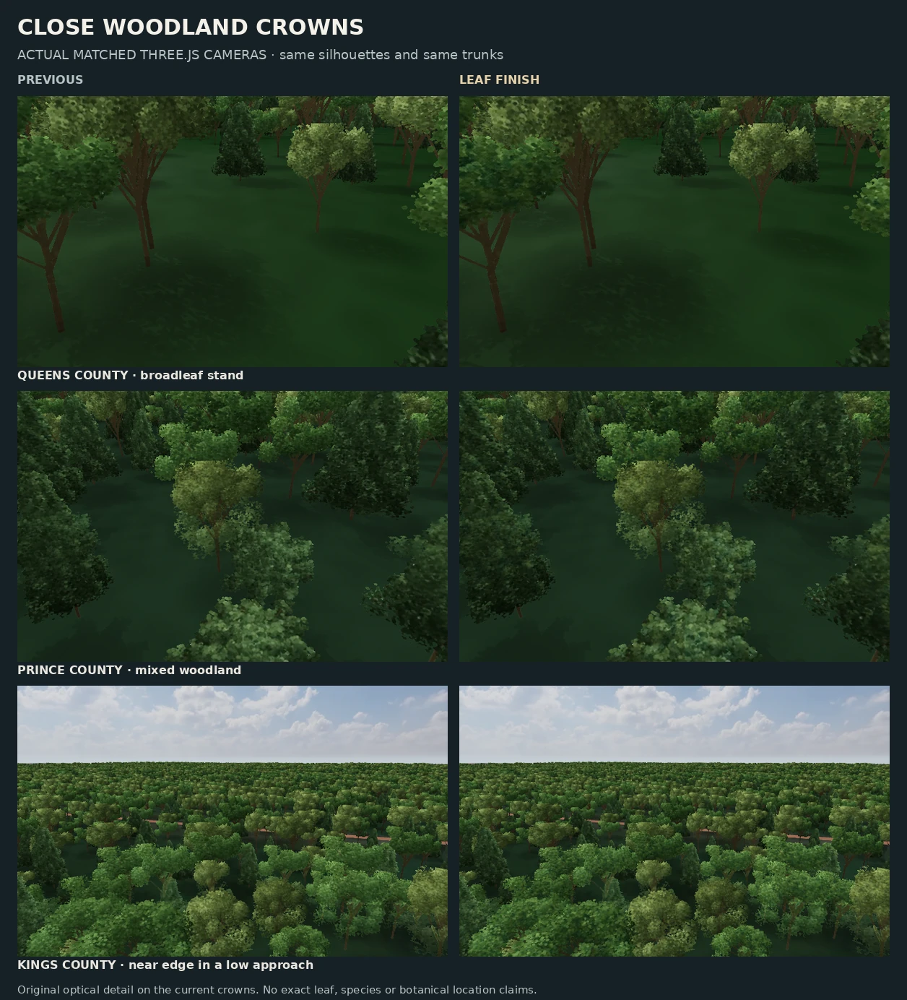

# Close canopy leaf finish

Standard's near tree crowns now break up some of the smooth colour clumps
in the older crown illustrations. Fine broadleaf shapes appear when the
camera is close enough to resolve them. Coherent larger-scale foliage
variation survives a little farther before fading back to the existing
crown colour. The added cues are original shading, not a survey of
individual leaf shapes, trees or species.

The effect keeps the existing alpha silhouettes, tree distribution, stem
positions, shadow layer and branch geometry. It does not touch non-green
trunk colour or the distant canopy. Pixel-footprint and distance filters
keep the effect from becoming distant speckle. The separate explicit
`canopyLight` and `woodland3D` comparisons retain their old art. No new
images, requests, draw calls or triangles are added.



## Renderer checks

| Same-camera comparison | Colour changes above 2/255 | Outside original crown coverage | Added draws / triangles |
| --- | ---: | ---: | ---: |
| Queens County understory | 37,641 | 0 | 0 / 0 |
| Prince County mixed woodland | 63,149 | 0 | 0 / 0 |
| Kings County approach | 46,493 | 0 | 0 / 0 |
| Charlottetown trees | 46,794 | 0 | 0 / 0 |
| Queens County distant | 0 | 0 | 0 / 0 |
| Prior explicit branch/ground-shadow preview | 0 | 0 | 0 / 0 |

Complementary Three.js object colours replace only the crown output in
the gate, retaining its actual partial coverage on edges. The distant
and explicit volume/shadow control frames are byte-identical. In four
successive 4 mm steps across the Queens view, the 99th percentile of the
added colour signal changed by 2/255 across 388,041 fully marked samples.
Normal Standard and stock-light Cavendish flights both moved 48.54 m or
more and paused without errors. No hardware performance claim is made.

[Exact data](canopy-leaf-finish-gate.json). Run the browser scripts from
the repository root after installing the project dependencies:

```sh
python tools/qa/crown-leaf-frames.py --out /tmp/pei-leaves --chromium /path/to/chromium
python tools/qa/crown-leaf-motion.py --out /tmp/pei-leaf-motion --view queens-understory --chromium /path/to/chromium
python tools/qa/crown-leaf-frames.py --out /tmp/pei-leaf-volume --view queens-understory --volume --chromium /path/to/chromium
npm run check
node tools/verify-world.mjs
```
