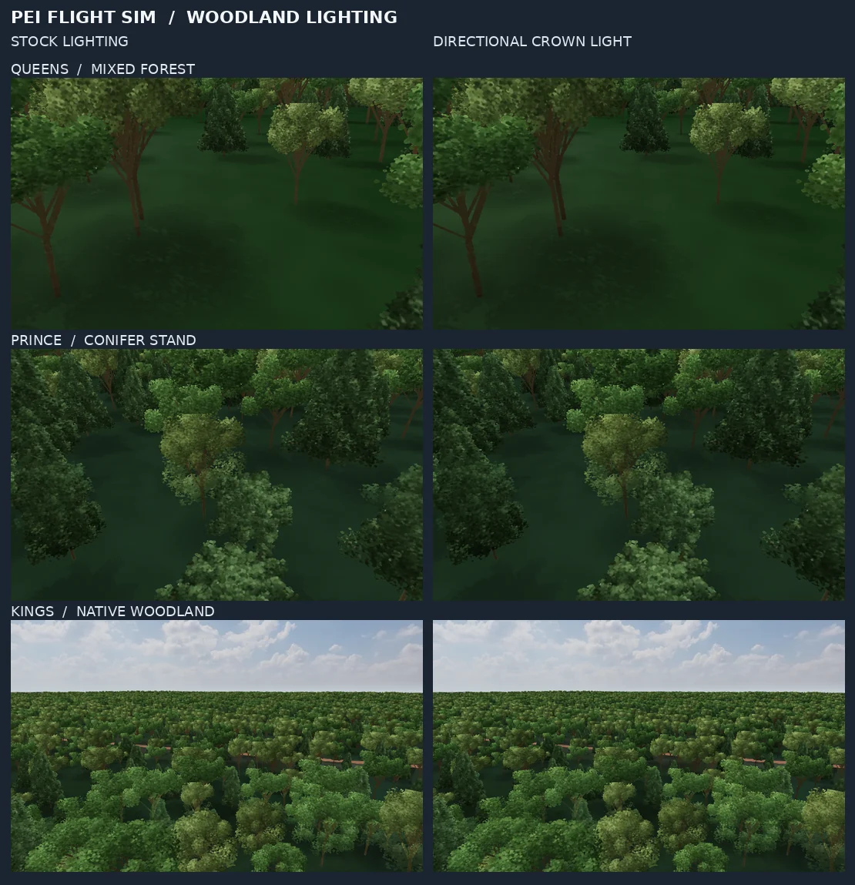

# Directional woodland light

Ordinary Standard scenery uses softer directional shading on the existing
woodland canopy art. Add `?stockCanopyLight` to compare the original diffuse
light. Explicit woodland, terrain, shadow and landmark studies keep their
prior lighting unless `?canopyLight` is requested. The renderer approximates a rounded
crown from the card coordinates and shades it against the same world
sun used by the terrain. A restrained backlit rim is limited to green
foliage. This is an authored lighting cue, not a measured canopy shape,
new shadow system or physical leaf-transmission model.

Tree positions, foliage opacity, silhouettes, geometry, atlas
textures and ground contact are unchanged. The optional near
`?woodland3D` geometry and its fitted shadows are also unchanged; in
that mode the new shader still shades the remaining billboards.



The [matched same-tab render gate](canopy-light-render-gate.json)
keeps draw calls and submitted triangles identical in each test. The
three county views had no RGB change outside the marked canopy and
its one-pixel antialiasing allowance. The coexistence view had 76
near branched trees and 76 fitted shadows in both modes. The original
[compiled flight gate](canopy-light-flight-gate.json) launches the
Cavendish low pass and verifies motion and pause with the option
absent and active. These checks do not measure hardware frame time.

## Standard release check

The [three-county Standard receipt](canopy-light-standard-gate.json) uses
both a magenta and green canopy diagnostic at each locked camera. Pixels
outside the resulting mask were tested without expanding it: **413,165
non-canopy pixels** matched exactly, including the ground and sky.
Before and after used the same draw and triangle counts in all three
scenes. Both compiled Cavendish low flights flew and paused with no
errors. All 376 tests, TypeScript/Vite and the world checks passed.

## Replay

```sh
npm run check
python tools/qa/canopy-light-standard-frames.py --chromium /path/to/chromium --out /tmp/pei-canopy-scenes
python tools/qa/canopy-light-frames.py --chromium /path/to/chromium --out /tmp/pei-canopy-volume \
  --view queens-understory --volume
python tools/qa/canopy-flight.py --dist dist --chromium /path/to/chromium --out /tmp/pei-canopy-flight.json
```
