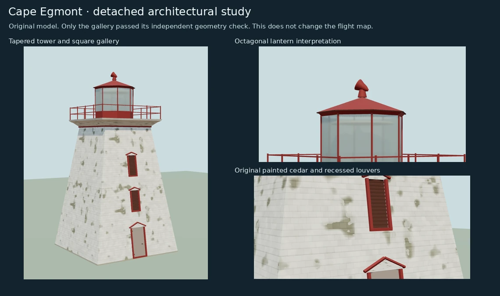

# Cape Egmont lighthouse exterior study

This is an original Three.js study of the square wooden tower in Prince County. It is separate from the flight simulator. The white cedar cladding, red trim, recessed louvers, square gallery and a small red lantern are built with geometry and procedural materials, not copied from aerial imagery or photographs. The lantern and fittings are decorative and non-operational.

The [federal heritage report](https://www.historicplaces.ca/media/15005/1990-110%28e%29lighthouse.pdf) describes the square tapered form. [Dennis G. Jarvis’s October 2015 exterior](https://commons.wikimedia.org/wiki/File:Cape_Egmont_Lighthouse_(21665083953).jpg) provides appearance context for the post-relocation tower. The model does not adopt the camera as a mapped position or treat a dated photo as evidence of current paint condition.

## Survey and limits

An independent check used previously withheld airborne survey returns from one 2020 [Natural Resources Canada flight](https://open.canada.ca/data/en/dataset/7069387e-9986-4297-9f55-0288e9676947); no training pulses overlapped the withheld sample. The gallery height cleared the frozen gate: 40 of 41 rays intersected and the 90th-percentile vertical residual was 0.026 m, across four quadrants. The wall had a 0.577 m residual at that percentile and only three sides were represented; it did not pass the taper gate. Six of eight main roof rays intersected, from only two sampled sectors, so the survey does not establish the number of faces. A new weathered material and small interpretive base pieces are not survey facts.

The existing atlas building and flight geometry stay as they were. Neither post-relocation ground placement nor current access was checked for production. The [aggregate receipt](../../tools/art/cape-egmont-detached/proof/aggregate-evidence.json) contains no raw survey points or imagery.

To see the source and run the studio, use the [local preview instructions](../../tools/art/cape-egmont-detached/README.md).
