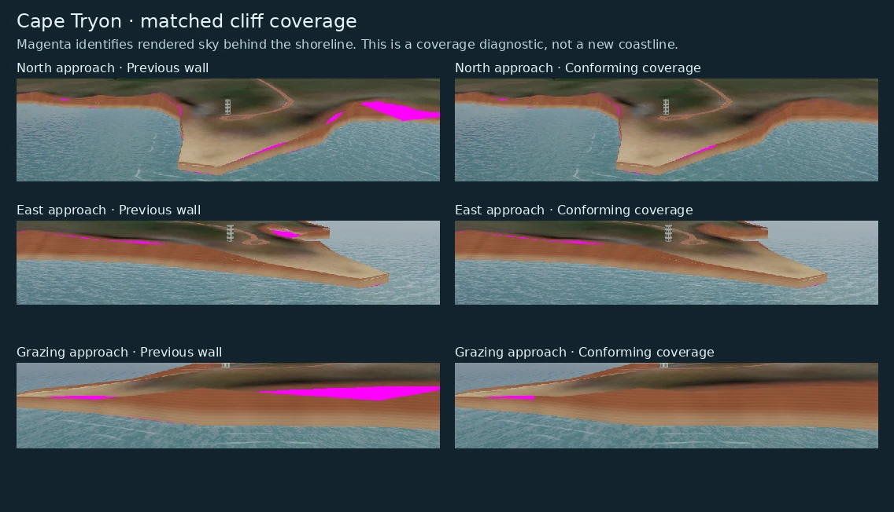

# Cape Tryon cliff pass

In Standard, select **Cape Tryon · cliff pass** to approach the headland from the Gulf. The starting height is about 82 m above the sea surface. It is a simulator sightseeing route, not advice for real flight.

Five selected cells west and east of the headland exposed the sky through the existing cliff curtains. The game now adds a near curtain that follows the original bilinear mask between the same endpoints. The old curtain, land/water classification, wave colours, terrain and collision remain unchanged. This is not a surveyed coastline update. The lighthouse is still the original coarse building; the local cliff heights and footprint position are not good enough for a trustworthy replacement.

Compare with `?departure=cape-tryon-coast&stockOpenCoast`. That flag restores the older coverage and does not remove the separate Orby Head repair. The [optional sandstone finish](cape-tryon-stone.md) is a separate material comparison and does not change any shoreline geometry.



## What was checked

In three matched low views, **9,131** fully exposed sky pixels were covered. Some gaps remain, especially at grazing angles. No new sky pixels or greater-than-one-code sky exposure appeared in these views. Nearby controls at Orby Head and Panmure did not change. The [replay receipt](cape-tryon-coast-gate.json) also tracks the stock geometry, exactly unchanged ground enquiries and compiled browser flights. The added local coverage costs one draw and 554 triangles in the tested views; these figures do not imply a reduction in frame time.

[Parks Canada’s Cape Tryon Lighthouse record](https://www.pc.gc.ca/apps/dfhd/page_hl_eng.aspx?id=14932) describes the real tower atop red sandstone. The separate [federal elevation source](https://natural-resources.canada.ca/science-data/data-analysis/geospatial-data-tools-services/elevation-data) confirms the area's steep cliff layout, but comparison against the current simulation showed disagreement in height and local shoreline. No replacement raster, photo, wet mask or model is introduced by this repair.


To repeat the browser checks after building the repo:

```sh
python tools/qa/tryon-same-frame.py --checkout . --poses docs/qa/cape-tryon-coast-poses.json \
  --out /tmp/tryon-frames --chromium /path/to/chromium
python tools/qa/tryon-flight.py --dist dist --out /tmp/tryon-flight --chromium /path/to/chromium
```
