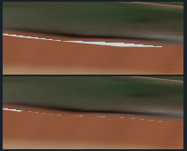

# Cape Tryon: separating the two East cliff gaps

The existing simulator already colours part of the cliff with a signed
shore curtain. The largest remaining fully exposed sky component in the
fixed East comparison came from two adjoining but geometrically distinct
soil/water cells. No new real-world shoreline, geology or ground contact
is inferred here.

- **Straight (1554, 1328):** the decoded corner signs make the coast a
  straight line. The old rendered wall is too low across the local
  headland. Four triangles retain its exact uploaded XZ axis and bring
  the wall closer to, but never above, the exact current terrain facets.
- **Bowed (1554, 1327):** the signed cover's zero line bends away from the
  old straight span. The new optical strip follows its rational contour
  inside the cell. Twenty-four straight subdivisions have a conservative
  continuous horizontal error bound below 2.6 mm relative to the
  existing decoded contour. The upper edges were checked against both
  captured-transform and binary32 world-position reconstructions of the
  currently submitted terrain.

Both old wall spans were read back from the native GPU buffer, including
their original heights. The source observations are about the current
simulator's data, not millimetre accuracy of the real headland.

## Fixed native observations

In the three optical replays at the fixed East camera, the straight
strip removed the fully exposed condition for 131 pixels in the main
component; the curved one removed the other 87. The combined draw did
the same for all 218. Other smaller openings remain. The old-to-new sky
count fell by 1,224 samples, with zero change on wholly occupied pixels,
zero alpha change, and exact restoration after disabling the strip.
The early background render and simultaneous late clear-depth diagnostic
had identical colour and mask images. The fixed plate used the actual
WebGL 2 scene with the existing sandstone active, not a statistical
proxy for the real scene.

[North study](cape-tryon-vertical-seat.md) ·
[Opt-in background rendering](cape-tryon-sky-seat.md)

## Installed opt-in qualification

The original North/Grazing strip and the two East strips share one
optional draw (55 triangles total). The old three triangles are
unchanged. The combined preview still leaves Standard alone without the
flag. The installed fixed East, North and Grazing comparisons confirmed
386, 324 and 515 changed RGB pixels, respectively, with the original
occupied colour and alpha preserved and exact frame restoration. The
existing North/Grazing effects remain identical on their original
support. The combined preview also mounted again during the real Cape
departure without a second shader submission. The tested depth-only,
zero-sample, optional water, cold Borden, unrequested and refused-shader
paths retained the base scene.

[Native validation receipt](cape-tryon-east-seat-validation.json) ·
[Continuous geometry witness](cape-tryon-east-seat-geometry.json)
