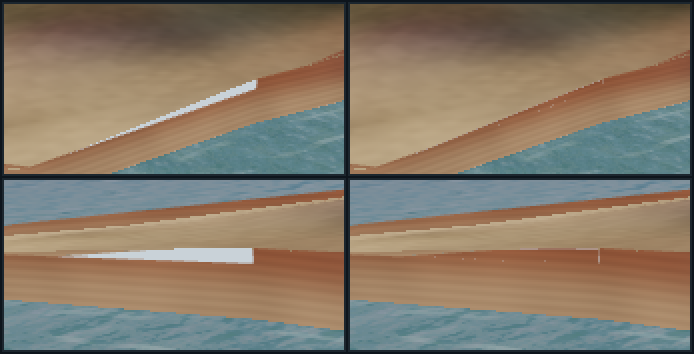

# Cape Tryon: one vertical cliff-seat study

**Detached replay only.** The live Cape Tryon departure, collision, terrain,
coast mask, sea and aircraft have not changed. This study tests one measured
cause of a visible hole in the shipped Cape Tryon coast geometry. It does
not propose a new surveyed shoreline or a replacement cliff model.

The original shore curtain at decoded Cover cell **(1554, 1324)** follows a
straight signed contour. Its legacy top is a straight interpolation between
the two end heights. The already-rendered terrain rises above that top
between the endpoints, leaving a gap when approached from the Gulf. The
three-triangle study fills only upward along the exact existing Float32
chord. It does not move the footprint, override the sea mask, or add a rock
texture.

The local geometry is anchored at the original eastern endpoint and uses
three exactly representable fractional stations along that chord. Its last
station remains inside the decoded cell, and the top stays below both the
observed native terrain triangle envelope and its Float32 reconstruction.
The study preserves the current curtain and ordinary material; the new
piece uses the same unmarked material role, including when the existing
regional sandstone is active.

## Why it is still detached

The diagnostic runs the real Three.js scene in a temporary QA checkout at
exact fixed camera poses. It admits a single late opaque draw only on the
ordinary clear-depth background, in a four-sample default framebuffer.
It checks the current opaque owners, actual GPU shadow-source words and
conservative projection; those conditions do not yet constitute a
moving-camera runtime policy. An opt-in water diagnostic, unsupported
framebuffer, or unknown colour owner is not a second authority to fill the
same pixels. The east cliff gaps belong to other cells and remain open.

Interpret the observation by comparison with the [existing Standard coast
coverage](cape-tryon-coast.md) and [sandstone finish](cape-tryon-stone.md).
This is an in-engine rendering check, not a flight-performance measurement.

## Reproduce the fixed comparison

At 860 × 580 in actual Chromium WebGL 2 with four samples, the North and
Grazing target components lose their fully exposed sky pixels (185 and
405). That does not mean every edge sample was covered. The East control
has no changed RGB or sky samples. The candidate never supplies a colour
where the original sky had no samples. The original frame is restored
byte-for-byte. One actual draw with three triangles is measured in each
admitted fixed view; no frame-rate inference is made.



In the two contributing views with the existing sandstone active,
846 north and 1,781 grazing samples changed from sky to the candidate.
Independent black/white candidate markers and complementary sky colours
conserve the four sample counts in every pixel, within one raw colour
code. Validated later canopy input words matched the resident buffers in
each tested view and their conservative projected bounds were disjoint.
The [native receipt](cape-tryon-vertical-seat-native.json) includes a
separate sandstone-disabled replay, unchanged Orby Head and Panmure
controls, and no-draw fallbacks for the optional water owner, zero
multisampling and the older coast. These are fixed-frame observations,
not a general compositing guarantee.

The [sealed strip](cape-tryon-vertical-seat-strip.json) contains original
derived geometry only. A small test checks the exact binary32 chord,
decoded cell containment and the piecewise affine ceiling. The
geometry follows the signed contour of the existing dataset; historical
source and geodetic limits remain those in [World data](../WORLD.md).

```sh
python tools/qa/tryon-vertical-seat.py --checkout . --deps node_modules \
  --poses docs/qa/cape-tryon-coast-poses.json --strip docs/qa/cape-tryon-vertical-seat-strip.json \
  --chromium /path/to/chromium --out /tmp/tryon-vertical-seat \
  --case live-rock --views headland-north,headland-grazing,headland-east
```
