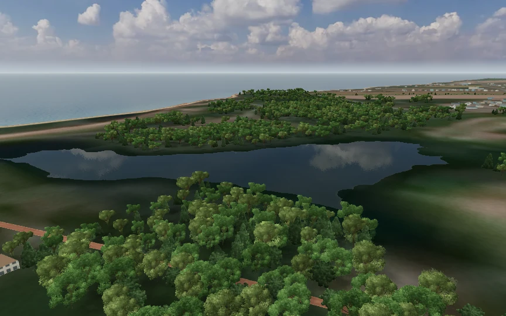

# Cavendish Dunelands freshwater core

In Dispatch, select **Dunelands freshwater** under **Optional scenery
studies** and apply. You can also use `?cavendishWaterReview` (or
`&cavendishWaterReview` if the URL already has options). Select
**Cavendish Dunelands · coastal pass** to start just offshore and cross the
pond on the approach to Green Gables. The Standard atlas stays unchanged
without the flag. The study can coexist with the separate Bowley Pond layer.

This preview maps about **6.1 hectares of directly supported 2020
open-water core**, not the entire lake or its present shoreline. Flight contact
inside the mask uses a separate **1.468 m CGVD2013** level, not the ocean.
Everywhere else keeps the original flight surface. The rim follows the
original visible terrain, and the replacement uses the same physical
screen ray to mask terrain and draw water. The water ripples and reflections
are authored scenery, not measured waves or depth. Survey/inland relief
or building-shadow flags hold this preview rather than allowing a different
terrain configuration to invalidate its floor and visual joins.

*An in-engine capture of the dated layer. The visible edge is the admitted
core, not a mapped present-day shoreline.*

## What the measured sources support

- [NRCan CanElevation LiDAR](https://open.canada.ca/data/en/dataset/7069387e-9986-4297-9f55-0288e9676947)
  and [one-metre elevation models](https://open.canada.ca/data/en/dataset/957782bf-847c-4644-a757-e383c0057995).
  The [2020 PEI acquisition notice](https://www.princeedwardisland.ca/en/news/photos-taken-from-the-air-will-map-entire-island-landscape)
  places the program in summer 2020. The precise local flight date is not
  known. The COPC header date is a processing date, not capture.
  Contains information licensed under the [Open Government Licence – Canada](https://open.canada.ca/en/open-government-licence-canada).
- The stage uses a spatially held-out point test. Before the final enclosed
  correction, 114,350 held-out classified water returns had 2.2 cm p90
  and 2.8 cm p95 absolute level error. This is replication inside the same
  dated survey, not independent evidence of the current surface.
- One small enclosed omission was traced to a near-threshold native elevation
  cell, not a surveyed island. All 441 cells in that enclosure have direct
  native water evidence, with no dry/structure observations, and the outer
  bounds and distance to every protected feature are unchanged. Other
  exclusions and unmapped shallow margins remain in place.
- [ESA WorldCover 10 m 2021 v200](https://doi.org/10.5281/zenodo.7254221)
  is a secondary exclusion, never a traced shoreline. © ESA WorldCover
  project 2021 / Contains modified Copernicus Sentinel data (2021) processed
  by ESA WorldCover consortium. [CC BY 4.0](https://creativecommons.org/licenses/by/4.0/).
- [Parks Canada](https://parks.canada.ca/pn-np/pe/pei-ipe/activ/sentiers-trails/cavendish-dune)
  confirms that the trail crosses freshwater scenery and has a floating
  boardwalk. The render deliberately omits any change to the actual boardwalk,
  adjacent paths, landscape outside the core, and post-Fiona conditions. The
  mapped trail and existing game meshes were independent exclusion checks,
  not input shoreline. No Parks Canada or other external imagery is included.

## Reproduce the pack

The [data ledger](../../data/cavendish-dunelands/) contains the compact
qualified one-metre mask (not raw survey returns), source pins, independent
surface witnesses and projected pack metadata. Reproject the derived
one-metre mask with SciPy, NumPy and pyproj, and use
`tools/geodata/bake-cavendish-water-core.py --help` for the exact arguments;
`--verify` checks both the checked-in archive and metadata byte-for-byte.

## Verification

The [matched scope check](cavendish-water-scope.json) recorded 39,608
changed pixels above two RGB codes in the aerial view and zero change in
all 289,292 protected pixels outside the projection. The malformed
response preserved both full camera frames, 933,120 pixels total.
The [aperture replay](cavendish-water-aperture.json) tested five offsets
each in two matched 4× multisampled views. No full or partial sample
exposed new sky through the water or terrain. Actual mesh submission
added two draws in these views; this is not an FPS or latency result.

[Compiled flight replay](cavendish-water-flight.json) uses the normal
departure and no camera, clock, or flight override. [Low comparison
view](cavendish-water-edge.webp) shows the original shoreline context
around the separate dated water core. This build is for exploration,
not navigation.
