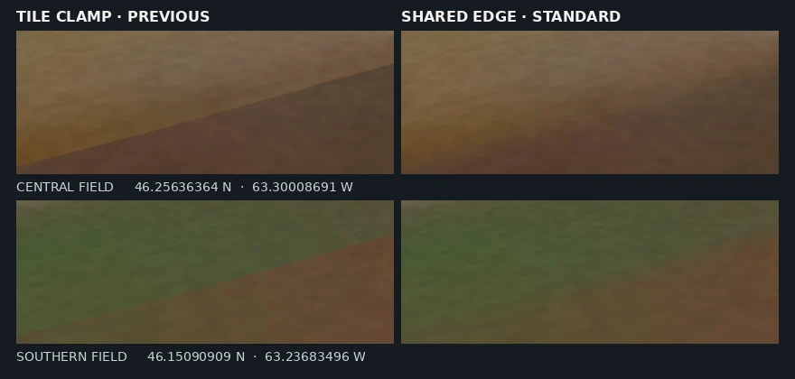

# Two field joins in central and southern PEI

Two more short atlas joins share the original imagery samples in Standard.
Both fields showed a sharp line exactly where their north and south source
tiles began clamping independently. The repair keeps the actual difference
in field colour and removes the hard sampling step only within the checked
part of each join. It does not add or resharpen photography.



| Ground reference (lat, lon) | North → south tiles | West-origin source columns | Median RGB8 step, both directions |
| --- | --- | --- | --- |
| 46.25636364, −63.30008691 | `14-15` → `14-16` | 463–483 | 24.75 → 2.15 / 24.73 → 2.22 |
| 46.15090909, −63.23683496 | `15-17` → `15-18` | 333–353 | 18.26 → 2.13 / 15.99 → 2.23 |

Each interval is half-open and includes two-texel end tapers. The
[authenticated imagery and cover receipt](central-aerial-joins/source.json)
checks the complete 2.5-texel cross-edge scope. The
[signed geometry check](central-aerial-joins/existing-geometry-context.json)
finds no project road centreline or dated building footprint crosses
either strip. This is not a new field survey or proof of modern fences,
drains, crops or other unmapped features.

Native comparisons keep raw alpha, draw counts, triangle counts and
every pixel outside the two-colour marks unchanged; the test restores the
original image exactly. The height, mirrored orientation and nearby
out-of-window controls keep their original pixels. The previous east-facing
join on tile `14-16` stays first in the sampler ordering; both its original
and corrected screenshots and both diagnostic masks are byte-identical.
A renderer without spare texture units does not sacrifice that older lane.

The strip is 10,240 bytes when resident. It uses existing signed textures,
makes no extra imagery request and falls back on both sides if either tile
fails authentication. Beyond the existing 330 m fade and at the along-edge
tapers, the original terrain is intentionally retained. `?stockInlandOrtho`
disables the inland joins for comparison. No geometry, data licensing,
terrain contact or flight behavior changed.

## Replay

[Fixed renderer checks](central-aerial-joins/render-checks.json) ·
[Controllable flight checks](central-aerial-joins/compiled-player.json) ·
[Private test corridor coordinates](central-aerial-joins/virtual-corridors.json)

```sh
python tools/qa/verify-eastern-aerial-sources.py \
  --window edge-14-15s --window edge-15-17s
python tools/qa/tracadie-frames.py --checkout . --cohort inland \
  --views edge-14-15s,edge-14-15s-reciprocal,edge-15-17s,edge-15-17s-reciprocal \
  --chromium /path/to/chromium --out /tmp/pei-central-aerial
```

Append `-high`, `-outside` or `-flipped` to either first camera name for
its controls. The replay uses software rendering for repeatable pixels,
not a hardware benchmark. The compiled player crosses both lines and
switches to Cockpit and Pause through normal controls. The private test
corridors are not real navigation routes or playable departures.

[Earlier atlas screening](aerial-join-screen.md) ·
[World data and attribution](../WORLD.md)
