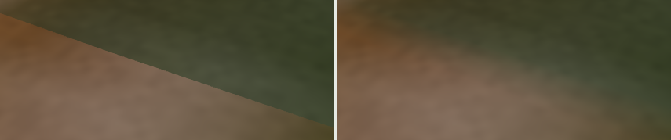

# Central-eastern PEI field imagery join

An artificially straight colour step cut across existing aerial imagery
over a field. Standard now blends the original bordering samples
inside a single signed strip. Ground elevations, textures on disk,
roads, buildings, flight contact, and the broader tan-to-green field
transition remain unchanged.

The image uses unscaled native crops with the same camera and exposure.
The correction uses original 16-14 and 17-14 donors and only
the shared west-to-east tile boundary, source rows **[187,207)** with centre **[189,205)**.
The authenticated [source receipt](central-east-field-image-join/source.json)
has the original two payload hashes, filtered donor bytes and cover
checks. Screening measured a 37.84 median raw RGB step across the boundary
versus 14.75 in the neighboring original samples. This was not a survey
of crop, hedge or parcel boundaries. The nearest recorded road or
building was outside the [400 m context screen](central-east-field-image-join/existing-geometry-context.json).

## Native frame evidence

| 840×540 native view | Median RGB step before | After | Changed pixels over 2 RGB codes |
| --- | ---: | ---: | ---: |
| Forward | 26.85 | 2.24 | 30,714 |
| Reciprocal | 29.76 | 2.54 | 33,247 |
| 550 m above ground | — | — | 0 |
| Outside the signed strip | — | — | 0 |

The [view receipts](central-east-field-image-join/native-fixed.json)
record the actual two regular near-mesh owners, exact bracket restore
and no alpha or out-of-role differences. The two positive views also
had zero sky marker pixels. High and outside native images remained
identical with both sources ready.

The older orthogonal 17-14/17-15 correction still comes first when
the renderer cannot run two lanes on the shared tile. In the
[independent old-pair view](central-east-field-image-join/older-shared-side.json),
the old authentic effect remained nonzero (15,024 strong pixels), and
all four old/active/role PNGs matched the original build byte for byte.
Both lanes can be registered on the common material. The two finite
correction strips are too far apart to be visible at active gain in the
same nearby camera view. This is not a simultaneous close-effect claim.

## Ordinary moving camera

The private [test corridor](central-east-field-image-join/moving-corridor.json)
uses the published terrain and unchanged flight code with neutral input.
It is not a player departure or a real flight recommendation.

| Actual progress from launch | Changed pixels over 2 RGB codes |
| --- | ---: |
| 16.742 m | 4,478 |
| 41.860 m | 7,038 |
| 343.420 m | 0 |

The [moving receipts](central-east-field-image-join/moving-flight.json)
re-read the original native old, active, role and restored PNGs. The
score was zero outside the marked role, alpha was unchanged, and the
restored frame matched each active image byte for byte. Draw counts and
triangle counts agreed at each checkpoint. Normal Cockpit and Pause
worked. No camera, clock, control, aircraft, terrain or source-image
override was used in the moving run.

The [explicit stock control](central-east-field-image-join/stock-control.json)
used the normal stockInlandOrtho option. The new pair did not register.
In both directions, every native image and each disabled-role marker was
byte-identical to its matched original image, with no sky or alpha change.
