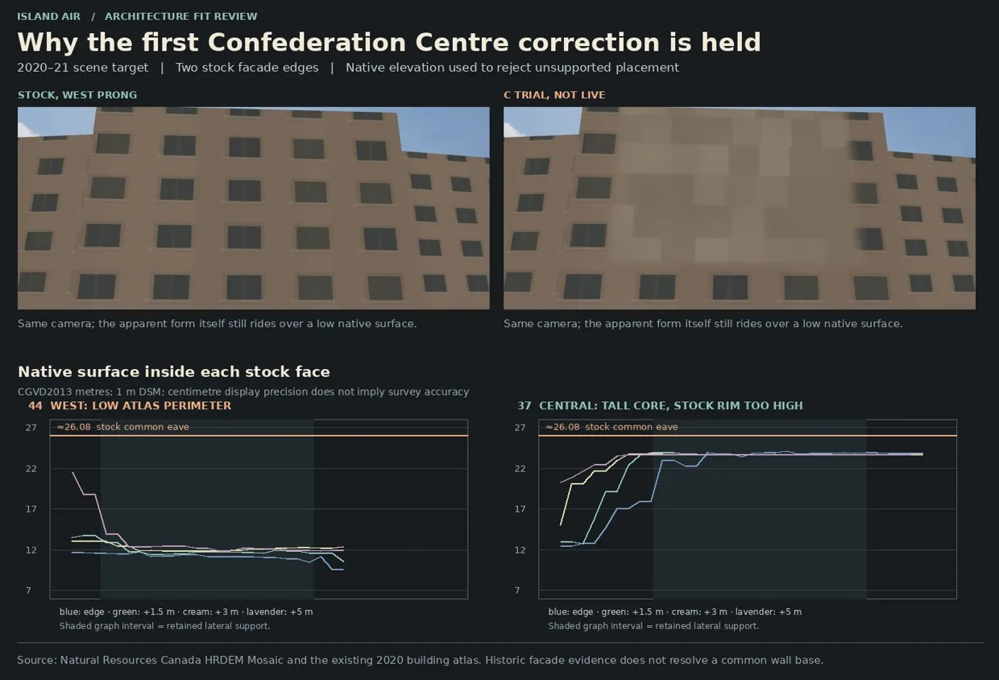

# Confederation Centre of the Arts frontage: checked but not installed

The ordinary building on the north side of Victoria Row comes from one irregular 2020 outline. The fallback extrudes most of that outline as one tall, repeatedly windowed building. A public record of the actual complex calls for something quite different: solid sandstone masses and narrow inset glass between distinct pavilions. The real front also has recessed, lower entrances. Replacing the windows alone was not enough to fix that misreading.

## Evidence

- **Place and historic character:** [Parks Canada designation](https://www.pc.gc.ca/apps/dfhd/page_nhs_eng.aspx?i=21153&id=10181) distinguishes continuous sandstone masses, intentionally sparse windows, and multiple pavilions.
- **Visible from the same street:** [Venue Visual Story, 2019, pages 8–9](https://confederationcentre.com/wp-content/uploads/2019/02/CCOA-Visual-Story_AUGUST-12.pdf) shows Queen Street looking along Victoria Row, and close photographs of the old Richmond entrance. Wide stone panels are separate from the dark vertical strips and low access. The [2019–20 annual report](https://confederationcentre.com/wp-content/uploads/2024/02/CCOA_AR-2019-20-eng_VIEW.pdf) and [2022 provincial library announcement](https://www.princeedwardisland.ca/en/news/moving-the-charlottetown-library) give independent documentary context.
- **Not the renovated building:** [City planning record](https://irac.pe.ca/wp-content/uploads/2024-12-24-City-Record-1379-4074-1393-v.pdf), PDF pages 49, 81 and 82, distinguishes existing elevations and floor plans from proposed construction. The [venue’s November 2026 announcement](https://confederationcentre.com/confederation-centre-of-the-arts-shares-island-stories-and-invitescommunity-support-ahead-of-april-2027-reopening/) describes substantial later work. No construction stage or current entrances are presented here.
- **What the simulator loads:** [NRCan Automatically Extracted Buildings](https://open.canada.ca/data/en/dataset/7a5cda52-c7df-427f-9ced-26f19a8a64d6), PEI 2020. The matched object is atlas tile `q12000113`, feature `63`, 59 outline vertices; separate tiles/rows provide Province House and Victoria Row. In the exact Queen view it occupies 74,596 pixels, including large ambiguous returns closer to the viewer. Even before vertical exclusions, the two trial edge polygons account for only 5,751 visible pixels (~7.7% of the object).

## Placement is the current blocker

The architectural sheets and photographs are used as documentary evidence only, not read into the renderer. The [NRCan 1 m HRDEM Mosaic](https://open.canada.ca/data/en/dataset/0fe65119-e96e-4a57-8bfe-9d9245fba06b) is a separate raster check. The [applied source metadata](https://open.canada.ca/data/en/dataset/0fe65119-e96e-4a57-8bfe-9d9245fba06b/resource/008455f0-a480-4f93-bb7f-458e696d4ece) pins all 180 independently checked native sample cells to July 15–September 15, 2020, through selected feature 181 in `metadata_2`. The interval describes the project, not the time of each return. The newer mosaic-wide update is not a new local survey. The same airborne acquisition also underlies the original building outlines, so this is not independent-sensor validation. Data stays outside this study’s deliverable.

| Candidate edge | Exact native evidence | Decision |
| --- | --- | --- |
| 44, near the Queen corner | At 1.5 m inside the old outline, 19 samples from the proposed broad interval have a median surface of 11.8 m. Even 5 m inside the same interval, median is 12.2 m and maximum 14.0 m. The fallback’s approximate common tall rim is 26.08 m. | **Do not repaint the stock upper mass.** The documented broad stone face cannot simply be assigned to the atlas perimeter at that height. |
| 37, farther along Richmond | In the narrower tested interval, all 18 samples at 1.5 m inside are 23.7–24.0 m; at 3 m inside they are 23.7–23.8 m. The first few horizontal metres are not equivalent and were excluded. An isolated paint test stopped at absolute simulator y 22.83 m, below the tested surface. | **Do not infer a full façade or roof.** A small face-only study is possible, but it cannot fix the long false upper rim or the lower generic glass. |

The trial started with large cream panels. Matching stock unglazed values fixed the brightness error (direct median RGB was +6/+9/+7 instead of +29/+37/+37), but the preserved fake frame still drew a rectangle around the field. A second material all but removed panel-to-panel colour contrast; it deliberately kept any transition out of the generic simulated glass. No textures were uploaded or copied.

The 37-only test changed 450 pixels by more than three RGB levels in the 960×640 Queen Street frame, with no changes outside the source-supported material. The close view still shows a rectangular interruption of generic windows rather than an authentic façade. The actual low flight started but did not reach the registered comparison point within the browser timeout, so no improved flight image was verified. Nothing from any of these trials is installed.

**Next step:** Register the individual building volumes and their setbacks to the dated survey, and resolve the lower glazing beside the old terrace. Keep the current fallback until a replacement makes correct contact with its surroundings in the engine. The Victoria Row storefronts, surrounding grade, Province House and flight behaviour are unchanged.

The [aggregate receipt](centre-frontage-hold.json) includes the pinned
stock owner, transect ranges, source attribution and camera metrics. Comparing
the 2020 CGVD2013 surface with simulator Y is a diagnostic for the misplaced
mass, not an as-built elevation survey. No reference photos, raw raster chips
or candidate game code are included.
