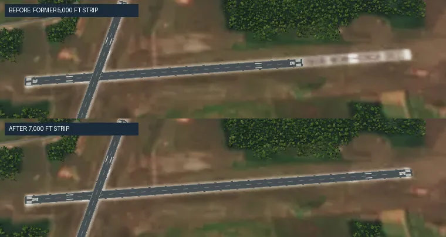

# Charlottetown runway 10/28, post-expansion

The old coordinates still described the approximately 5,000 ft runway.
They produced 1,524.61 m in the simulator. The updated 10/28 strip is
2,133.60 × 45.72 m, from the 7,000 × 150 ft asphalt dimensions in the
[14 May 2026 Canada Flight Supplement, CYYG runway data](https://imageserver.fltplan.com/afd/Canada/14MAY2026/CYYG-2575.PDF).
The painted strip and simulator touchdown classification use that same
geometry; the terrain elevations, 03/21 and 05/23 strips are unchanged.

## Registration, not surveyed thresholds

The east-west axis and midpoint come from
[OpenStreetMap way 28328903 version 10](https://www.openstreetmap.org/way/28328903/history)
(9 July 2026, [© OpenStreetMap contributors](https://www.openstreetmap.org/copyright),
[ODbL 1.0](https://opendatacommons.org/licenses/odbl/1-0/)).
The raw mapped endpoints are pinned separately in
[`src/sim/cyyg-runway-reference.ts`](../../src/sim/cyyg-runway-reference.ts).
Their projection is about 2,102 m. The simulator preserves their midpoint and
extends each mapped end by about 16 m to the official length. In the released
10 m-class Sentinel detail mosaic, both ends fall within about a pixel of the
pavement transitions; the earlier east endpoint is plainly inside the strip.
This does not determine exact marked or displaced thresholds, runway slopes,
or navigation-grade positions. The placement is for simulator scenery only.

## Landing regression

`npm run check` includes a fixed-step 28 landing started on short final over
the extension. It must touch between the former 28 end and the start and
brake below 0.2 m/s without leaving the runway. It also checks off-strip points,
and retains the existing 03/21 and Summerside departure regressions.

Run `tools/qa/runway-28-landing.py` with `--expect landed` for the updated
checkout and `--expect stopped` for `e67ecac`. The temporary Chromium copies
set the same flight state and scripted controls but call the actual flight
rules, real world contact and renderer in both cases.

Both fixed overhead renders submitted 267,300 triangles and 23 draws.
The strongest paint differences were confined to the crosswind strip's
screen footprint. In the real Chromium scene the old geometry reported
`Terrain contact` at 36.72 m/s. The same initial descent with updated
geometry reported `Touchdown` at 36.63 m/s and finished at 0.075 m/s
still on the runway. No training-use conclusion follows from this trial.
