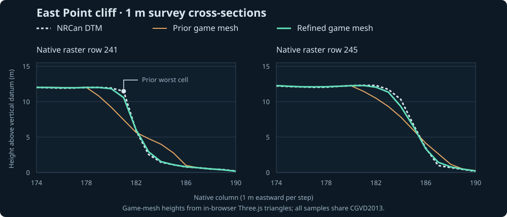

# East Point · surveyed cliff refinement

This work corrects a specific terrain-sampling error on East Point's steep southeast face. It is not a new survey, a finer shoreline classification, a new rock material, or an accuracy claim about the rest of the province.

The [native NRCan window](../../data/coastal-elevation/index.json) measures **1 m** pixels with CGVD2013 heights. The previous game mesh sampled it with ~3.3 m vertices, broadening the steep cliff. The new near mesh replaces exactly 518 of 18,432 parent cells, including a transition halo, with ~0.84 m subdivisions. The previous mesh remains available if the additional 15,810-byte compressed refinement cannot be verified.



## Ground and contact

The audit queries the actual Three.js scene and the gameplay contact function at **all 131,072 native source cell centres** across the East and West survey windows. Elevation errors compare the original East source to actual visible terrain after removing the game's 0.12 m display lift. The mask remains identical: 43,700 East cells classify as land.

| East Point metric | Before | After |
|---|---:|---:|
| Absolute error, p90 | 0.11678 m | **0.08845 m** |
| Absolute error, p95 | 0.27114 m | **0.13456 m** |
| Worst cell | 4.05252 m | **0.99526 m** |
| Land cells with >1 m error | 365 | **0** |
| Land cells with >0.75 m error | 643 | **4** |

At native column 181, row 241, the source reads 11.48 m. The prior Three.js surface read 7.427 m; the refined surface reads 10.568 m. The remaining 0.995 m worst case is in nearby row 245. These numbers measure fidelity to the same source that guides refinement, not independent or held-out field verification.

East render/contact agreement is within **0.00012 m**, and a separate cross-LOD audit found no hole, extra face or measurable crack above **0.000007 m** across 423,733 East edge profiles. All on-water contacts in both windows remain at the visible sea level. West heights, mask and collision remain identical at millimetre precision, with no change at the inland Cavendish check. A browser run with a corrupted optional response reproduced the previous East and West mesh, collision, metrics and contact handoff.

## Distance and cost

| East terrain tile | Before | After |
|---|---:|---:|
| Near, 112-segment parent | 62,318 | 78,866 triangles |
| Medium, 56-segment parent | 17,634 | 26,592 triangles |
| Far, 8-segment parent | 11,544 | 20,502 triangles |

Maximum distant-to-near difference on the recorded land points is **0.08813 m**; with the matched 1080p cameras the geometric difference is at most **0.01105 px** at 8.5 km and **0.00428 px** at 22 km. Neither moving the camera nor crossing a mesh-detail threshold changes the collision surface.

[Before](coastal-cliff-before.json) · [After](coastal-cliff-after.json) · [Corrupt-pack fallback](coastal-cliff-fallback.json).
The lists of SHA-256 hashes identify the tested inputs.

## Browser and fallback checks

Four matched player-camera frames use the same eye, aim, loaded imagery and scenery, with the renderer drawing **16,548 additional triangles** in each but the same draw-call counts. The small visible differences concentrate on the cliff: 1,014–1,793 of 655,360 pixels changed by more than eight RGB levels across the four views. A separate magenta-sky diagnostic found **zero** sky pixels across 117,120 known shoreline pixels, with a fully activated sky control. This pass improves the relief, not the rock material or lighting.

Five cold production scenarios completed the East Point departure: intact pack, absent refinement, corrupted same-size decoded refinement, interrupted HTTP body, and absent East base. None generated browser errors beyond the injected missing-file responses. For the stalled response, the real Chromium network clock saw the abort at **6.21 s** during concurrent software rendering; the nominal 1.6 s main-thread timer is not a fixed wall-clock SLA. The game became flyable with both validated base layers while the refinement body was still held. Releasing the server's remainder later did not change the installed geometry. A healthy refinement never attaches without its matching base pack.

[Matched camera and void checks](coastal-cliff-frames.json) · [Built-game HTTP and departure tests](coastal-cliff-assets.json).

## Reproduce

Install Node dependencies and the [browser/GDAL prerequisites](coastal-runtime.md#reproduce). Replace `BEFORE` (Git `9247190`) and `AFTER` with the relevant checkouts; run from `AFTER`. Provide `CHROMIUM` with a Chromium executable. The JSON output paths are disposable.

```sh
python3 tools/qa/coast-scene-audit.py --checkout "$BEFORE" --stride 1 \
  --out /tmp/pei-cliff-baseline.json
python3 tools/qa/coast-scene-audit.py --checkout "$AFTER" --stride 1 \
  --gate-against docs/qa/coastal-runtime-before.json \
  --refinement-against /tmp/pei-cliff-baseline.json --out /tmp/pei-cliff-candidate.json
python3 tools/qa/coast-scene-audit.py --checkout "$AFTER" --stride 1 \
  --refinement-fallback /tmp/pei-cliff-baseline.json --out /tmp/pei-cliff-fallback.json
python3 tools/qa/coastal-cliff-transect.py --before /tmp/pei-cliff-baseline.json \
  --after /tmp/pei-cliff-candidate.json --out /tmp/pei-cliff-profile.svg
```

For the captures (Pillow and NumPy required) and the compiled-game HTTP gate:

```sh
python3 tools/qa/coastal-cliff-poses.py --checkout "$BEFORE" --out /tmp/pei-cliff-before
python3 tools/qa/coastal-cliff-poses.py --checkout "$AFTER" --out /tmp/pei-cliff-after
python3 tools/qa/coastal-cliff-poses.py --checkout "$BEFORE" --views cliff-face \
  --void-probe --out /tmp/pei-cliff-void-before
python3 tools/qa/coastal-cliff-poses.py --checkout "$AFTER" --views cliff-face \
  --void-probe --out /tmp/pei-cliff-void-after
python3 tools/qa/coastal-cliff-frame-gate.py --before /tmp/pei-cliff-before \
  --after /tmp/pei-cliff-after --cliff-void-before /tmp/pei-cliff-void-before \
  --cliff-void-after /tmp/pei-cliff-void-after --out /tmp/pei-cliff-frames.json
(cd "$AFTER" && npm run build)
python3 tools/qa/coastal-cliff-assets.py --dist "$AFTER/dist" --chromium "$CHROMIUM" \
  --out /tmp/pei-cliff-assets.json
```
