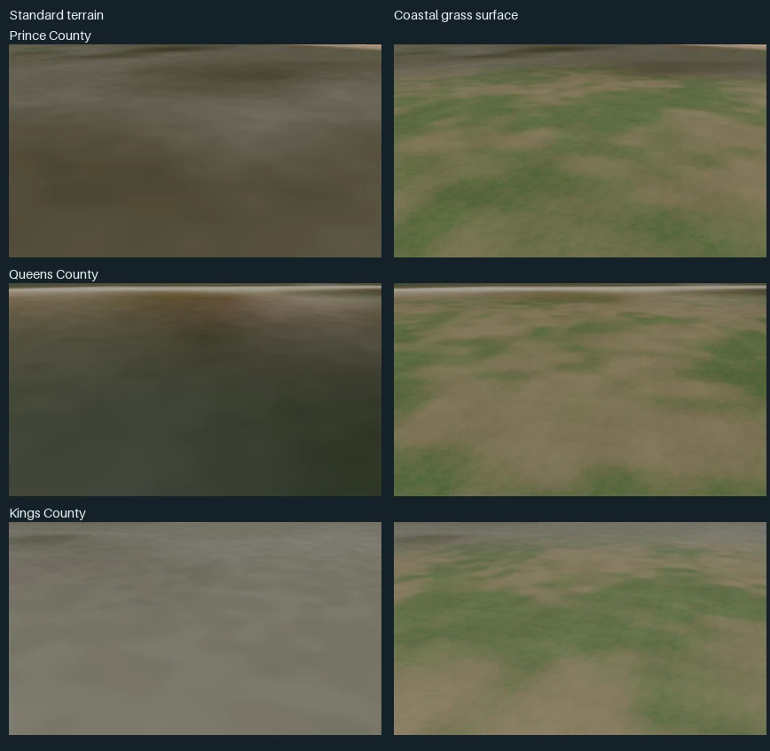

# Coastal grass surface

In **Standard**, enable **Coastal grass surface** under Optional scenery
studies. Choose one of the Prince, Queens or Kings County coastal grass
passes. This is a close terrain material, not an update to the landform,
flight mechanics, shoreline, or placement of individual plants.

## Where it applies

The [PEI Wetland and Sand Dune Inventory](https://gis.princeedwardisland.ca/server/rest/services/Hosted/Wetland_and_Sand_Dune_Inventory_2020/FeatureServer/0)
identifies dune polygons. Those records are based on 2020 aerial
interpretation and fieldwork, with a September 2026 database update.
This study intersects the non-forested classes with
[ESA WorldCover 2021](https://doi.org/10.5281/zenodo.7254221) grassland,
the simulator’s signed dry support, and its existing mapped-infrastructure
exclusion grid. It uses neither the original aerial photographs nor a
whole-polygon fill. It makes no claim about current plants or public access.

The **180,424 owned 5 m samples across 86 terrain tiles** are source-qualified
coverage, not a statement that every patch is painted. Three conditions still
matter in flight: scene ownership, near viewing distance, and exact
authentication. Existing East and West Point surveys stay protected.
Alternate terrain and Measured dune relief take precedence, while the
separately classified dry sand material remains compatible.

## What changes

Original local shading combines regional colour with a generic
[CC0 Sparse Grass material](https://polyhaven.com/a/sparse_grass) by Amal Kumar.
It adds grass-and-soil variation and small-scale surface relief lighting
without changing geometry. The source photo scan does not depict PEI.
It fades back to stock within 105 m from the camera. No individual grass
blades or plants are added by this option.

Adjacent terrain tiles use matching mask samples and the same two-metre
texture phase. Where a neighbour is excluded, unavailable, late, or still
fading in, both sides use the smaller weight along the join. This prevents
a bright strip where an optional texture stops at a tile line. Shared
corners follow the same rule for all four sides.

Standard needs no optional downloads. The first qualified approach reads
one masked package (100,121 bytes) and one generic texture (480,772 bytes).
Only nearby tile masks are decoded. At most four decoded masks are held.
Corrupt or unavailable inputs leave the ordinary terrain visible.

The authority data include information licensed under the
[Open Government Licence – Prince Edward Island](https://www.princeedwardisland.ca/en/information/finance/open-government-licence-prince-edward-island);
source: Resource Inventory and Modelling Section, Forests, Fish and Wildlife,
Department of Land & Environment. ESA WorldCover 2021 is © the
ESA WorldCover project and includes modified Copernicus Sentinel data,
[CC BY 4.0](https://creativecommons.org/licenses/by/4.0/).
Exclusions include [© OpenStreetMap contributors](https://www.openstreetmap.org/copyright)
under [ODbL 1.0](https://opendatacommons.org/licenses/odbl/1-0/).



## Checks

- [Exact source files and licence](coastal-grass-source.json)
- [Independent border and altitude coverage](coastal-grass-scope.json)
- [Matched field frames and an unchanged high-altitude control](coastal-grass-render.json)
- [Permanent protected neighbour](coastal-grass-protected-edge.json) and
  [deliberately delayed neighbour](coastal-grass-streamed-edge.json)
- [Normal-control routes and corrupt texture fallback](coastal-grass-flight.json)

The three packaged routes each flew about 383–386 m and paused normally.
A deliberately damaged but same-length texture left the view on stock
during a separate Queens flight. No draw or triangle counts changed in
the matched renderer tests. That does not imply identical GPU timings.

To regenerate the local authoring inputs, use GDAL, NumPy, SciPy and Pillow:

```sh
python tools/geodata/dune-sand/qualify-sand-exact.py --landcover-class 30 \
  --world public/world --inventory /data/sand-dune-source.geojson \
  --worldcover /data/N45W063.tif --worldcover /data/N45W066.tif \
  --out /tmp/qualified-coastal-grass
python tools/geodata/dune-grass/pack-grass-coverage.py \
  --qualified /tmp/qualified-coastal-grass/sand-qualified-exact.npz \
  --world public/world --out /tmp/coastal-grass-atlas
python tools/geodata/dune-grass/bake-sparse-grass-material.py \
  --input /data/sparse-grass-jpgs --output /tmp/grass-photometric.png
```
