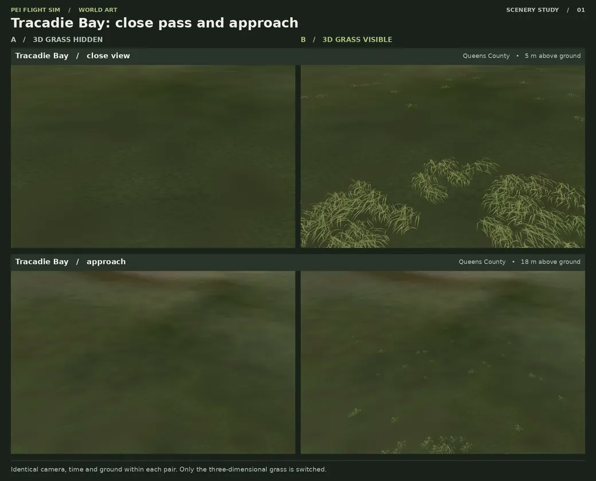

# Close salt and brackish marsh scenery

This work models **close grass form** in three strictly bounded, source-checked
patches of mapped coastal marsh. Existing land, water, coastline, slopes,
aircraft contact and trial physics remain stock. The vegetation is original
procedural art, not a survey of blade positions or a representation of current
weather, tides or ecology at an individual location.

| Physical site | Pure inventory feature | Selected 5 m cells | Nominal grid area |
| --- | ---: | ---: | ---: |
| Cascumpec, Prince County | 1350 | 195 | 0.4875 ha |
| Tracadie Bay, Queens County | 5057 | 7,306 | 18.265 ha |
| Morell, Kings County | 4574 | 1,078 | 2.695 ha |

The exact support around every nonzero sampler cell fits inside the same pure
inventory polygon, stays in the authorized existing land classes, and
avoids independently loaded road, building, runway, sidewalk, parking, trail
and both dune material owners. It is not a whole-marsh classification. All
other nearby shores retain their existing art.

## Source and original art

The local footprints come from the [PEI Wetland and Sand Dune Inventory
2020](https://gis.princeedwardisland.ca/server/rest/services/Hosted/Wetland_and_Sand_Dune_Inventory_2020/FeatureServer/0).
The source derives from 2020 air-image interpretation with field
follow-up; the public service reports a 2026 revision. No aerial imagery
was extracted from it. Contains information licensed under the
[Open Government Licence – Prince Edward Island](https://www.princeedwardisland.ca/en/information/finance/open-government-licence-prince-edward-island).
Data: Resource Inventory and Modelling Section, Forests, Fish and Wildlife
Division, PEI Department of Land and Environment.

The [2023 PEI State of the Coast report](https://www.princeedwardisland.ca/sites/default/files/publications/2023_pei_state_of_the_coast.pdf)
describes broad marsh vegetation zones. The [2026 salt-marsh
assessment](https://www.princeedwardisland.ca/en/publication/salt-marsh-mapping-and-migration-modelling-for-prince-edward-island)
helps explain the limits of shoreline mapping. Neither supports a field
census, measurement of the current canopy, or a specific tide estimate for
these three patches. The model uses visual cues from these references only:
flattened or leaning leaves, thin tips, irregular areas of denser growth,
and a few upright seed stems. No reference photograph is included.

The lower vegetation is represented by tapered plan ribbons and an original
surface material. Leaf instances are generated from the authorized cells
only when nearby, seated on rendered terrain triangles, and kept within a
fixed swept envelope. The switching criterion is geometric distance, not
an assumption about plant density or current salinity.

## Try it in Standard

Choose **Tracadie Bay · marsh pass** in Dispatch for a virtual low flyover.
The same independently bounded layer is visible near Cascumpec and Morell.
Use `?stockCoastalMarsh` to compare the older ground without turning off the
Tracadie aerial-image correction, woodland floor, Trail, or other Standard
layers. The atlas is not a navigational tool.

At high altitude or far from the three regions, the layer needs no local
mask request or grass calls. An eligible nearby region reads only one of the
existing local source masks (112, 903 or 280 compressed bytes).
Both encoded and HTTP-decoded gzip forms are authenticated and fail closed.
Ordinary texture styling remains available without multisampling; the
new fine blades require an actual multisampled drawing buffer.

The instanced grass uses at most two draws, with at most 104 close and 242
middle-distance instances and no separate shadow pass, for a combined
102,658-triangle upper bound. All middle-distance basal triangles are also
contained in each close model. A separate draw check verifies that the
middle-distance sampler does not just leave a single sparse ring at the
edge of the screen. Coverage is intentionally bounded and fades by about
44 m horizontally. These are renderer limits, not a hardware FPS claim.

[Independent source support](coastal-marsh/independent-marsh-whole-support.json) ·
[Emitted geometry and maximum wind envelope](coastal-marsh/independent-instance-v6a.json) ·
[Bounded loading ring and live instance allocation](coastal-marsh/independent-distributed-v6a-draws.json) ·
[Identical basal geometry across detail levels](coastal-marsh/independent-v6a-shared-lod.json)

## What was verified


[Cascumpec and Morell matched views](art/coastal-marsh-west-east.webp)

In the production browser build, the Dispatch departure flew about 141 m
and paused correctly with the layer enabled, disabled, or given a corrupted
mask. At the end of the normal flight it requested only the Tracadie mask and
showed one grass draw (46,706 triangles); the corruption and stock controls drew
no grass. These checks do not measure FPS, and the model deliberately does not
add foreground detail across the entire marsh or at high altitude.

In locked 840 × 540 scenes, comparing the same corrected ground with and
without grass, 63,171 pixels changed by more than two RGB8 codes at Cascumpec,
65,395 at Tracadie, and 71,605 at Morell. At 18 m in the Tracadie approach
4,709 pixels changed. Not even one RGB code changed outside the exact grass
marker. The 450 m control was pixel-identical, with no mask requests or extra
draws. The mat is most distinct in the
foreground and less pronounced at flying height.

[Fixed-camera replay data](coastal-marsh/frames.json) ·
[Independent release judgement](coastal-marsh/independent-v6a-release-replay.json) ·
[Player replay data](coastal-marsh/player.json) ·
[Geometry and wind reproduction](coastal-marsh/marsh-emitted-geometry.json)

Reproduce those checks with Python Playwright, Pillow, NumPy, and a local Chromium:

```sh
npm run check
python tools/qa/coastal-marsh-frames.py --checkout . --out /tmp/pei-marsh-frames \
  --chromium /path/to/chromium
python tools/qa/coastal-marsh-player.py --dist dist --out /tmp/pei-marsh-player.json \
  --chromium /path/to/chromium
node tools/verify-world.mjs
```

## Rebuild the source masks

Unpack the three pinned [public map subsets](../../data/coastal-marsh/) to
a scratch directory. Use Python with GDAL, NumPy and SciPy:

```sh
python tools/geodata/qualify-coastal-marsh.py --inventory /tmp/pei-marsh-source \
  --world public/world --out /tmp/pei-marsh-qualified
python tools/geodata/pack-coastal-marsh.py --qualified /tmp/pei-marsh-qualified \
  --out /tmp/pei-marsh-packed
```

The packer fixes the gzip timestamp and OS byte. Python 3.12/3.13 and
zlib 1.3.1/1.3.2 produced identical files; on a different toolchain compare
all three output files byte-for-byte with `public/world/coastal-marsh/`.
The simulator also checks the published Trail, sand, dune-grass, road, building,
sidewalk, parking, terrain and Cover owners that this scope was
tested against. A missing or mismatched source leaves the previous rendering.
