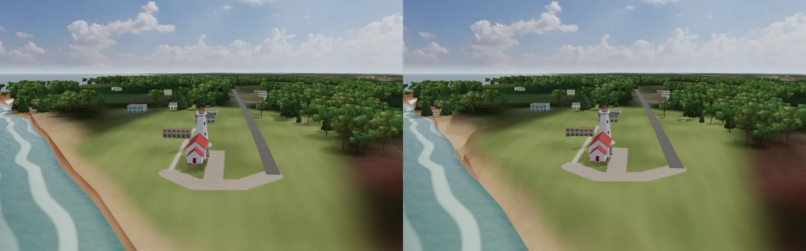
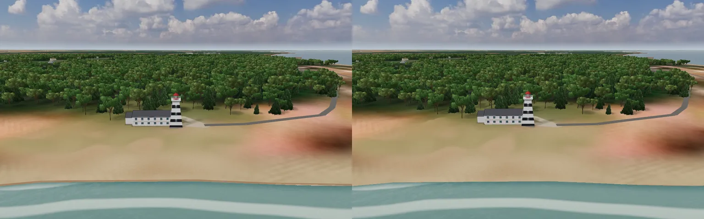

# Coastal terrain: playable agreement checks

**Scope:** two 256 × 256 m Natural Resources Canada HRDEM windows, at East Point and West Point. This is a test of how faithfully the simulator reproduces a known raster in those windows. It is not an independent survey, a certified coastline, a tide or bathymetry model, or evidence of province-wide detail at this resolution.

The offline, centimetre-encoded **1 m source** is in EPSG:3979, with CGVD2013 orthometric heights. The game triangulates those values at approximately **3.3 m spacing** and uses the province cover mask for land/water. Signed DTM values are not a shoreline test: the source includes both negative land points and offshore samples. The 16 m blend beyond the native window is synthetic transition geometry, not additional survey coverage.

## Results

The primary run visits **all 131,072 native cell centres** using GDAL's CRS transform. Errors are absolute vertical distances from the native sample to the actual near-view triangles, after removing the game mesh's 0.12 m drawing offset. The comparison below uses all land under the same in-game cover mask in both versions.

| Test | East Point | West Point |
|---|---:|---:|
| Cells classified as land by the game | 43,700 | 49,386 |
| Render error, p90, before → after | 4.012 m → **0.117 m** | 1.145 m → **0.090 m** |
| Worst remaining source error | **4.053 m** | **0.893 m** |
| Mesh/contact difference, maximum | 8.567 m → **0.00009 m** | 0.550 m → **0.00006 m** |
| P90 inside 20 m of the current coastline, off-vertex | 0.362 m | 0.056 m |
| P90 in the outer 24 m of the native footprint, off-vertex | 0.090 m | 0.081 m |

Of the 93,086 classified land points, only 12 lay within 2 cm of a replacement vertex. They are excluded from the separately reported off-vertex/core/rim statistics. The East cliff residual exceeds four metres at one cell; the coarse coastline and source interpolation still matter for very low passes.

- **Collision and water:** All 37,986 sampled water contacts agree with the visible water plane. A separate 4 mm straddle probe tests both the fine-grid boundary and the outer collision handoff without crossing a land/water boundary. Maximum contact-height difference at the outer handoff is 0.00025 m. This caught a nearly 17 m discontinuity in an intermediate build.
- **Topology:** 1,004,995 edge profiles with the actual 8-, 56- and 112-segment province LOD meshes found no missing or double-covered terrain and a maximum adjacent-face height step of 0.000007 m in the two test areas. Probing both triangle planes at the same coordinate avoids mistaking an actual steep slope for a crack. 500 independent Three.js downward raycasts cross-check the geometry index. Synthetic controls include a real step, a gap, an overlap and a continuous, steep T-junction.
- **Shore curtains:** At 2,600 sample positions, the vertical shoreline walls span both the modeled land and the visible sea. This test also covers ground below sea level.
- **Regression control:** 576 inland Cavendish points retained the same millimetre-rounded rendered and collision heights as before. The source-window surface is unchanged through the far/medium/near round trip. These are terrain checks, not a GPU frame-rate benchmark or a photorealism rating.

[Before: numeric report](coastal-runtime-before.json) · [After: numeric report](coastal-runtime-after.json).
Each includes relative file paths and SHA-256 fingerprints of the checked build inputs.

## Reproduce

Requirements: the project's npm dependencies, Node 22.12 or newer, Python with Playwright, Chromium, and a Python with GDAL/OSR. The audit stages a throwaway copy and reads local assets; it does not replace the game's geometry or contact functions. Set `CHROMIUM` to your Chromium executable and `GDAL_PYTHON` to an interpreter with `osgeo` (default `/usr/bin/python3`).

```sh
npm ci
node --test tools/qa/coast-edge-audit.test.mjs
python3 tools/qa/coast-scene-audit.py --checkout . --stride 1 \
  --gate-against docs/qa/coastal-runtime-before.json --out /tmp/pei-coastal-runtime.json
```

For a rapid smoke report omit `--stride 1` (one of every 16 cells). For a fresh baseline, run with the same stride, without `--gate-against`, and set `--checkout` to the pre-integration build at `0080af0`. Use the current harness to test the older checkout.

## Matched browser views

Left: province atlas only. Right: new relief with the same world camera,
field of view and frozen water phase. These are simulator renders, not
reference photographs. Fine local interpolation reveals the cliff and dune
shape; it does not reconstruct modern coastline works or replace the coarse
surface texture. At these views software Chromium submitted about 75,000
additional triangles for the two inserts without adding draw calls.

| East Point cliff | West Point dunes |
| --- | --- |
|  |  |

```sh
python3 tools/qa/fixed-scenery.py --checkout /path/to/baseline \
  --out /tmp/pei-coast-before --views east-close,west-close
python3 tools/qa/fixed-scenery.py --checkout . --out /tmp/pei-coast-after \
  --views east-close,west-close --pose-baseline /tmp/pei-coast-before/results.json
npm run build
python3 tools/qa/coastal-asset-gate.py --dist dist --chromium "$CHROMIUM" \
  --out /tmp/pei-coast-assets
```

The last command tests both lighthouse departures with both packs, with an
intentionally corrupt west pack and with a west pack that responds after the
startup budget. In either fault case, only West Point falls back; it remains
flyable and does not switch terrain mid-flight.
